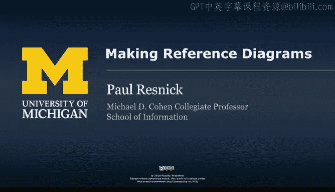
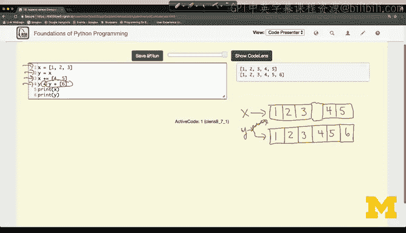

# 密歇根大学《Python3编程（课程1、2）》｜Python 3 Programming（Python for everyone进阶）（中英字幕） - P85：85_04_02_制作引用关系图.zh_en - GPT中英字幕课程资源 - BV1CM411Z72u

When in doubt。Make a reference diagram。Even if you only might be in doubt。Make a reference diagram。

It's going to seem slow， painful。Even to watch me do it。

 when you're doing it for the first few times， it's going to be even slower and more painful。

 but it's worth it because it gives you a way of understanding things that can be pretty confusing otherwise。

So here's a little code example。4our lines。 And then we're printing out what's the result。

 but it's not。Not so easy。To figure out exactly what's going to print out and so let's make a diagram to follow it。

So we're going to basically simulate。Like what code lens would do。We're going to do it ourselves。

So X on line 1 gets bound to a list of three items。1，2，3。On mine， too。Y becomes an alias for x。

A line，3。We have this X plus equals。 Now， I gave you the suggestion that when you're dealing with lists。

 just don't use plus equals。 But sometimes you have to read other people's code。

 and they don't follow that good advice， so。Suppose you had this x plus equals。 That's the version。

Where we're going to take the new list。4 and5。And append them on。

To the old list so that we now have a list of five items。And line 3。

Changes the object that X is pointing to。 since y is pointing to that same object。

 Y now has five items， as well。Next， a line 4。We're going to use。The better version。

That is a little easier to understand where we。Do the normal thing of figuring out the right hand side。

 which takes the list 1，2，3，4，5 and appends another list to it， making a new list。

So then we have one，2，3。4，5。That's a list。We can catnate on。This other list， which contains6。

And then we reassign it。 That's what this equal is doing。 So that why。

 y no longer points to what it used to point to。 It now points to this new value。X， however。

 still points to the old value。So when we print out x on line 5， we're going to get five items。

 when we print out y on line 6， we're going to get all six items。

Let's check and see if that analysis is correct。Sure enough。Line 5， print out5 items。 Line 6。

 print out all 6。Trying to do this in your head， especially if you ever end up with more than four lines of code that are doing things like this。

 very difficult to do。 So remember， if there's anything even remotely confusing。

 make a reference diagram。 Praise now， even when it might not be so confusing， you'll thank me later。

On to the next。

