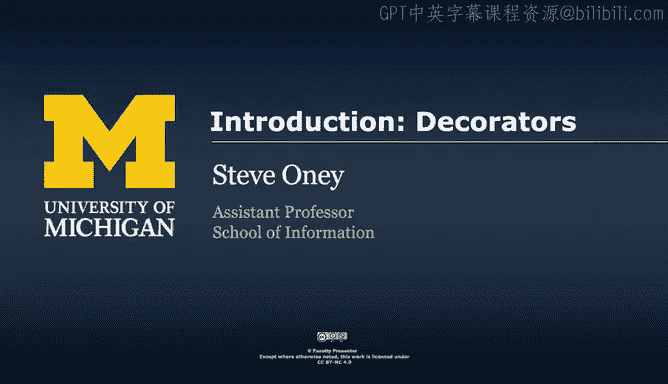

# 密歇根大学《Python3编程（课程3、4、5）》｜Python 3 Programming（Python for everyone进阶）（中英字幕） - P86：29_03_01_引言：装饰器.zh_en - GPT中英字幕课程资源 - BV1gj41177yd

Welcome back in this lesson we're going to learn about decorators。

Decorators are a powerful tool in Python that allow you to modify the behavior of functions or classes。

They're often used to add new features in a way that's concise and powerful， so let's get started。

