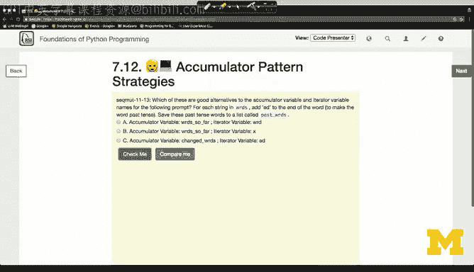

# 密歇根大学《Python3编程（课程1、2）》｜Python 3 Programming（Python for everyone进阶）（中英字幕） - P86：86_04_03_累加器模式策略.zh_en - GPT中英字幕课程资源 - BV1CM411Z72u

We're back with a little more way of the programmer advice。

You've seen the accumulator pattern in various guises now。

And this is some advice on how you can know when to use it。

And some little tricks for getting it right。You may remember back in elementary school。

Or maybe you have kids like I do who are who've been in elementary school recently。

 and they start dealing with word problems。 And， and you look at the problems and you say， wow。

 you know， you're just going， that's that's3 plus 5。

 but somehow converting that word problem into 3 plus 5 is challenging。 So they learn little tricks。

 like when， when it says how many do they have altogether。

 They should know that it's an addition problem。 Or how many are left is going to be a subtraction problem。

 So here's something a little similar for how to recognize when you're going to be dealing with one of our accumulation patterns。

 We've got these phrases on the left。On this table。

And we've got which accumulation pattern that might suggest you that you're going to use。

 So if the problem says how many things are in a list or how frequently does something happen。

 that's going to be count accumulation。If the problem asks for the sum or the total。

 that's going to be a sum accumulation。 If the problem asks to generate a list of things。

 that's going to be a list accumulation。 And if it says to concatenate or join things together。

 that's probably going to be a string accumulation。Next on this page。

 we've got a little bit of advice of how to think about what you're going to do before you write any code。

And one thing to ask is which sequence are you going to iterate through and a second question is。

 what kind of value are you going to accumulate？Are you going to accumulate a number， a list。

 or a string？And then our third set of advice is about choosing good names for your accumulator variable and your iterator variable names that'll help you keep track of things。

As we've said for any iteration。It's a good idea to use a singular noun for the iterator variable name。

And if you are iterating through a list of words， then it might be a good idea to use an iterator variable name like WRD to just remind you that each time on each iteration。

 WRD， your iterator variable is going to be bound to a word。For the accumulator variable。

 I sometimes just use a generic a， but it also can be helpful to sort of remind yourself of what you're accumulating。

 So got suggestions for names like count so far or total so far or cubes so far。

Could be good names for your accumulator variable。 Having that appendix so far sort of reminds you that on each iteration。

 the accumulator is getting more stuff。 And so what you have at a certain point in the execution of the program is。

The total so far， not the grand total。 But after youve finished all of the iterations。

 you're going to have the grand total。There's， there's a bunch of questions to help you check your understanding on this。

 but I'm just going to。Go through a few of them。With you， so。

And we've got several of these in the book。 I'll just go through a couple and you're supposed to sort of pick out what if anything in this problem should make you think that you're going to do an accumulation。

And， you know， I'll tell you now that some of them， there is something。 and for some of them。

 it actually isn't in an accd pattern at all。 So let's start with this one for each string in words。

Add E， D to the end of the word in order to make the word be in the past tense。

And save those past tense words to a list called past words。

Does this suggest to you an accumulation pattern？ And if so， why？

 And we've got two possibilities for why here， either because。It says save some things to a list。

 or because it says add E D to the end of the word。The correct answer is。

Saving a bunch of things to a list should suggest to you accumulating a list。

What goes into each item？That's not what suggests that we need an accumulation pattern。

Let's try the next one。Write code to sum up all the numbers in the list seat counts。

 store that number in the variable total seat counts。And here， our correct answer is。To sum up。

Because to sum up， suggest that we got a bunch of things and we want to get the grand total。

 so that is going to be a sum accumulation。So there's some more， and I encourage you to try those。

Here's a couple questions about what type of object you should expect to have stored in your accumulator variable。

So the question here is write code that will count the number of vowels in the sentence S and assign the result of the variable nu vowels。

Now， we haven't quite got all the mechanisms in Python to be able to count only the vowels and to leave out the consonants。

 You're going to get that pretty soon in this course。

But even so the structure of this is enough that， you know， it's going to be an accumulation pattern。

 and you're going to count the number of vowels。 A account is a number。So our correct answer here。

Is that it is an integer？Because we want to keep track of a number。

So different question about that same problem。What sequence will you iterate through as you accumulate a result。

And we have two possibilities here， because。We have a sentence S， and we have variable nu vowels。

 Which of those are you going to iterate through。 And the answer is。

 you're going to iterate through S。 You're going to accumulate your results in nu vowels。

 But the sequence that you're going to iterate through is the characters in the sentence S。So。

 there's a couple more。Of that flavor。And then we've got some questions about what should you name your accumulator variable and what should you name your iterator variable。

 So let's try this one。For each string in words， add E D to the end of the word to make the word past tense。

 Save these past tense words to a list called past words。So a couple possibilities here。

 we're either going to name our accumulate a variable words so far or we're going to name it。

Changed words。And our iterator variable name can either be W R D， short for word or X。

 or it could be E D。 And my suggestion is。This is just a matter of style。

 but these style things help you to avoid confusion and can help readers of your programs also not get confused。

Is that words so far is， is kind of an ideal name for your accumulator variable。 It tells you so far。

 says it's an accumulator and word says what kind of thing you're accumulating there。

And for your iterator variable， you're going to be iterating。Through this string， W RDS， plural。

That's a list of strings。 Each of those strings is one word。

 So having an iterer variable of W RD seems like a really good choice to me。

There are a few more questions like this， and I encourage you to go through all of them just to reinforce the way of the programmer around recognizing when you need to use an accumulator pattern on choosing the right variable names and on recognizing what kind of thing you're going to accumulate a string or account or number and what sequence you're going to iterate through。

So go through those and you will become an expert on the accumulator pattern。 See you next time。

