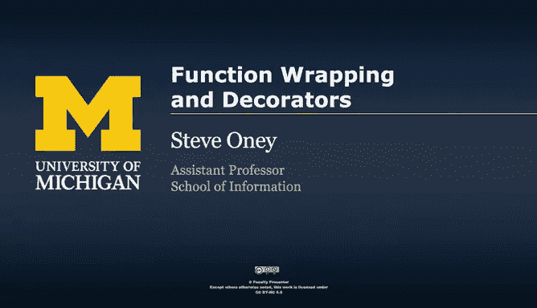
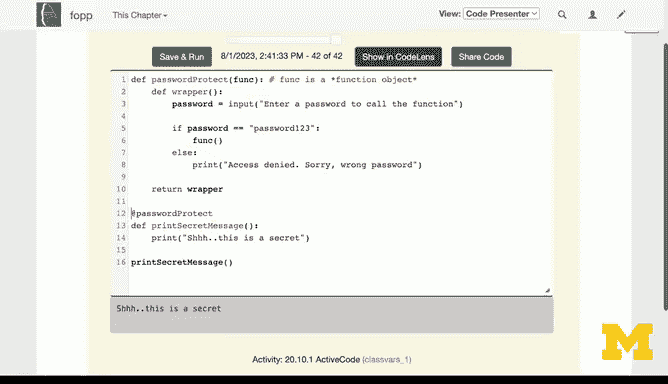

# 密歇根大学《Python3编程（课程3、4、5）》｜Python 3 Programming（Python for everyone进阶）（中英字幕） - P87：30_03_02_函数包装与装饰器.zh_en - GPT中英字幕课程资源 - BV1gj41177yd

Welcome back although most of this course is focused on classes and instances。

 in this lesson we're going to take a slight detour to talk about function wrapping and decorators。

 and then we're going to talk about how that applies to classes in the next video。

So remember that in Python functions like this subtract 32 function here or this multiply 59 function here are objects。

 that means that beyond calling them we can reference them。

 pass them as arguments to other functions or return them。

Although we can't directly manipulate the behavior of a function。

 what we can do is we can wrap it in another function that does something before or after that original function is called or we can change the arguments so that a function takes Now this idea is called function wrapping。

So I'm going to use this red box。😊，In this example， to represent our subtract 32 function。

 from just screen data negative 32。And I'm going to use this blue box。Yeah。

To represent my multiply by5 ninth function。Now， you might already know that the formula for converting a Fahrenheit temperature into Celsius is Celsius is。

59th。Times。The Fahrenheit temperature，-32。But let's see if we can use our subtract 32 in multiply 59 functions and composition in order to create a new function that's going to actually convert a Fahrenheit temperature into Celsius。

 and we'll see why we might want to do something like this in a little bit。

So what I'm going to do is I'm going to define a new function。Called composeose。

And our function is going to accept two other functions as arguments， so I'm just going to call them。

Funk 1， and funk 2。So my compose function is going to return a third function。

 which I'm going to define as a lambda function， so I'm going to say return。Lambda。

And I'm going to have my third function except one argument， and I'll call it x。

And I want it to return the value of funk one。Called on the value of funnc2。

Called on whatever we passed in here。So this X。Refers to the argument to the lambda function。

So what we're doing here is within this compose function， we're returning a third function。

This lambmbda function， which I'm just going to represent as a third。Green function here。Okay。

 so if I wanted to create a function that converted Fahrenheit to Celsius using this formula。

And these functions， then what I could do is I could say F to C。Equals compose。Multiply。😔，5，9s。

With subtract。32。And what I'm going to get here before I illustrate why is I'm going to get a function。

That can accept one argument， so if I say 75 degrees in Fahrenheit。

Then it's going to return the equivalent Celsius temperature。So what's going on here？

So let's break this down a little more， so recall that subtract 32。Is a function object right。

 so it's this red box that we had above。And recall that multiply five nines。Yeah。

Is this other function object？This blue box that we had above。So here， when we call composeose。

 then funk1。Is this blue function object？In funnctu。Is this red function object？So。

What's happening is that when we call， for example。F2C or whatever function we return。

Here 75 is going to be the value of x， so here we have 75。And then working out from there。

 what we do is we have funk2。Which subtracts 32 from 75， so when we call funk2 on 75。

Then we're going to get 43。By subtracting 32 from 75。And then we take 43 and we call funk1。Yeah。

Which multiplies。43 by five ninth。To get us。The temperature that we ultimately return。

But more importantly， what we're doing is we're accepting two functions as arguments and we're returning a third function here。

And what we're really doing is we're wrapping our two functions， subtract 32。

And multiply five ninths。We're wrapping them inside of this third lambmbda function。

So this idea of function wrapping is really powerful and it can be applied to many problems。

 but it can be really difficult to grasp at first， so I encourage you to try to walk through this code on your own until you get to the point where you can understand it。

So let me go through another example。Now， suppose that I wanted to。Add logging to a function。

 so I'll take my subtract 32 and multiply59s functions。

 and let's suppose that I wanted to help me debug， just print out when my function is being called。

 what arguments it's being called with and what it actually returns。

What I can do is I can wrap my functions inside of another function。

 so I'm going to define a function。Named a logging。And it's going to accept a function。

As an argument， so I'll say funk is a function object。Now。

 what my add logging function is going to do is it's going to return a new function。

 which I'm going to call wrappper so I can declare a function within my add logging function。

 I'm going to say de。Rrappper。And my wrappper is going to take in one argument。

 which I'm going to call X。Yeah。Now， from within wrappper。

 what I can do is I can call whatever function I passed in。So I can， for example， say。Funk。X。

And then I can return the wrapper function itself， so I'll say returnturn wrappper。O。

I'm going to add a little bit more to this code， so I'm going to first print out。

About to call my function。Fk。With argument。If I make this in F string。I'll say with argument。X。嗯。

And then after I call the function。I'm going to print out。Done calling my function funk。

With argument X。So what I'm going to do is I'm going to create a new function， I'll call it Subtract。

32 with logging。And I'm going to say it's equal to add logging。To subtract。32。

And I'm going to modify my definition for subtract 32 a little bit， just to say。That I print？

I am calling， subtract。32。嗯嗯。I think we can get rid of this multiply 59 function for now。O。

So let's suppose that I call my subtract 32 with logging function。And the argument 75。

What's going to happen is I get three things printed out。

 I first get about to call my function funk with argument 75， and calling subtract 32。

 and then done calling my function funk with argument 75。So。Again。

 this can be a little bit convoluted， but let's go over what's happening here。

So I have my subtract 32 function， which again， I'll represent as this red box。

And what I'm doing is I'm passing that function in。As the argument funk。To add logging。Now。

 what ad logging is doing is it's creating a new function called wrappper。

 so I can say that wrappper is。A new function， which I'm going to represent。With this green box。

And that's what we return。So add logging again returns a function object。

 so subtract 32 with logging。Is this function that my a logging function returned？

So that's what Subtract 32 with logging is， but let's talk a little bit more about what it actually does。

So the first thing that it does is it calls this print statement and it says， again。

 about to call my function with argument and then whatever we passed in as an argument。

 so in this case that argument would be 75。And then importantly。

 what it's doing is it's calling our function funk。With whatever we passed in as an argument。

 so in this case again， the argument is 75。So in this case， when we call funk。

 then it's calling subtract 32。And so after we print about to call my function with argument 75。

We then print out calling subtract 32 because we're calling that subtract 32 function。

And then we print out done calling my function with argument 75。Right， again， x being 75 here。

So again， this wrapper function is wrapping whatever function I passed in。

 so here I passed in subtract 32。As funk。And my wrapper function is wrapping it。With code that does。

 in this case， logging。So。We can get a little bit more complicated here。 so for example。

 here my wrapper function doesn't actually return anything。 I could have it return。嗯。

It could have it return none。Or I could store the result of calling funk。As a variable result。

And I could return that result。And now if I do this， if I say x equals subtract 32 with logging。

And then if I print out the value of x。Then I should get。The actual result， which is here 43。

So I could also apply my add logging function to other functions so I could， for example， wrap。

A Lambda function， so I'll say add logging Lambda Xx plus1。And if I call my。Yeah。好的。

Add one with logging function。그。Then we'll see that it does the exact same thing with this lambmbda function that just adds one to its argument。

 So again， add one with logging is our new wrapped function。 and so when we call it online 17 here。

We print out about to call my function with argument in this case 10。Then we call the function。

 which in this case， our function doesn't print out anything。

And then we print out done calling my function with argument in this case 10。

And we return the result， which gets printed out here on line 18。Now。

 this kind of function wrapping is common enough that Python includes a special syntax called decorators for doing it more concisely。

So if I add my。Function for subtracting 32 down here。Then what I can do。

If I get rid of all my other code。I I can add a decorator by saying at and then whatever wrapping function I provide。

 so in this case， my wrapping function is add logging。是。

And so now what this does is if I call subtract。32。I'm 100。哦。Now。

 what this does is it automatically wraps my function definition using this add logging function。

So this is effectively equivalent to saying。Deef subtract 32。And then saying subtract。

32 equals add logging to subtract。32。And if I do this， then I get the exact same result。

But by adding this decorator。I get a syntax that's a lot clearer and more concise。

So another advantage of the syntax is that if I wanted to。

 I could easily add or remove logging just by commenting out this line。

 so now I have a quote unquote normalmal subtract 32 function。And by including this decorator。

 so let's suppose that Im having trouble with my function and I want to understand how it's being called。

By including it， then I'm adding the functionality of the add logging wrapper to my function。

So let's go over another example of where we might use decorators。

 Sose that I wanted to password protect access to a function or some data that a function exposes。

 I'm going to rename this function password。Protect。And here。

 funk is still going to be a function object。But I'm going to replace its logic with logic for entering some sort of password。

 So I'm going to first say。Ask the user to enter a password。And here， just for simplicity。

 I'm going to say that the password is  one， two，3。

 so I'm going to say if they entered the correct password。嗯。Then。

Kind of grant access to our function。 So I'm going to say call funk。Yeah。Thanks。

And if they did not enter the correct password， so I'll say else。I'm going to print。Access denied。

 sorry。Wrong password。So let's suppose that instead of subtract 32， I have some function。

 I'll just call it。Print secret。Message。And it's just going to print some message that for whatever reason is supposed to be secret。

 so I'm just going to say print。This is a secret。O。Yeah。So here again， without decorators。

 if I just call print Se message。Then it's just going to print out whatever secret message this contains。

 but if I add a decorator， so here I'm just going to say at passwordword protect。

If I add a decorator。And actually， in this case， my function accepts no arguments。

 So I'm going to say my wrappper has。No arguments。Now， if I try to call it here。

 I get a little prompt saying enter a password to call the function if I enter in an incorrect password。

And hit okay。Then it's going to say access denied sorry or wrong password if I access it using the correct password。

Then you can see that I'm able to call my function。Now， this seems like maybe a silly example。I mean。

 obviously this isn't secret， obviously we don't have the logic for a password。

 but this kind of function wrapping is used in web applications to protect access to sensitive pages。

 so you might have Python code for a web server that wraps code that could transmit personal information with the decorator that has functionality for checking if a user is logged in。

So these kinds of decorators give us a convenient syntax for modifying the behaviors of functions that we write。

 and it makes it easier to add or remove those modifications as well。

That's all for now until next time。