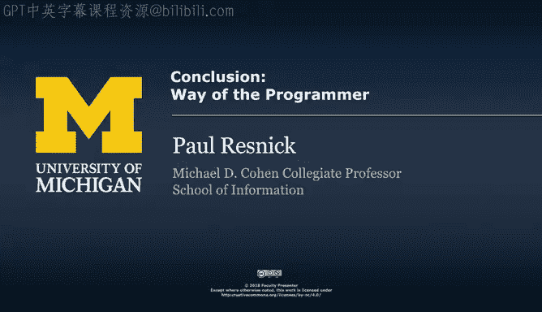

# 密歇根大学《Python3编程（课程1、2）》｜Python 3 Programming（Python for everyone进阶）（中英字幕） - P87：87_04_04_程序员之道进阶总结.zh_en - GPT中英字幕课程资源 - BV1CM411Z72u

Welcome back。 I hope that you are traveling the way of the programmer。

Making a habit of writing reference diagrams， choosing good variable names。

And training yourself to recognize the telltale markings of an accumulation problem。Above all。

Practice programming to borrow and horribly mangle a quote from Mahatma Gandhi。

There is no way to programming。 Programing is the way。I didn't find a great joke for you。

 So I'm going to give you just a random。Punverse that I've always enjoyed。1，1 was one race horsese，2。

2 was 1，2。1，1，1，1， raise，2，2，1，1，2。