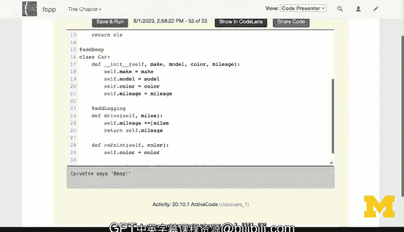

# 密歇根大学《Python3编程（课程3、4、5）》｜Python 3 Programming（Python for everyone进阶）（中英字幕） - P88：31_03_03_类的装饰器.zh_en - GPT中英字幕课程资源 - BV1gj41177yd

Welcome back so last time we talked about function decorators。

 but decorators can also be used with classes and instances。

So we can use decorators with classes and instances in two main ways。

 so let's take this a logging decorator that we had from earlier。And just as a reminder。

 what this a logging decorator does is it accepts a function。And it returns a new wrapped function。

And then it prints out what we're about to call our function with。

Then it calls the function and stores the result。It says we're done calling our function。

In this case， we're saying which result we got and then we return that result from the wrapped function。

So again， this add logging function can wrap any other function so I can say have to add one。

Return x plus1。And I can add logging by saying add logging。And if I do this。

Whenever I call my function here I see about to call my function with argument 5 from line 3。

 done calling my function with argument5， got success result from line 5。

And we can see six is what we return as well。So again。

 this is just applying our decorator to regular functions。

We can also apply these decorators to class methods， so let's suppose that I have a class。

Then I'm going to paste in here。And this class represents aspects of the car。

 so here in the constructor， we set the make， we set the model， its color。

 we set its initial mileage。And we set instance variables for make， model， color， and mileage。

But then we also have methods like drive and drive accepts one argument。

 which is a number of miles to drive， and when we drive that number of miles。

 then we increase our mileage by that number of miles or kilometers or whatever units we want to use。

And we return our mileage。And then let's suppose we have a repaint method where we can change the color as well。

So if we create an instance of car。Here to create something representing a red Corvette。

And if we drive it。You can see here that we get no output from drive。

 although we could verify that this works so I print Corvette do mileage。

I can see that this drive method did work， but maybe it might be useful just to add a little bit more logging information。

 so here I can use my decorator for adding logging。

 but I can use it on this method so I can just say add logging。

To add logging functionality to my method。Now， if I do this as is。

It's not quite going to work because what you'll see here is this wrapper is accepting one positional argument。

 but two are given。 So what this is saying is remember that here self is the first argument to our method drive and then we accept another additional argument and so in this case our decorator also needs to add two arguments so I'm going to add self。

Ass the first argument。And I'll call funk on self。And X。So now if I do this and run my code。

Then I can see that when I call Corvette drive 100。

 then I get the logging information from my decorator。And if I call it again。So if I just print out。

20 dashes to separate out my two function calls。If I call Corvette。drive。By another six miles。

Then I can see the logging information for how exactly I'm calling my function。

So that's one way that we can use decorators with classes。

 but we can also do decorators with classes another way。

 which is to decorate the class itself rather than the individual methods。

So let's suppose that I have my car class and what I'm going to do is I'm going to add another decorator。

I'm going to call that decorator。Add beep。H。And what it's going to do is it's going to accept a class object。

And in Python， classes just like functions are what are called first class objects。

 meaning that we can reference them， pass them in as arguments， we can return new classes。

From functions as well。 So class here is going to be a class。

 So what I'm going to do inside of my add beep function is I'm going to say class。Has another method。

 which I'm going to call beep。I we're just going to say class。beep is a lambmbda function。

And that Lambda function is just going to print。Whatever my model is。

 so in this case it's going to be Corvette。And it's going to say says。Beep。

And then I need to return the class from my a beep as well， so I'm going to say return CLS。嗯。Okay。So。

Now if I create this car。And if I say Corvette。beep。Here I haven't added the decorator yet。

 so if I say Corvette。beep， then I get an error saying that I don't have a beep method on cars。

But if I。Add beep。Then what this should do。Is it should wrap our car class？

In this add beep decorator。And so what that's going to do is it's going to create this new method that I can call named beep so now。

When I call Corvette。beep and run my code。Then I should see Corvette says beep。So again。

 there are two ways of using decorators with classes， one would be to decorate the class itself。

 which we just did， and here in this case I just added a new method but I could do things like return a new subclass so I could say。

Class。Subclass。Inherit's from class。And I could add new methods here。

I could do things like overwrite the constructor so I could say class dot。And呢。

Equals and then I could add a new function here， so really I could do almost any manipulation that you can imagine on the class inside of this decorator。

So that's adding a decorator to the class itself。Or we could add functionality to individual methods as well。

 like our add logging to this drive method。That's all for now until next time。

