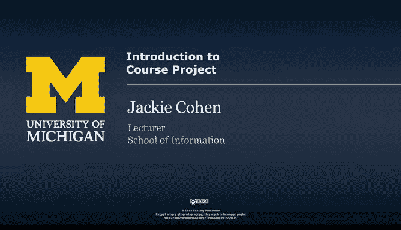

# 密歇根大学《Python3编程（课程1、2）》｜Python 3 Programming（Python for everyone进阶）（中英字幕） - P88：88_04_01_最终课程作业导论.zh_en - GPT中英字幕课程资源 - BV1CM411Z72u

Hello， I'm here to tell you about your end of course project。

So this course project that you're about to do will cover a lot of the concepts that you've already covered in the course。

 you'll have to do a series of problems that are of varying types and covering varying concepts。

 but all of these problems that you'll be doing are the kind of programs that lots of people use in their real lives。

Accummulation， gathering data together， changing what it looks like in this little program。

 So these kinds of programs that you're about to write in your project are possibly very applicable to your everyday life in school or work or whatever。

 really， I want to remind you of some tips that may be useful as you start to work on this project。

 So1t of all， as you know， you should always change one thing in a program。

Predict what will happen when you eventually run that program after changing this and then try it that way。

 if you've only changed one thing， made a prediction and then tried it， you will know。

Whether or not that worked to whether or not your prediction was right。

 And so you'll know if you have a good understanding of what you're working on in that moment。

 if you do a bunch of different things and then try it。

 you might have to dig through all those different things to figure out what was good and what was not good and what you need to do to finish that program and get it to happen the way you want。

So always change one thing， predict and then try it。

 I also want to remind you to use variable names that are clear to you For instance。

 if you're using an accumulator pattern or any for loop。

 you never want the iterator variable to be plural because it's always going to be bound to one singular thing and you wouldn't want a plural variable name for a singular thing because that can be really confusing when you talk and think about your code similarly。

I would advise you not， for example， to use the word LIS S T inside a variable name that couldn't be a list because that's going to get confusing too when you read your code later and you'll think。

 oh， it's a list and then it will not be a list。All of these problems that you're about to do in this end of course project are different。

 but they're all similar patterns to problems that you've seen or done before。

 And as you work on them， I'd advise you to think about those and think about how they're similar to other stuff you've done。

 and that will make it easier to progress on these。For each one you should go through。

 make a step by step plan in words， no code at all for how you're going to solve the problem。

And then make sure that you can translate each of those pieces into code。 For example。

 in an accumulation problem， you should talk through step by step as if you're talking to a robot or write down what each of those steps are that needs to happen in that program。

 that little task。 And then you can think step by step about how to translate each of those things into code。

 How can you translate your words into a program that will run and continue with changing one thing and then trying it to make sure that the code runs。

Finally， if you see a problem， for example， maybe the last problem in this end of course project where there's a complex task to do for each one of a set of things。

Do something with each string， for example。You should think about your plan for each individual task。

 say for doing that complex task for one string and make sure that that works and everything is fine for just one string。

If your code for doing the task one time with one string is successful。

 then you can move to building all of your code and putting it into a for loop and implementing the full solution so that all of your code is successful for that program。

All of these problems are really useful for applications in almost everybody's everyday life in one way or another。

 I think they're fun。 I hope you will enjoy yourself。 and I wish you good luck。😊。

