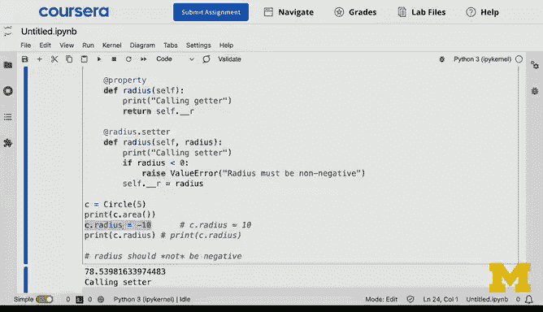

# 密歇根大学《Python3编程（课程3、4、5）》｜Python 3 Programming（Python for everyone进阶）（中英字幕） - P89：32_03_04_属性装饰器.zh_en - GPT中英字幕课程资源 - BV1gj41177yd

。Welcome back Python contains a number of other useful builtin decorators。

 including some for classes， so let's suppose that we have this class which represents circles now every circle has an instance variable representing the radius of that circle and let's suppose that we have this method area which is going to be the area of that circle。

 which is pi times that radius squared which is what this equation prints out。Now。

 suppose that we don't want users to be able to set this radius to a negative number。

 so I'll say radius should not。Be negative。Now， this is hard to enforce because users can always say C dot radius。

Equals negative 10 or any negative number。So one thing that we could do is we could make radius a private instance variable by saying。

Self。_ R equals radius。And now this makes it harder to set this instance variable and to set it to a negative number。

 if we still wanted to give users of this class the option of setting this instance variable to a non negative number。

 we could define a function， which I'll call set radius。

And what this function is going to do is it's going to make sure that our radius is not less than zero。

 So what I'll say is if radius is less than0。What I'll do is I'll raise。A value error。

And what this does is it makes a runtime exception happen， so I'm going to say radius。

Must be non negative。不。So now when I want to set my radius。

 what I need to do is I need to call C dot set radius。

And I can set my radius to be something else if I set it to be 2， then this is going to work。

 but if I try to set my radius to be a negative number，Then I should get a runtime exception。

So this works， but it's not ideal for a number of reasons。So first of all。

 if we wanted to easily get the radius， so if I wanted to say。C dot radius。

Then this doesn't work now because now this R is a private instance variable。

 so I would need to say something like circle_ R。Which of course is not natural。

 it would be great if we could have something like C dot radius。Now。

 what I could do is I could define just like I have this function to set the radius。

 I could have a function to get the radius， so I could say。Deaf get radius。And return。

So dot underscore R。Oh， and by the way， in this set radius function。

 I should probably set self dot underscore R to be radius。Okay， so now if I want to get the radius。

 I can print out c。ge radius。Yeah。And I can see that that radius is5。

 and if I want to set the radius， then I can say C dot set radius。To change the radius to be 10。Okay。

 so this works， but it's not ideal， what would be ideal is if we could set the radius with the more natural something like C dot radius equals 10。

And if we could get the radius by saying more naturally something like print， C dot radius。Right。

 so of course I can't do this because if I just renamed this instance variable to be radius。

 then we have the problem that we had before， which is that we could just set the radius to be a negative number and it wouldn't go through this check to make sure that the radius was non negative。

So what can we do， how can we get this more natural syntax where we can set the radius like this or get the radius like this while still being able to check if the radius is less than zero to make sure that we have a positive radius？

Well， technically there are a couple of methods， get AtRA and set AtRA that would allow users to set these directly。

 but the best way of doing this would be to use the built in property decorator。

So what we can do is we can add the property decorator， which is built in by just saying at property。

是的。And I'm going to rename this get radius function to just be radius。

What this property decorator does is it turns this radius method into a getter method。

 so now if we want to access the value of our circles radius。

 then we can just say print C dot radius。And if I print out the value of c dot radius， in this case。

 then we get 10。But when now when we print out the value of C dot radius。

 what this is actually doing is it's calling this getter method。

 so you can see that by saying if I print out calling getter。Then when I run this line of code。

 it's going to print out call getter and then 10， because now whenever I say C dot radius。

 it calls this function and the value is going to be whatever it returns。

Now we can also define a setter。By first renaming this to have the same name radius。

And by adding the radius。Dot setter。Decorator here。So now when I want to set the radius。

 instead of having to say C dot set radius to be 10， I can say C dot radius。Equals 10。

And this is actually going to go through our Seter method。So we can make that apparent by saying。

Calling Seter。And what you'll see when I run my code。Is that when we say C dot radius equals 10。

 we're calling the setter， when we print out the value of C dot radius。

 then we're calling the getter， and you can see that if I also try to set C dot radius to be a negative number。

 which is what we do not want to allow， then we're going to raise this value error so if I try to run my code。

You'll see that we get an error saying that the radius must be non negative。

So here what we did was we created a private instance variable for the radius。

 but we defined a getter。And a setter。Using this property decorator。

And the getter in the Seter allow us to run a method to get the value of radius or to set the value of radius。

There's also another thing that we could define called a deleter using a similar syntax。

 but it's a lot less common so I won't get into that。So in sum。

 this property decorator allows us to define methods that can be accessed like attributes。

 and this can make our code more intuitive by saying things like C dot radius equals and easier to read。

That's all for now until next time。

