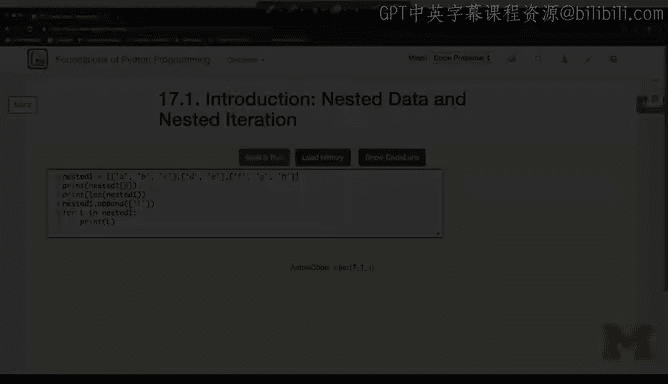
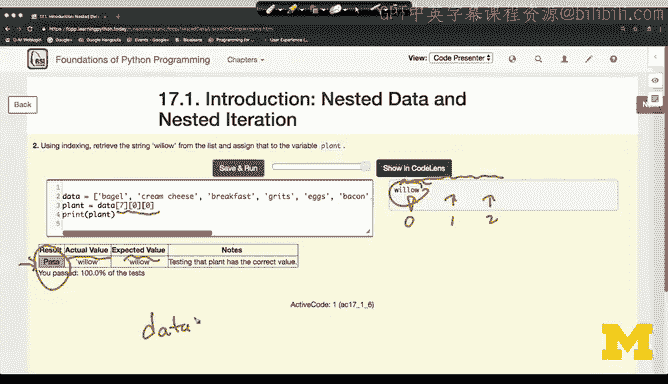

# 密歇根大学《Python3编程（课程3、4、5）》｜Python 3 Programming（Python for everyone进阶）（中英字幕） - P8：07_02_02_嵌套列表.zh_en - GPT中英字幕课程资源 - BV1gj41177yd

Welcome back。In the past， we've snuck in a few nested lists。

 but without ever really looking closely at what they are or how to work with them。

Here we have a list called Ned1。Whose items are themselves lists。So here's the first item， ABC。

 a second item， D， E， and a third item。Is the list FGH。I'll talk about the。Whole list。

 nested one as the outer list。And each of these smaller lists inside as the inner lists。

So the first item in the outer list is an inter list ABC。

I'm going to comment out some of the later lines of code here and we'll work our way through it。

 seeing what the effect is of just one line at a time。On line  too。

 we're printing the first item from the outer list， which is the first inner list。ABC。다 함께를。

Un commentment line 3。And run it， we're going ask for the length of nested one。

The length of that is three items， it's not A， B and C， it's item1， item 2 and item3。

 so three items in nested one。I can append a new item。As we've seen before。And。

Nested one is now going to have four items。 The last item will be a list containing just I。

And I can iterate through these lists。And print each to them out。

So this is going to print out all four of the lists。We get。The first inter list， the second one。

 the third one。And the fourth one。So it's helpful to see the code lenss representation of a nested list。

So let's see this in code lens。Then when I assign this variable， nested one to have a nested。

List is its value。You can see it's。Printed representation。

 and it gets a little funny here because code lens is sometimes deciding to make an inner list。

Be do sh。Right inside the outer list。And sometimes it's deciding that it doesn't really have room to put ABC。

Here， so it's showing us the pointer。To the inner list。So nested one again is a list of three items。

The first item。Is this in list， the second item is。Deyi。And the third item is the inter list。

 F G and H。Let's see what happens if I append an item to each of the inner lists。So， nested one。

Square bracket 0。That's referring to the first。In her list。

And I'm going to append a new item to that。Making it AB，C and Z。And I'm also going to append。

Something to。The second inner list。And let's see what happens in codelands again。

So we get this original view of nested one， what the reference diagram looks like。

 and now what happens to that first inter list when I append Z to it。

Well you'll see this odd thing has happened。Instead of having this pointer out。

To the other inner list， it's now magically decided that it has enough room to put it right here。

 So this doesn't actually make any difference。 It's just how code lenss is choosing to show it to us。

And it's put a fourth item in there。If we now see what happens when we append。

W to the second In list。We find that。It's now put that here and instead of keeping the list right in here。

 it's made a pointer out to here， so either way it's a way of representing that this item in the outer list is itself a list。

We can put all the list items right in there， or we can。

They could point her out to another inner list。So these are two alternative ways that you can represent an nest list in these reference diagrams。

You can do double indexing。With two square brackets to pull an item out of an inner list。So。

The first indexing we're going to do on line， too is that we say nested one square brackets。

1 that pulls out。One of the inner lists， and why。Is now bound。To that list， containing D。And E。

On line 3， when I print why I should just get the list。D。Yi。As my output。On line 4。

 if I ask for y square bracket 0， that should get me the first item in y。So， I should get。

D printing out。Now let's think about what happens on line6。On line 6。

 I also have two square brackets。But， it's not。Dellving into a big nested list。

 the first square brackets is actually used to define。A list to create a list。So we create a list 10。

 20 and 30。And then， we pull out。The item at position 1。 So what we should get is our output。Is 20。

On line number 7， we also have two square brackets。 but in this case。

 before either of the square brackets， we have nested one， which refers to this。Big listist。

 the outer list that has inner lists as elements。And we are first grabbing the thing at square brackets 1。

And then we are from then that。We were grabbing the thing at square bracket at 0。

So this is going to print D。How does Python know？In a situation like this。

 when there are two square brackets， one after the other， is it indexing twice to get inside。

An outer list and then inside an inner list， or is it。As in line 6， is it creating。

A list and then indexing into that list。 And the answer is that the Python interpreter can tell just by the context。

If there's a list before the square bracket。Then the square bracket means index go into that list。

If there's no square bracket before it， as with 102030 on  line 6。Then it means create a list。

You already saw previously that we could append to a list， even if it's a complicated list。

 but you can also assign values。To positions in both the outer list and in inner lists。

The way you do that is you make an expression that picks out a this position。Like。

Nested square bracket1。But you put it on the left side of an equal sign。 On the right side。

 you say what new value you want。So line number two here is going to。

Say nested square bracket 1 refers to the position where currently we have DNA E。

 and it's going to replace that DNA E。With the list 1，2，3。

And we can take that same logic one step further on line 3。Nested square bracket 1， square bracket 0。

Goes to the list。That said， position。Wen。And it finds。Within that inner list。

 the item that's set position 0。And it replaces that item with the value 100。

So let's see what happens when we run this。In codelands。But first， we create。This nested list。

 you can see there are four items。 The first item is the inter list， ABC。

 The second item is the inter list D E， and so on。On line  too。

 when I replace nested one square bracket1 with a new value。Let's see what's going to happen。

Notice what happens。With the second item。It's now the list。1，2，3。It used to be the listDE。

Let's just back up in our execution， we'll see that。So it used to be D。But when we move forward。

 that DE got replaced。By the one，2，3。On lineine 3。We're taking nested square bracket at 1 square bracket at 0。

So nested is this list。Position 1。Is this list。And position 0 within that。

Is right there currently containing the value 1。 We're going to make that  one be 100。

So let's see that， see if that one becomes a 100。And sure enough， it did。

We can have other complex objects as list elements。 For example， here。

 each of the items is a dictionary。Let's see how code lens chooses to。Show that。So we have。

A variable nested2。Its value is a list。That list has three items。And each of those items。

Is a dictionary。So the first。Item nested inside of our outer list is a dictionary， it has two keys。

 A and B， and they each have values one and 3。The second item in the list is also a dictionary。

 and it has keys， A， C， and 5。Here we have an even more nested list。

Our task is to pull out the word willow。Which is nested pretty far in here。

It's not at the top level of the list。It's not even at the second level。You can see that。

Here's one of the list items， and。It has， as one of its values， the list of Willow Brch and Elm。

 and then Willow is a list inside of that。 So we actually have one square bracket here。

The second square bracket， a third square bracket。 So we are three levels。

Deep inside of the data structure inside the variable data。So if it's three levels in。

 we're actually going to need three square brackets。Total。

To pull out the word willow from inside of data。Now I like to develop my extraction expressions incrementally。

That is。I'm going to do it a little bit at a time。 I'm going to first make the expression that pulls out。

Something from within that， I'm going to pull out a little more。

 and then from within that I'm going to pull out a little more。So let's do that incrementally。

 and you'll can see sort of my approach to writing code for something like this。Now。

 they told us to name our variable plant。Now， I'm gonna to。

Say plant is data square brackets something。And I'm going to just print plant to help myself see what I got。

Now， what item am I going to get， Where am I going to index， Well， this is 0。1。Index 2， index 3，4。

 baconcon is 5。This inner list is6。And this inner list， which contains willow somewhere in it。

 is seven。So that tells me， I should extract。Data square bracket 7。 Now。

 that's not going to get me just the word willow。And I could try to make a more complicated expression where I fill in the others right away。

 but I do like to do this incrementally because I might have counted wrong or whatever。

 let's just see if I got the right kind of thing from data square bracket 7。

So I did pick out the right element from data， the right inner list。

 You can see that willow's in here somewhere。But I'm going to have to do another extraction。

Since this is an exercise that has an auto checker for us， it's told us that we failed。

 We were supposed to get just Willow。 But instead， we got this list that somewhere has willow in it。

 So we have a little more work to do。We knew we were going to have more work to do。

So inside data square bracket 7。I now have。Some help because I can see what it looks like。

 and it's actually in the first element。Square bracket at zero。So I'll do this and check。

 make sure I still have it right。Sure enough， Willow is in that。And which element is it？

Psition  zero。1。😔，2。I want willow， so I'm going to say。Square bracket， zero。Sure enough。

I now have just Willow， which is what I was looking for， and the test tells us that we passed。

So when you see something like square bracket at 7 square bracket 0， square bracket of0。

 that means you're descending。Several layers in a complicated data structure。

And the best way to create expressions like that is to just do it one at a time and keep building it up until you've descended farther and farther into the list。

So that's nested lists， you can index into them with repeated use of the square brackets。

Or you can assign values or append deep inside the nesting。You can say something like。Data。

Square bracket 7。

Square bracket 0。Dottaend。Of some other value。Or you can say data square bracket 7， square bracket 0。

And have that on the left side of an assignment statement。The append will。

Assume that there is a list at data square bracket 7 square bracket 0。

 and it'll give that list another item at the end， 29。And if we just do an assignment statement。

 we will replace whatever's there， even if it's a whole list。

It's just going to replace it with one new value 42。See you next time。

