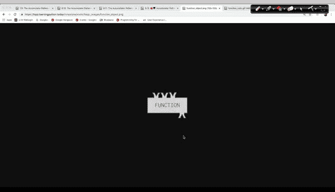
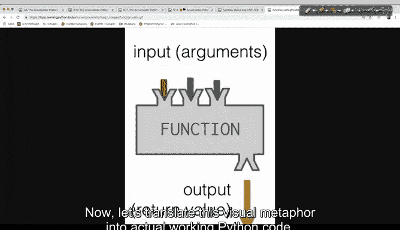
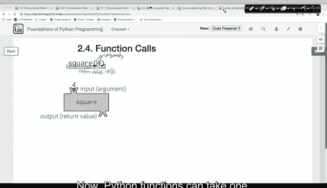
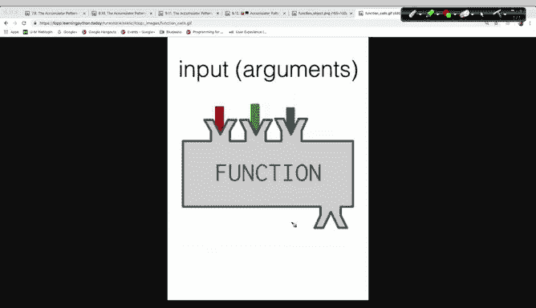
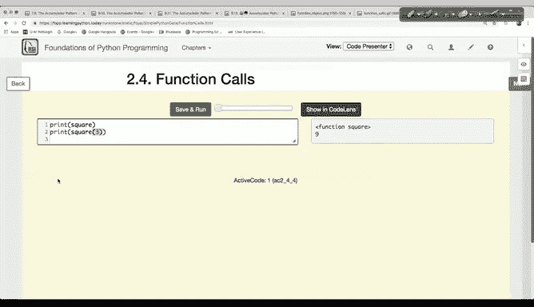

# 密歇根大学《Python3编程（课程1、2）》｜Python 3 Programming（Python for everyone进阶）（中英字幕） - P8：08_01_04_函数调用.zh_en - GPT中英字幕课程资源 - BV1CM411Z72u

Welcome back。One type of expression that you might write in Python is what's called a function call expression。

So you can think of functions as boxes that contain some machinery inside of them。

 so I'm going to visually represent them here just using this gray box。

And you can think of a function as something that takes in some inputs。

 so here the inputs feed into the top here， and then these inputs go inside of this machinery。

 this machinery does something with the inputs， and then after it's done its work with the inputs。

 it sps out an output。So visually again， you can think of it as working something like this。

So here we have a function。 It takes in three inputs or arguments。Then it does some work。

 and then it spits out in output or return value， so let's watch that again。

 so again we have the function and it takes in three inputs here or arguments， and it does some work。

 and then it spits out in output or a return value。

Now let's translate this visual metaphor into actual working Python code。

Here's an example of how we were to actually write a function call expression in Python。

 supposeupp that we have a function name square and our square function takes in one argument which is going to be a number。

 and then it returns or outputs whatever that argument is squared。 So for example， if we say square。

And then open parentheses， and we put our argument in between the parentheses here。

 So this is called calling the square function with four as an argument。

So this is how we actually write that in Python again。

 we say square or whatever the name of the function is。

 then inside of parentheses immediately after the name of the function， we pass in our arguments。

So the arguments。Go hear。And then the value of this overall expression。

So whatever the value of this expression is is going to be the return value。

And so in the case of square， if square squares whatever input or arguments you give it。

 then the return value is going to be 16。And this is what it looks like when we translate this Python code into that visual representation that I just mentioned。

 so we have the square function again represented as a box。And the square function， in this case。

 we suppose that it takes in one input or argument， and if we pass in four。

 it does some work and it spits out an output or return value of 16。To watch that again。

 we pass in for the square function does some work and it computes an output or return value in this case of 16 and again。

 this is how we write that in Python code， we say the name of the function square。

Then open parentheses to say that we want to call that function， and then in between parentheses。

 then we pass in whatever arguments we want our functions to take。Now， Python functions can take one。

 two， or any number of arguments or inputs， but there's always exactly one output。

So for example， here this function takes in three inputs or arguments。

 but it spits out one return value。So again， functions always take any number of arguments。

 but there's always one value of that function call。

So let's look at a little bit more Python code on calling functions。So here on the first line。

 we're actually calling two functions technically because here print is a function that we're calling and we're passing in as an argument to print。

In expression， which just so happens to be another function call。

 and this function call uses the square function that I just described。 So again。

 the square function that I describing， this isn't a built in with Python。

 this is something that we define for the purpose of explaining function calls。

 but we defined it in a way that it takes in one argument。 In this case， square 3。

 and then it spits out that number squared。 So if we say print out the value of square3。

 then this is going to print out。The integer 9。So let's see that in action。

 so I'm going to comment out。The rest of these lines， and run my code。

And I can see that the value of this expression， square of3。Is nine。If we call a function。

 but we don't have a print statement， so let's suppose that I say square5。

The value of this expression is going to be 10， but you'll notice when I save and run my code。

 it's not going to actually affect the output。 And that's because we never actually printed the value of square 5。

 We just computed the value of square 5。 Excuse me， it's not 10。 It's 25。 Of course。

 So here the value of this is 25， but we never print out its value。Now。

 let's suppose that we have another function called sub sub。Takes in two arguments。

So I can represent that visually like this。So it takes in one and。2 arguments。

And just like every other function， it's going to spit out one return value。

Now let's suppose that sub subtracts the second argument from the first argument， so in other words。

 suppose if I passed in6。By passing in6。In four。Then my sub function is going to spit out。Qu。

Because 6-4 is 2。So we would call the sub function by saying print out and then sub。

 and then here you'll notice that we have two arguments and we separate those arguments by a comma。

 so we print out the value of sub 6 and 4。And we see that the value of this expression。

 sub 6 and 4 is 2。If we call it again， so if we call sub with arguments five and nine。

Then this is going to give us negative 4 because 5-9 is negative 4。

We can also combine function calls with other operators， including function calls。

 so here if we print out the value of square3 plus 2。

 then Python is going to first compute the value of this overall expression by evaluating the value of square of 3。

And then it's going to add the result of that to two。

 so Python is going to compute the value of square of 3 and it's going to get9。

 and then it's going to compute the value of this expression。

 which has the value 2 because it's a literal expression and then it's going to add these numbers together to give us 11。

Now， this expression on line 2 is much more complicated。

 so here we can see that we're calling the sub function。We are calling it with two。

 So the first argument。Is square of 3， so this is arg1。The second argument。Is square of one plus one。

 So this is ourrg 2。Now， whenever Python calls a function call expression。

 it needs to figure out what the values of the arguments are。

 so Python kind of computes the values of a function call expression from the inside out。

 so it's going to go from the value of 1 plus1。To， the value of square1 plus  one。

And then the value of square 3。And then after it has the values for square3 and square 1 plus 1。

 it's going to subtract those two values by calling the sub function。 So again。

 we're kind of going from the inside。Out to the next layer。

And then out to the next layer beyond that。So when Python computes this。

 it's going to first compute the value of square 1 plus 1 or 2。

 so it's going to compute the value of square 2 and that's going to give us 4。

 it's going to compute the value of square3 and that's going to give us 9。

And then it's going to compute the value of sub。When called on 9 and 4。

 and that's going to give us 5。So if I run my code。You'll see that we get 11。

From line  one and5 from line 2。Just to run through the exact steps that Python takes when computing the code on line too。

Python first compute。 What's the value of square 3， It gets 9。Then it computes what's  one plus one。

 and it gets 2。Then it computes what square of 2 and it gets4。Then it subtracts 9 and4 and gets 5。

 and that's what it ultimately prints out。Now one thing to note is that functions are objects in Python。

 so if I print out what's the value of square， then Python is going to tell me that square is a function。

 so if I run my code，You can see that line one print out function square。

In order to actually call the function or run that machinery。

 we need to have the name of the function。And then， open parentheses。

And pass in our arguments inside of those parentheses。 So in other words。

 we need to have open parentheses right after the name of the function in order to say that we want to call the function。

 we don't want to just reference the function object itself。

Let's offer for now， until next time。