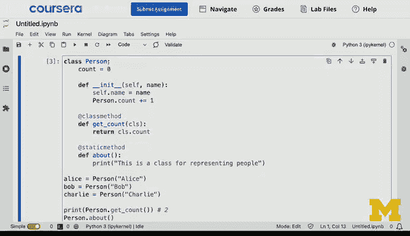

# 密歇根大学《Python3编程（课程3、4、5）》｜Python 3 Programming（Python for everyone进阶）（中英字幕） - P90：33_03_05_方法装饰器.zh_en - GPT中英字幕课程资源 - BV1gj41177yd

There are two other decorators that are built in and useful for defining methods on classes。So first。

 the class method decorator is used to define a method that operates on the class itself rather than an instance of the class。

So let's suppose that we have this person class and as an attribute of the person class we have count。

 which is supposed to be the number of people instances that we created。

 so what you can see is that in this constructor so every time we create a person instance what we do is we say person。

 count plus equals one so that's going to add one onto this count and say that we created one more person。

So in other words， if we create two people， Alice and Bob。Then when we get the count。

Of the number of people， then that's going to be two。

So let's suppose that we wanted to define a method that's going to get the number of people that were created and we want that to be get count。

Now， what we can do is we can use this class method decorator。

To make it so that when we define this method， then rather than operating on an instance of person。

 it operates on the class person。rather than passing in an instance of person as the first argument which is normally self。

 then what this is going to do is it's going to pass the class itself。

 so in this case it's going to pass in person as a value of class， as the first argument。

 so what we can do here is we can say if we add this class method decorator， we can say class。

 count because again， in this case class is going to be person。

And so now the way that we can access this get count function is we can say print personson。ge count。

 and if we run this， then we should get to。If we created another person。Then we are get three， etc。

So again， this class method decorator says that this method operates on the class rather than on specific instances。

Now there's a somewhat similar decorator called static method。

Except what static method does is it says this method belongs to the class。

 except it doesn't pass in the class as an argument。

 so let's suppose that I wanted to have a function named about。

And let's suppose that about just prints out information about this class in general。

 so I'm just going to say print。This is a class for representing。People。

So unlike this get count method which references the person's count attribute。

 this about method doesn't need to reference anything about any particular instance or about the person class and so that's why we can make this a static method because we don't need the class or instance。

 but we just have some notion that this about method kind of belongs inside of this person class and so rather than making maybe rather than making it a function outside of it。

 we still want to put it inside of the person class even though it doesn't reference anything about person or any particular instance。

Okay， so here both get count。And about。Are methods of this person class。

 but the difference is that get count operates on the class itself， so we call it a class method。

And it takes in class as an argument while about doesn't operate on the class or an instance of the class and so we call this aesthetic static method。

 even though we can still reference it by saying person。about。Okay。So class method and static method。

Are two built in decorators that are useful for defining methods that operate on classes rather than instances。

That's all for now until next time。

