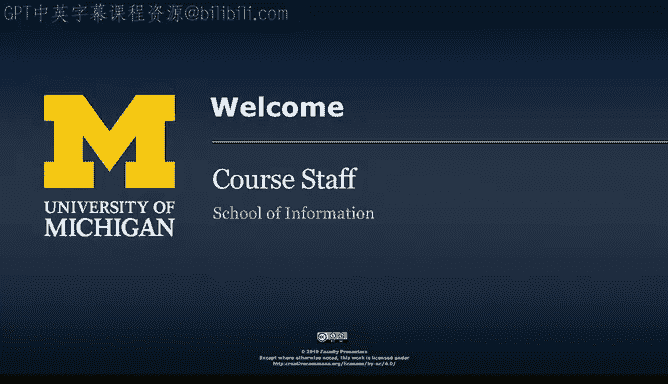
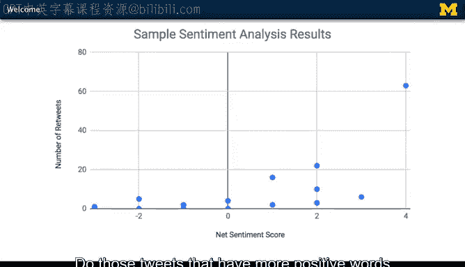

# 密歇根大学《Python3编程（课程1、2）》｜Python 3 Programming（Python for everyone进阶）（中英字幕） - P91：03_01_03_Python函数、文件与字典入门.zh_en - GPT中英字幕课程资源 - BV1CM411Z72u

Welcome。If you're returning after learning the basics with us， we're delighted to have you back。

And if you're just joining us for the first time， because you already know the fundamentals of Python。

 like FL statements， for loops， and strings and lists， then welcome for the first time。

 just be sure that you watch the video introducing the Runestone textbook environment because we're going to be using that throughout the course。

I'm Paul Resnick and I'm Steveonni and we're both faculty here in the School of Information at the University of Michigan。

In this course， we're going to cover the rest of Python fundamentals。

Still focusing on the execution model to help you reason about and debug your programs。

We're also going to learn how to read and write files。

 we'll learn about the Python dictionary data structure。

 and we'll learn to use the accumulation pattern to accumulate results from complex data structures and to accumulate results into dictionaries and from dictionaries。

You're going to learn how to define functions， which I think of as the dividing line between just playing around with programming and becoming a real programmer。

And will' delve into some of the subtleties of functions， including optional and default parameters。

 keyword based parameter passing， and anonymous Lambda functions。And you'll learn about sorting。

You're not going to learn sorting algorithms， but you'll learn how to use Python's built in sorting capability。

You'll pass in the right parameters and you'll get your items back in in exactly the order that you wanted。

The final project will be a little sentiment analysis program。

 we're going to give you a pile of fake tweets and you're going to write code that counts how many positive and negative words there are。

 you'll write out a comma separated values file， upload it into a spreadsheet and generate a graph so that you can analyze。

Do those tweets that have more positive words in them get more replies and more retweets？

Sos fun， and that's also going to synthesize all of the things that you learn throughout the course。

Now like the first course， we're mostly going to do screencasts with code examples。

 but will occasionally come on screen for words of wisdom and to introduce topics I'll also be telling a few more dad jokes。

So let's get to it， bye for now。