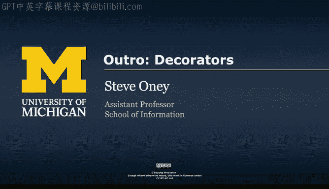
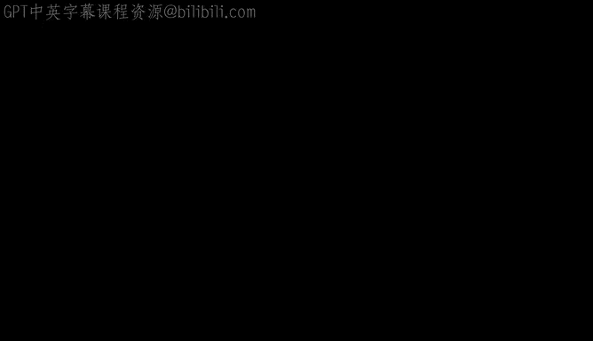

# 密歇根大学《Python3编程（课程3、4、5）》｜Python 3 Programming（Python for everyone进阶）（中英字幕） - P91：34_03_06_结语：装饰器.zh_en - GPT中英字幕课程资源 - BV1gj41177yd

In this lesson we learned about decorators， a powerful tool for modifying the behavior of functions or classes in Python。

 although we mostly wrote our own decorators， there are many libraries and frameworks that provide an array of useful decorators for us to use we'll also cover more examples of pre-made decorators going forward。

See you next time。

