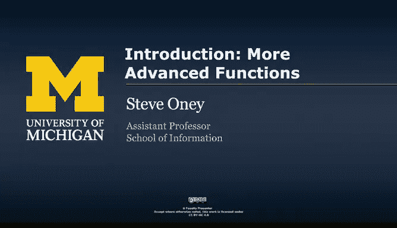

# 密歇根大学《Python3编程（课程3、4、5）》｜Python 3 Programming（Python for everyone进阶）（中英字幕） - P92：35_04_01_引言：高级函数进阶.zh_en - GPT中英字幕课程资源 - BV1gj41177yd

Welcome back in this lesson we're going to cover more advanced topics related to functions in Python specifically we'll cover how to add documentation to functions in classes using doc strings。

 how to accept a variable number of arguments using Args in quags。

 and how to write better and more advanced decorators， so let's get started。

