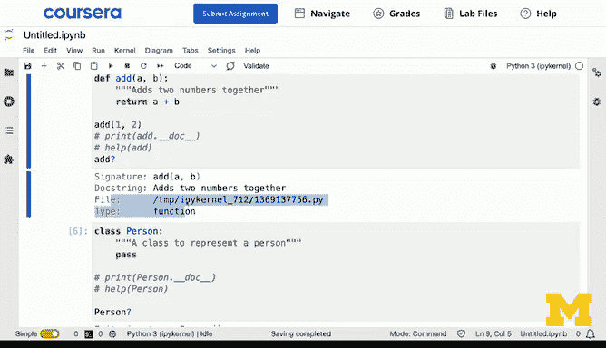

# 密歇根大学《Python3编程（课程3、4、5）》｜Python 3 Programming（Python for everyone进阶）（中英字幕） - P93：36_04_02_使用文档字符串添加函数说明.zh_en - GPT中英字幕课程资源 - BV1gj41177yd

Welcome back in Python we can add documentation to explain what a function does or how it works using something called doc strings。

 a doc string is a string that appears as the first statement of a module or function or class or method definition so for example。

 suppose that we have this add function that adds two numbers together。

We can add a doc string to our a function to describe what it does by typing quotation marks。

 or typically we use triple quotation marks to make it a multiline string。

 and I'm just going to say that this a function adds。Two numbers together。

So I made this doc string enclosed in triple quotation marks because oftentimes we want doc strings that are longer and include multiple lines。

 so it's good practice to include a doc string for any function that you write if possible and to make it as descriptive as you can。

These doc strings can be useful if other programmers are using your code because here they can read the function and if the function is longer。

 then rather than reading the whole function， they can just read the description of what the function does。

So you can access it through the source code， but you can also access the doc string by printing out。

Add or whatever the function name is， dot underscore doc underscore。And when I do that。

 then it's going to print out the doc string that I have for in this case， my add function。

Now the exact same thing also works for classes， so if I had a class person。

I could also have a do string here， so I could say the person class is a class to represent。A person。

And now if I print out。Well， and let me also just， I'll make it an empty class for now。

So now if I print out person。_ doc。What you'll see is the documentation for the person class as well。

There are additional methods that allow us to print out these doc strings。

 so in addition to dot underscore Doc， there's a built in function called help， so if I type help。

Person。Then that's going to print out additional information about the person class or I could do the same thing for my add function。

So I can see additional information about my ad function like what arguments it takes in and the doc string as well one other thing that I can do that only works in the Jupiter environment is I can also type person question mark。

And what this is going to do is it's going to print out detailed information about a class so I can see the initialization signature。

 I can see the doc string， I can see the type as well or I could even see any subclasses that it has and the same question mark syntax also works on。

On functions， So if I type in Jupyter， if I type add question mark。

Then you'll see the function signature， the doc string。

 and more information about my ad function for now。

Okay， that's all for now until next time。

