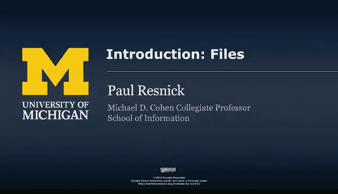

# 密歇根大学《Python3编程（课程1、2）》｜Python 3 Programming（Python for everyone进阶）（中英字幕） - P94：06_01_01_文件处理导论.zh_en - GPT中英字幕课程资源 - BV1CM411Z72u

Here we go， with processing files。Up until now， the only data that our programs have processed。

 the only inputs have either come from literals that we put into the program itself or things that the user typed during execution as a result of a call to the input function。

The only place where outputs have gone is the output window。

 which doesn't persist after you go to another page in the textbook。

A file contains data that persists between executions of your program。As a computer user。

 you're already familiar with the concept of files。

 You've probably worked with image files and spreadsheet files and word processing files。

In this lesson， you'll learn how to manipulate files in a Python program。

 We'll only be working with text files， not audio or other binary formats。 At the end of this lesson。

 you should be able to write a program that reads the file's contents either as a single string or line by line。

You should be able to use relative paths to specify the location of a file。

 You should be able to write new text to a file。I'll see you at the end for a wrap up and more geeky humor。

