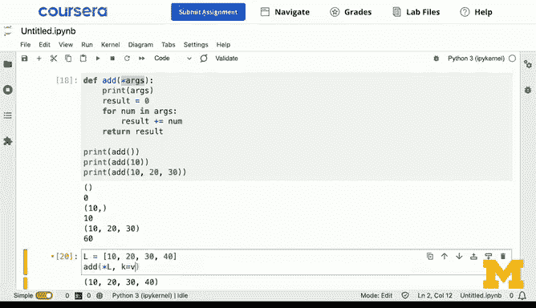

# 密歇根大学《Python3编程（课程3、4、5）》｜Python 3 Programming（Python for everyone进阶）（中英字幕） - P94：37_04_03_args动态位置参数.zh_en - GPT中英字幕课程资源 - BV1gj41177yd

Welcome back。Sometimes we want to write functions that accept any number of arguments。 So。

 for example， here we have an add function that accepts two arguments， meaning that we can call add。

1 and2。But we might also want to be able to accept any number of arguments。

 so we might want to be able to add a third argument here as well。

So if we try to do this as it's defined， then we get an error。

So if we want to define a function that accepts any number of arguments。

 then in Python there's a special syntax for doing this， it's called Args in Kw or quargs。

 so Args allows us to pass a variable number of positional arguments while KW Args allows us to pass in a variable number of keyword arguments let's start with Args so again ArgGs allows us to pass in a variable number of positional arguments to a function so let's take this function add and I'm going to delete A and B as arguments and instead what I'm going to write is this special character star。

Args。And rather than returning A+ B， right now I'm just going to print out the value of As。

So if I do this when I call add with 12，3， then what you'll see is that As is a tuple containing one。

 two， and three。So what we're doing here is that this star signifies that args isn't just a normal argument。

 instead it's a special type of argument known as a variable length。Argument list or really tuple。

So what that means is that I can add call my add function with three arguments， I can call add。

With zero arguments。One argument or really any number of arguments and it's going to work and Args is going to be a tuple that contains all of the positional arguments。

 so positional arguments being first argument， second argument， third argument， etc。

So if we wanted to make our add function actually work。

 then what we might do is we might define result， initialize it to be zero。

 and then we might loop over all of our args， so I might say something like4 nu in as。

Result plus equals that number， and so we add up all of the arguments and then we might return that result。

And so now if we print out add when called with zero arguments， then we get zero。

 if we print out add when called with one argument。

Then we get the sum of that one argument and again。

 we can add any number of arguments and it's going to add them together。So。Again。

 that's AGs in that AGs allows us to accept a variable number of arguments。

Now let's suppose that we want to do kind of the opposite。

 let's suppose that we have a list so I'm just going to say L equals 10， 20， 30， 40。

So let's suppose that we have this list L and we want to call add。

To add up all of the items in L together。If I try to do something like this。Then I get an error。

Saying in this case， unsupported edition type intertegerurn list。

So the problem with trying to call add with L as an argument is going to be maybe more apparent if we print out the value of args。

Inside of add。So when we do that， what we can see is that when we call add with L as an argument。

 then here Args is a tuple that has one item。Wwhichch is the list so really what we expect is Args to be a tuple with numbers and in this case Args is a tuple that has a list。

So we can't pass in L directly like this into our a function what we want to do instead is we want to do something called unpacking so we want to unpack this list L and make it more of a list of arguments So what I'm going to do is I'm going to add a star here in front of L and that's going to say call add。

And take L and unpack it so that we're calling add with 10 as the first argument。

 20 is a second argument， 30 is the third argument， and so on。So now if I do this。

 then you'll see that my list of arguments is 10， 20， 30， 40， which is what I want。

 and you'll see that we successfully take it sum。So in sum。

 we can use the star syntax to define a function that accepts any number of arguments。

 or we can use the star syntax to call a function and unpack a sequence like this list L to call this add function with L as positional arguments as well。

However， what we haven't covered yet is keyword arguments of the form K equals V。

 so we'll cover that in the next video when we talk about KW As。See you next time。

