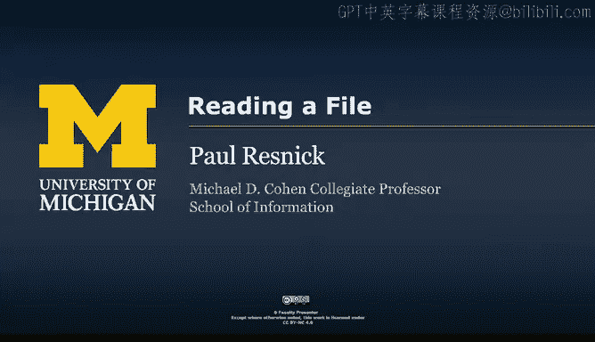
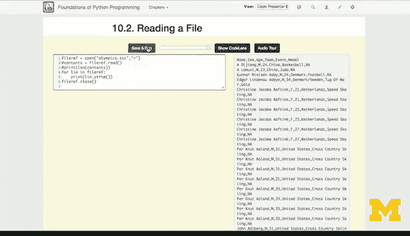

# 密歇根大学《Python3编程（课程1、2）》｜Python 3 Programming（Python for everyone进阶）（中英字幕） - P95：07_01_02_文件读取操作.zh_en - GPT中英字幕课程资源 - BV1CM411Z72u

Welcome back。What is a file， It's just a collection of data saved on a hard disk or other storage that persists over time。

A file has a name， and files can be organized into folders or directories。

We'll be working with text files as opposed to images or sounds or videos。

Here we have an example of a file called Olympic。text。That is available to us in Runonestone。

 each line as information about one athlete's participation in the Olympics。

It's actually a simulated file， Runestone can't access the real files on your computer for security and privacy reasons。

 so we simulate the presence of a few files in the runestone environment so we can illustrate how file reading works。

Python provides some functions for reading data from an existing file。There are two steps。First。

 you call the open function to open the file。So here we have an invocation of the open function。

And we pass in。Two arguments。When is a string， It's the name of the file， Olympics do text。

And the other says what to do with the file。In our case， R for reading。 Later on。

 we'll see W for writing。The open function returns an object。

It's a file object and we are assigning it to this variable name called file Ref。

There is going to be an additional step that we're going to have to do to actually read the contents。

 so this step that we're showing so far just creates the file object。

Then there are going to be some lines of code that we haven't written yet that will actually get the contents from the file and do something with it。

 And then there is a corresponding close operation that let's Python know that we're done working with this file object and it's okay to stop keeping track of it。

 So there's on line 3 file ref do close。If I run this。We're actually not going to see any output。

Because all we've done is open the file and then close it。

 We haven't actually read the contents in and we certainly haven't printed anything out。

 so you're not seeing anything in the output window。

What if we did want to read the contents and print them out？

There's a few different ways of working with file objects。The first method that we'll use is dotread。

 which is going to bring in the entire contents。Of the file as a single string。

Let me show you what that would look like。So we call the dot read method on the file Ref object。

 that returns a string， and I'm assigning that to the variable called contents。And then。

 I could just print out。Oh， let's print out the first00 characters of it。

And now we'll see something in the output window。So we're seeing the first 100 characters from the file。

 which got us three lines and a little bit of the fourth line。Now。

 you'll rarely use this method of reading the entire contents of the file。

 All at once is a big string。Partly because if you had a really big file。

 it would be a problem for your computer to handle all of that in memory all at once。

The only times we're going to use this do read method is if you wanted to sort of grab the whole file and as a string and pass it to some other function that pars it。

And even then there'll usually be some other function available that will directly read from the file object a little bit at a time and parse its contents。

So the second method that I'm going to show you is instead of reading it all at once。

We have a dot read lines method。Instead of getting everything is a single string。

It returns a list of strings， one string for each line in the file。So let's print out。

 let's say the first four lines of the file this way。And I forgot to rename the file。

 the variable that I'm referring to， let's call it。Lines， because I called it lines online too。

And you can see now that we're printing out a list。AndWe've got the square brackets。

And inside the list， there are four strings。Here' is the first string。

 The second string begins here and is ending here。And so on。

 each of the strings notice is ending with this special back slash end character。

That's the new line character， because in the file， we have。A bunch of lines of text。

 So when we read these lines in， each of the strings has a backslash N at the end of it。

Instead of just printing out all these lines。I could。Maybe get a slightly prettier print out。

 if I iterate。Through them。So for line in lines， and maybe I'll just take the first four lines again。

The first five lines， and I'm going to print。The individual line。So now when I run it。

 it's going to iterate through these four lines and each one of them is going to go on its own line。

 we're no longer going to get the square brackets to show up。

Because we are not printing the whole list。 We're iterating through the individual strings。

 We're also not going to get。These quote marks is we're going to pass the strings and when we print those out。

 we just show their contents in the output window。So let's see how that looks when we run it。

And sure enough we get each of the lines separately。

Now you might notice something a little strange here， which is that we get these blank lines。

The reason for that is that each of the strings you'll remember。

 had that new line character at the end， which meant to a carriage return。And the print function。

Always， does it。A carriage return。 And so we're getting two of those。

 one is starting us on a new line， and the other one is starting us on a new line again。

 so we get a blank line。What if we didn't want to have that extra blank line？Well。

 you've seen the dot strip method before I can strip the white space from the beginning and ends of each of these lines。

 so the dot strip method gets rid of any white space at the beginning or the end。

 white space is the space character， a tab character or a new line character。So if I call this。

 now I'm going to get the print out that doesn't have the blank lines。And sure enough。

 we've got the first four lines from the file。Now there's a shorter way to iterate over the lines。

 if that's all we're going to do is iterate over all of them。

So let me show you that because it's the more pythonic way rather than reading the entire file into a list。

We can just directly iterate。Over all of the lines by saying for line and file ref。

So here it's a file object， it's not a list， but it knows how to be iterated over and each time we get one more line。

 so this is going to do exactly the same thing that we had before。

Except now we're going to get all the lines in the file。

So we can iterate over this file object directly。 We can't do this thing of。Taking a slice of it。

 like we did with lists。That gives us an error。 So a file object supports iteration。

 but it does not support taking slices。 So if we wanted to。

Just do something with the first four lines， we'd have to use the dot read lines。

Rather than just iterating over the file object， but if we're prepared to process all the lines。

 which is the normal thing that you're going to do with a file。This is the standard Pythonic idiom。

Now， when should you actually call dot read lines or dot read。Well。

 one reason to call dot read lines is if you wanted to take slices。

 another reason might be that you wanted to just get count of how many lines are in the file。

So if I get all of the lines and put them in a variable， I could now print out。The length of lines。

And I would tell me how many lines were in the file。I'm going to comment out the other two。

Turns out there are 60 lines in the file。If I wanted to。Find out how many characters are in the file。

I could read the entire file。As one character string。And then I could ask for its length。

So except in those special cases， the more common thing that you're going to want to do is to just iterate over the file object itself。

Now we won't use。Dot read or dot read lines instead will' just iterate over the file object itself。

 This is the most common way that you'll be working with files。

So that's Python code for reading from a file。 Well see you next time。

