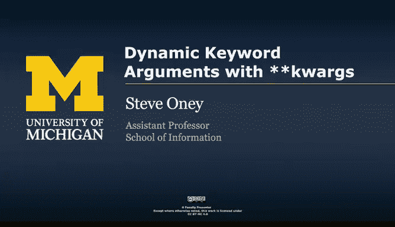
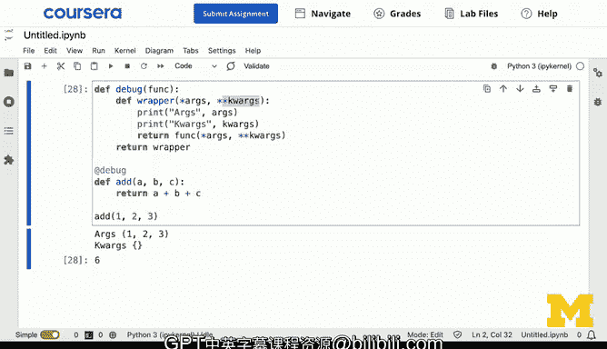

# 密歇根大学《Python3编程（课程3、4、5）》｜Python 3 Programming（Python for everyone进阶）（中英字幕） - P95：38_04_04_kwargs动态关键字参数.zh_en - GPT中英字幕课程资源 - BV1gj41177yd

Welcome back。Now let's move on to quargs， which allows us to pass in a variable number of keyword arguments to a function。

 so suppose that we have this function create user profile that takes in information about a user。

 but suppose that we want to accept any key value pair， so we might want to accept things like name。

 so I'll say name equals I age。Or anything else。So if we want to accept any number of keyword arguments。

 then we can use this two star syntax and these two stars signify that KW Args or a quargs isn't just a normal argument。

 instead it's again a special type of argument known as a variable list keyword argument。

So what this makes is quaggs a dictionary where the keys are going to be things like name。

 age and city， and the values are going to be Alice 30 and Wonderland or really whatever I pass in。

 so if I run this code，What you'll see is that when I call createreate E profilefile with this set of keyword arguments。

Then Quargggs gets a dictionary that has these items。

So if in this function we actually wanted to create a dictionary or user profile with this information。

 then we might want to say something like user profile starts off as an empty dictionary。

 then we might want to loop over all of our quarks so I can say for。Key in value， inring do items。

User profile sub key equals value。And return user profile。So now if I do this。

 what this is returning is a dictionary where we have all of our key value pairs again。

So now this is an example where we're defining a function that accepts a variable number of keyword arguments。

 let's suppose conversely that we had a dictionary so if I have this as a dictionary。

And now let's suppose that I want to call my create user profile and use all of these as keyword arguments。

So we might be tempted to say create。User profile and call this on D。

But the problem with this is if we print。Qurks。嗯。And actually。

 I would need to say something like x equals D。Yeah。But the problem with this is that here。

 this is saying that create user profile accepts zero positional arguments。

 but we tried to pass in one positional argument， so instead what we want to do is we want to add two stars here to say that we want to unpack this dictionary into a set of keyword arguments。

 so now if we do this， then we're able to call our function and we're passing in D by unpacking all of these key value pairs into keyword arguments。

So that's quarks and again， we specify that using two stars。Now finally。

 we can also combine args and quargs into a single function。

 so let's suppose that we have a new function。And I'm going to say print。Info。

And I'm going to make it accept a list a variable list of arguments using star args。

And a variable list of keyword arguments using two stars。

And I'm just going to print out As and I'm going to print out quags。Now， if I call my function。

 I can call it with any number of positional and keyword arguments， so if I call print。Info。With 10。

 20 as positional arguments and name equals Alices。And age equals 30 as keyword arguments。Again。

 these are。Positional。And these are。Teyword。So these keyword arguments are going to be placed into quarkgs and these positional arguments。

Are going to be placed into Args。So if I run my code。

Then you'll see that when I print out the value of args， then I get。

10 and 20 because these are the positional arguments， when I print out the value of quags。

 then I get name Alice and age set to 30 because those are the keyword arguments。

So one common use case for using both args and quarggs is in decorators。So for example。

 let's suppose that we have a decorator named debug， so I'm going to say de debug。

And I'm going to make it contain a wrapper。And now what I'm going to do is I'm going to accept positional arguments as as。

And keyword arguments as quarks。What I can do is I can call my function。Yeah。

And pass in all of the positional arguments。And all of the keyword arguments。

And let me do some additional information here， so I'll just print out。Args。And。

I'm going to print out quarks。😔，Before actually running the rap function。

So now suppose that I have a function add。Yeah。Now， if I add my debug。Decorator。

And if I call add on one and two。Yeah。What you'll see is that here I have a set of positional arguments。

 one， two， I have no keyword arguments in this example。

 if my a function accepted three arguments or really any number of arguments。

 then I don't need to change my decorator anymore。Yeah。

Although I would need to change how I called it。And so what you can see is that my function wrapper now works with any number of arguments and keyword arguments by using the star and double star syntax。

So that's how we can use args and quags in the context of decorators。

 that's all for now until next time。

