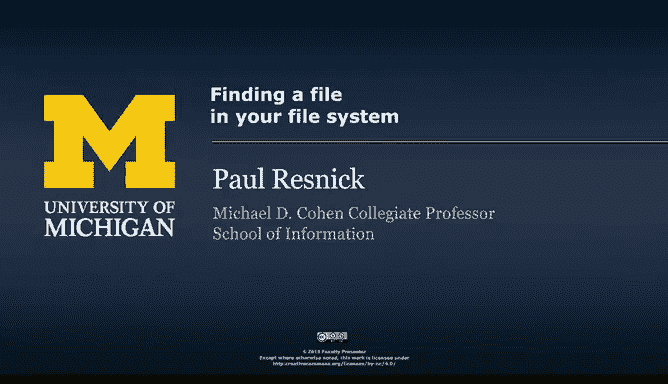
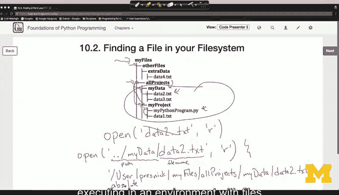

# 密歇根大学《Python3编程（课程1、2）》｜Python 3 Programming（Python for everyone进阶）（中英字幕） - P96：08_01_03_文件系统路径定位.zh_en - GPT中英字幕课程资源 - BV1CM411Z72u

So far， we've pretended that all files live in a single folder or directory and it's the directory that your Python program is connected to。

So your Python program doesn't need to specify a location for the file when opening it。

With our assimulated files in the runestone environment， that worked fine。

But if you're ever running Python in a local machine， it probably won't be enough for you。

So let's see how you can have files organized into folders and directories and still find them in your Python program。

So most people do organize their files into folders or directories because otherwise you just have hundreds of files in one directory and you can't find them。

So for example， here's a diagram showing a hierarchy of directories and files。

There's a top level directory called My files。And inside that directory。

 we have two other subdirecties。Other files。And all projects。All projects itself has two more。

Subdirecties called my data and my project inside of my data。We've got。A couple of files。

 ones called data 2 dot text。 In my project， we've got data  one dot text。

And my Python programmed at Py。By convention。We put Python programs into files whose name ends and do Py。

So a Python program， when we run it， is automatically connected to the directory where it's invoked from。

We are an invoking Python directly in the Runestone book， so we can't really see how that works。

 but I can give you a way to think about it to use if and when you do install Python on your own computer to run it locally。

In the open function。You can pass just a file name， as we've been doing。Like that。Open data1。

text for reading。But we also can specify a complete path that says where to find the file。

 as well as the file's name。So normally we would use a relative path which specifies how to get to another directory from the directory that you're currently connected to。

So suppose that we' running this my python program do py。And we're running it from the directory。

 my project。And we want to open。Data2 do text。We can't just say。Open of data 2。

We have to tell it how to find it。 So this is not going to work。We have to instead say。

From the current directory， which is my project。 you got to go up a level。To get to all projects。

 the way to say that you go up a level is to say dot， dot。

 dot dot says go to the containing or the parent directory。Within all projects。

 we have to go down to send into this subfold my data。We got to go down there。

And now we've given the directions go up to the parent within that。 go down to my data。

 And it looks like I。We got to capitalize the D。Let me fix that。

And then now we're in the right directory， and now we can say data 2 dot text。

Everything else is just the same。So that's called a relative path。This part。Is called the path。

And then， we have。The file name。There's also a way to specify an absolute path。That is。

Absolute meaning。 Here's how to find this file。On the computer。

 rather than relative to the current directory that you're currently connected to。When you do that。

 you'll have。A path that begins with slash。So it would be something like slash user。Slash P。 Resnk。

Slash。My files。And you'd have to give the whole path。All projects。After all projects。

You would go to my data。And finally， the file name。I don't recommend using these。

What are called absolute paths。Because it makes your code and data not portable。

If I use the relative path， and I take。This entire set of。Folds。

 and I just copy it to someplace else on a different computer。 Maybe somebody else's computer， not。

Slash user/lash P Resnk。And I can still find it， so generally people prefer to use these relative paths because it makes their code and data more portable you can transfer it to other computers。

If you've only been running Python in the Runestone textbook。

 you haven't had an occasion yet to use these file paths when opening files and don't worry about it。

 Just make a mental note to come back to this video or the corresponding page in the book when you are executing in an environment with files grouped into directories。

See you next time。