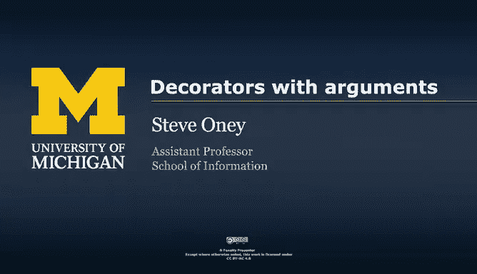
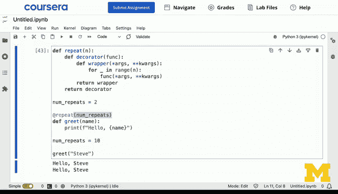

# 密歇根大学《Python3编程（课程3、4、5）》｜Python 3 Programming（Python for everyone进阶）（中英字幕） - P96：39_04_05_带参数的装饰器.zh_en - GPT中英字幕课程资源 - BV1gj41177yd

Welcome back。Thus far the decorators that we've written have been simple functions that take in a single argument which is the function that we're going to wrap or decorate however。

 we can also write decorators that take in additional arguments so let's take this example so here we have a decorator and what this decorator does is it wraps a function and it just prints out calling wrappper before actually calling that function so if we add this decorator to this greet function which prints out hello and whatever name you pass in then whenever we call greet。

 it's going to say calling wrappper and then it's going to print hello and then in this case Steve。

Now， let's suppose that I wanted to modify this wrapper so that it calls the function multiple times。

What I'll do is I'll modify our wrapper so that it calls funk warrants。

And then I'll make it so that it calls funk again。So now whenever I add my decorator。

 then it prints out hello Steve in this case twice， even though I only called it once。Now。

 let me call my decorator instead， repeatat。그。And to make it a little bit more general。

 what I'll do is I'll use it four loops， I'll say four underscore in range。

 and then I'll just start out with five。Okay， so now what my wrappper does is when I add repeat as a decorator。

 then it's going to call this function five times when I call it once， so if I say greet Steve once。

 then it should say hello Steve one， two， three， four， five times。Okay， so that's great。

 but let's suppose that we want to not hard code this five。

 let's suppose that we want to be able to repeat our function any number of times that it's called。

Then what we could do is we could actually define our decorator in a way that it accepts one argument。

 So what I'll do is I'm going to actually indent。This， and I'm going to call this my decorator。

And if I put this all inside of a larger function。Which I'll call repeat。

I can have that function except an argument， so here I'm going to accept n as an argument which signifies the number of times that I want to repeat。

And then here I'm going to return Decator。Okay。So what I've done here is I took the decorator that I had before。

And I indented it to be inside of a larger decorator that accepts an argument in this case。

 that argument is N， which is the number of times that I want to repeat。

And what I can do here is rather than always repeating five times， I can say repeat n times instead。

Okay， so now that I've done this， what I can do is I can make this decorator accept an argument。

 which is the number of times that I want to repeat calling it， so if I say repeat 10 for example。

And I need to add a colon here。But when I say repeat 10。

 what it's going to do is it's going to repeat this 10 times if I say instead repeat 3。

It's going to repeat it three times or repeat two， et cetera， it's going to repeat it two times。

I can even have this number reference a variable that I declare in my code。

 so I can say something like numb repeats。Equals5。AndThen I can say repeatat numb repeat times。

And now if I do this， then this decorator is going to repeat my function call five times。

One thing to note here is that I can't actually modify the value of nu repeat after I've declared my function。

 so if I say。Num repeats equals。10 here， and if I say it's 2 here。

 it's going to be the value of nu repeats whenever I declare my function。

 so even though I reassigned nu repeats to be 10，Our decorator still uses two as the number of times to repeat our function call。

So this shows that we can have decorators that accept optional arguments as well。

That's all for now until next time。