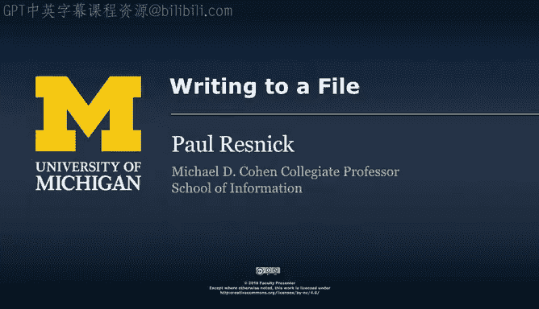
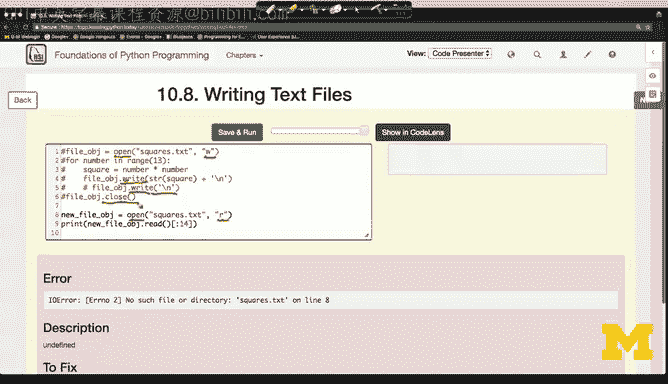

# 密歇根大学《Python3编程（课程1、2）》｜Python 3 Programming（Python for everyone进阶）（中英字幕） - P97：09_01_04_文件写入操作.zh_en - GPT中英字幕课程资源 - BV1CM411Z72u

Welcome back。Writing to a file is pretty similar to a reading from a file。

You still have to open a file object based on a name for the file。

But instead of reading from the file object， you'll write to it。Let's see an example。Here。

 we're printing out the squares of all the numbers from 0 up to， but not including 13。

How if I run it。We'll see we get 0 times 0， and1 times 1 is 1， and then 4，3 times 3 is 9 and so on。

I suppose instead of writing those to the output window。

 we wanted to write them to a file where they would be permanently stored。Well。

 let's start coding that up。A normal。Itttle template for reading or writing from a file is that we have some file object。

Equals open。Of some file name， I'll call it squares dot text。

And now we have to say writing instead of reading。And whenever I open a file object like that， I。

Tend to forget that I need to close it。 So I'll just put the clothes in right away。Now。

 if I run this。Nothing different happens because I'm still printing to the output window。

Though instead of printing to the output window， I want to write to a file。So， I'm going to say。

File O BJ dot right instead of having a print statement。And I'm going to have to turn that。Number。0。

1，4， or whatever into a string in order to be able to write it。

The print function is pretty forgiving。 We could give it a number or a string。

 and it would figure it out。But here， we have to actually give it a string。So if I do this。

 I will now have at the end in my file object， all those numbers， 0，1，4，9， and so on。

Now we have a little simulator for written files， just as we have a simulator for reading from files。

In Runestone， as you recall， we can't read or write files from the local file system for security reasons。

 So we have built in this ability to read a few files that are built into each page。

 and we can write files， which will be available。Just until the page gets reloaded。

So we have this file called squares dotex and here's the output。Now。

 that output may be a little different from what you were expecting。Because we have 0，1，4，9。

 and so on。It's not nice like it was in the output window。 We don't have 0，1。

 for each on its own line。The reason for that difference is that when you call print。

And you give it a string， like。4。You'll automatically get 4。And a new line in the output window。

When we call dot right， we just get the contents， so we just get the four。

 but we don't get a new line character。You have to decide for yourself when you want a new line。

So what I'm going to do is after I've written each square， I'm also going to explicitly write。

A new line。The backslash end character。Now， if I save and run it。

 we'll see something that looks a little nicer。In the data file。Now， we've got。All the values。

 each one on its own line。Of course， we could combine these onto a single line。

 We could have the string of square， plus。Back slash N， all on one line。That would work just as well。

Sometimes， especially for。Students who are just learning I like to make the new line character be its own line because it's a real reminder that with that right。

 you have to create that new line character explicitly。

Unlike with the print function where it does it for you。So that works just the same。Now。

 when we have a file for the duration of this page being displayed， that file is available。

 so I could。Read it。I can read that file， it's called squares。 textex。

New file object equals open of squares dot text。And this time I'm opening it for reading。

And let's just print out。Let's say， the first 10 characters。The dot read gets me all the characters。

 If I just want the first 10 characters。I'll do that。

 And now we'll see something in the output window。 Let me clear all of my markings。And there you see。

 we've got the first。10 characters showing up in the output window。 The first character is the0。

 And then there's a second character for the new line。 So that's  two characters，3，4，5，6，7，8。

9ine and 10。If I had asked for。Just the first nine characters。

I would have up to the one without the six。And sure enough， there it is。 And by the way。

This file really is there。Even if I don't recreate it each time with the code。

I could now just read it if I wanted to。So let me get the first 14 characters， let's say。

To so you'll see that we get something different。And sure enough， we get the 25 in addition。

As I said， we've simulated the creation of this file。 It's there until we reload the page。

Let me just demonstrate that for you if I reload the page， but try to keep this code。

 we're going to have a problem that won't be able to find the file。

So if I try to run this same code again。It says that there is no such file directory squares do text。

 so it can't open it because it hasn't been created。 That's how we write to files。

It's structurally similar to reading。 We open the file。Just as we do for reading。

 but when we're writing， we do it with a quoteW instead of quote R。We call dot right。As needed。

But if we want a new line， we have to explicitly write the backslash end character。

And then we have to close the file。 It's especially important for writing， because otherwise。

 the contents might not be fully written， and you might lose some of them。See you next time。

