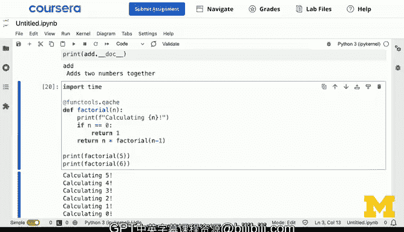

# 密歇根大学《Python3编程（课程3、4、5）》｜Python 3 Programming（Python for everyone进阶）（中英字幕） - P97：40_04_06_functools模块内置装饰器.zh_en - GPT中英字幕课程资源 - BV1gj41177yd

Welcome back Python includes a number of built in decorators that we can use in our code now there are too many to go over comprehensively。

 but let's cover some examples from the funk toolsols module。

Note that unfortunately the Runonestone textbook doesn't yet support func tools。

 so I'm going to write this code in a Jupiter notebook。So。

What I want to start with is an example that's actually going to help us write our own decorators。

 so let's suppose that we have this decorator named debug and what debug does is it says whenever we call a funk。

 we're calling this function and it says our arguments and our keyword arguments。You can see here。

 for example， that when I call add with one2， it says calling this function add。

With arguments one and two and keyword arguments being an empty dictionary。Okay。So。

One thing that I want to note is you might not be tempted to actually print out functions themselves。

 but let's suppose that I get rid of this decorator。

And let's suppose that I print out the add function itself without actually calling it。

Now one thing that you'll notice here is that we say function and then we get the name of the function。

 which can be kind of useful knowing that this function is the add function。

 and then we get some other things that are not readable， but I want to focus on this function ad。

Now if I add this decorator in。What we're going to lose is the name of this function。

So like here I get function， debug locals， wrappper。

 and we don't get the ad kind of readable ad description。

Like we did when we didn't have the decorator。So that might not seem like such a big deal。

 but one thing that might be worse is if I have a doc string for the add function。

 so if I say this adds two numbers together。And now if I print out add dot underscore doc。

Then I get the dock string。But if I wrap this function， so if I say deepbug。

Then I no longer have a doc string， and if I say add question mark。

Then you'll see that there's no doc string if I have this wrapper。And if I get rid of it。

 then you'll see that I get the doc string and signature again。

So one problem that we get when we use decorators by default is that we lose the doc string。

 we also lose things like the function name， which I can access by saying。Add do underscore name。

And we kind of lose information， that information about the function when we wrap it， so again。

 this is what it looks like when I haven't wrapped it and when I add the wrapper。

You'll see that we lose the name of our function and its dostream。

If we want to preserve the metadata of the original function。

 what we can do is we can use a built in decorator from this funk tools module called wraps。

 so here if we say at funktools。raps，Funk。Then what this does。

Is it preserves the original name and the doc string and any other metadata that I have associated with this a function？

So when defining your own wrapping functions， it's good practice to use this funk toolsols dot wraps to make sure that if a user uses your decorator that it's going to preserve the function name。

 the doc string， etc as well。So funktools。raps is one example of a built in decorator。

Another example of a built in decorator is the cache decorator from the func tools module。

 so let's suppose that we have in another cell。A function。

That involves some computationally expensive works， I'm going to say de expensive。Computation。

And what I'm going to do is I'm going to just import the time module， and I'm going to say time。

 sleepep3。And what this is going to do is this is just going to simulate。

Something that takes three seconds to run。So think of this as like a substitute for you know your computer having to spend three seconds running some crazy math equation that's really hard to compute something like that。

 so that's what I mean when I say that this is an expensive computation。

And then let's suppose that after this expensive computation， we return some results。

 I'll just return and squared。Okay， so now if we call our expensive computation function multiple times with the same argument。

 so I'm going to say print expensive。Computation。Called with three。不想。

And let's say that we need to do this a few times。So if we do this。

 then we're going to run our expensive computation function。

 but it's going to take three seconds every single time that we need to run it so again。

 imagine that this line represents like doing some crazy math equation that takes a long time to run。

Now， if we need to call our expensive computation function multiple times。

 then there's a better way what we could do is we could remember or cache the result when we call it with3 so that the next time we call it with three。

 we remember that， oh， last time I called this function with three， I got the result nine。So again。

 the problem here is that this is going to output。9。But it has to take。Three seconds。

And each of these calls will take three seconds。But really。

 it'd be nice if we could remember after the first call that， hey。

 the output of calling expensive computation with three is nine so that we don't need to do that expensive computation again。

So funk tools has。A decorator calledc， so if I say funktools。cache。What funktools。

cash does is it caches or in other words， remembers the return value of this function when called with a specific argument。

 so in this case if we're going to call expensive computation with the argument three multiple times。

 it's going to remember， hey， last time I called this with three as an argument， I got nine。

 and so I don't need to actually call it again。So now if I do this。

 the first time that I run my code， it takes three seconds。

 but then you'll see all of the other ones appear instantly after that， so let's do that again。

 so the first time I run this it's going to take three seconds。But then afterwards。

 everything else appears instantly， and if I didn't catch the result。

Then I would need to wait three seconds between each function call in order to get my results。

So another example of where this might be useful is that let's suppose that we define a function named factorial。

That accepts one argument， which is n。And let's suppose that this function computes what's called the factorial of a number。

 so when we do the factorial of a number， so if we say for example。

 five and then factorial is usually specified by this exclamation point。Then the value of this is5。

Times 4。Times 3 times 2 times1。If we wanted to compute six factorial。

Then that value is 6 times 5 times 4 times 3 times 2 times1。If we wanted to do seven factorial。

 then we could do seven times， and but what you might actually recognize here is that seven factorial is actually seven times6 factorial。

And similarly， six factorial。Is six times。5ive factorial。So by definition， zero factorial。

Is defined to be one。And so one way that we can write our factorial function is we can say。

If n is equal to0， return。1。Otherwise， we can return and。Times， factorial。N minus1。So for example。

 if we're calling factorial of six， then what this is saying is that factorial of six is six times factorial of five。

And then we would do factorial of five and five is going to be five times factorial four， et ce。

 and so the end result that we would get。Is this。O。So if we run this code。

What we get when we do factorial of six is six times  five times4 times 3 times 2 times 1。

 and that's going to be equal to 720。Now let's suppose that we print out。

Which number we're calculating the factorial of， so I'm going to say print。Cat kulatinging。

And factorial。And what you'll see is that when we call factorial of six。

 we first calculate six factorial， then we calculate  five，4， three，2， one， etc。If we also。

Calculated the factorial of5。嗯。Then what you'll see when we calculate factorial 5 is that here we're calculating five factorial。

 then4， three，2，1， etc。And then when we call factoriallon6， we get6，5，4，321。

And what you'll notice is that here we're doing a lot of repeated work， so like here。

 when we're calculating five factorial。We would want to use the result that we computed up here and same thing with when we're calculating four factorial and three factorial。

 etc， so it'd be great if we could just reuse the work that we did when calculating five factorial when also calculating six factorial。

And so one way that we could do that is by using this funk toolss cache decorator。So note here again。

 when we calculate six factorial， we have to go from6 to 5 to 4，321， etc， but if we import fun tools。

cache and use that as a decorator，What you'll see is that when we calculate six factorial。

 we no longer actually have to calculate5，4，321 factorial again。

 because we've cached or remembered the result from last time。

So there are a number of other built- in decorators in Python。

 including in the funk toolsol module and in other modules。

 so this is just a taste or a sense of the kinds of decorators that you can use。

 but you can find more information in the Python documentation as well。

That's all for now until next time。