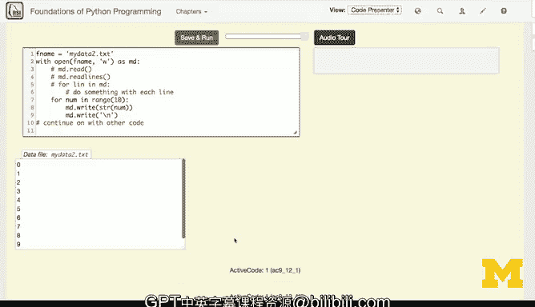

# 密歇根大学《Python3编程（课程1、2）》｜Python 3 Programming（Python for everyone进阶）（中英字幕） - P98：10_01_05_with语句文件操作.zh_en - GPT中英字幕课程资源 - BV1CM411Z72u

Welcome back。We're going to see a little shorthand that makes it even easier to work with files and avoids the need to remember to close them。

Python has an advanced feature called Context Manager。

We don't need to worry about it in all of its generality。

 but it makes possible this nice's recipe for working with files。It's easiest to understand it。

 by example， you start with a special word with。And then there's another special word as。In between。

 you have the open statement。So we say open in the file name and whether you want to read or write it。

After the word as you have a variable name。So this is actually equivalent。To saying。M D。😔，Equals。

Open。Of。My data。Thatt T X T。For reading。It's equivalent to that in that。

In the code block that's indented under the word with。We can refer。To Md。

And MD will be bound to our file object。But we get a behind the scenes。

Action that happens at the end of the code block。 It's as if we have an M D dot close。

It gets executed behind the scenes， we don't actually have to specify it。

 it just gets done for us after everything else gets executed in that code block。If I run this。

I just get the print out of the first line and the second line。As you might expect。

Since we've iterated through the lines in the file object。Printing each one。

 we get the print out of those two lines that were in the file。

They're showing up in the output window。Let's get rid of our markings here and just generalize this a little bit。

Suppose we didn't want to just open Mydata。 text。But we wanted this to work with。With any file name。

 so let's say F name equals I data dot text。We would open the file name here。And then。

We would do stuff。With the file object。So we would have MD。read。Or。Anddy dot read lines。

Or we might have。For line in。MD。Do something with each line。

So now we have sort of a general recipe for reading data from a file。

We start with this with statement。Where we open a file object and we assign it to the variable name MD。

And then we use one of our three methods of working with the file。

 We either read all of its data in as a single character string with dot read or we read all of the lines as a list of character strings with dot read lines。

 or we just iterate through those character strings directly using iteration over the file object on line 5。

The same recipe will work。Just as well for writing files。So if I change that R to a W。

I can do the same things that we would do。For writing to a file。So for example。

 I might say for a number。In range of。10。End that right。Of。STR of none。And MD got right。

A new line character。And again， the close happens automatically for us。 So when I run this。

And unfortunately， I'm not seeing the file contents and that reminds me of one little gacha that you might want to remember。

If you're trying to write a file。You can't write to a file that's the same name as one of the built in files in the page。

We have a little protective measure that keeps you from overr it。

 So if I just change the name of the file。Now I get as my output what I was expecting。

You can survive a long time as a Python programmer， not using the width construct。

But experienced programmers will use it。 You'll see it on stack Overflow and other help sites。

 So it's a good idea to be able to read it and feel free to use it if you like。😊，See you next time。

