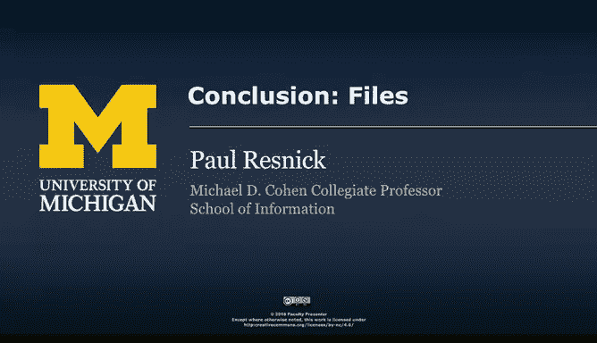

# 密歇根大学《Python3编程（课程1、2）》｜Python 3 Programming（Python for everyone进阶）（中英字幕） - P99：11_01_06_文件处理总结.zh_en - GPT中英字幕课程资源 - BV1CM411Z72u

We're tuugging along here。You've learned the basics of reading and writing files now。

There are two things that trip people up， so just keep these in mind。First。

 you have to pass a string the file's name as the first parameter when you call the open function。

If you have a variable name whose value is the file name， don't put it in quotes。

 If you have a literal file name， do put it in quotes。Second。

 you have to keep track of the distinction between the file name， a string。

The file object which is the thing returned by the open function and the file's contents。

 which you get by doing operations on the file object。I'm glad you made it this far。 It's joke time。

😊，Reading， I had plans to read a book about sinkhole， but they fell through。Writing。

There was once a young man who professed his desire to become a great writer。When asked to define Gr。

 he said。I want to write stuff that the whole world will read。 stuff that people will。

 that they'll react to on a truly emotional level， stuff that will make them scream， cry。

 howl in pain and anger。He now writes the error messages for the Python interpreter。

See you next time。