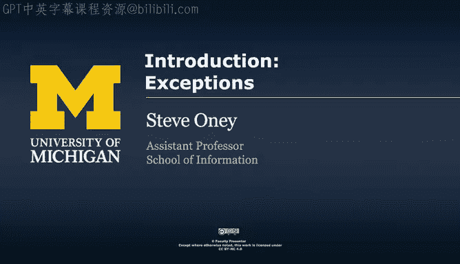

# 密歇根大学《Python3编程（课程3、4、5）》｜Python 3 Programming（Python for everyone进阶）（中英字幕） - P99：42_04_01_引言：异常处理.zh_en - GPT中英字幕课程资源 - BV1gj41177yd

Welcome back。In this lesson， we're going to focus on exceptions。 we've seen exceptions before。

 probably frustratingly when your code execution was halted because of a runtime exception。

 but by the end of this lesson， you'll learn how to write code that handles exceptions when they come up。

So for example， if you write code that reads a file。

 it would normally throw an error if it tries to read a file that doesn't exist。

But rather than having that stop the program， we'll be able to make it so that it does something like create the file or use a placeholder value instead of the file contents。

By learning this and more， we'll gain better control of how our programs execute， so let's dive in。

