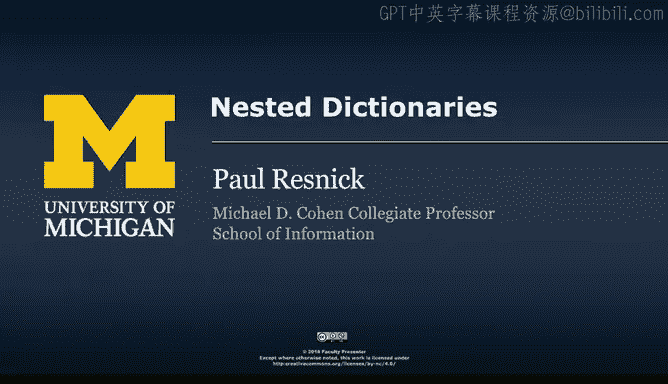
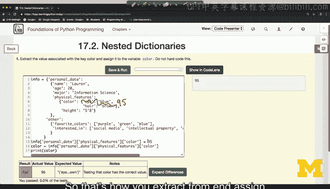

# 密歇根大学《Python3编程（课程3、4、5）》｜Python 3 Programming（Python for everyone进阶）（中英字幕） - P9：08_02_03_嵌套字典.zh_en - GPT中英字幕课程资源 - BV1gj41177yd

Welcome back。We can have multiple levels of nesting of both dictionaries and lists。

Here's a pretty complicated data structure。Our task is going to be to extract the value associated with color。

So that's here down on line six。The color。Has the value， which is a dictionary。eyye。

 blue and hair brown。So we're going to use the same incremental approach that I showed for extracting something from a heavily nested dictionary。

We're going to need one square bracket for each level that we're descending。

So we're going to need one square bracket。To get the stuff associated with personal data。

And then within that， we're going to need another square bracket。

To get the stuff associated with physical features and within that。

 we're going to need another square bracket to just get the color。So let's do this。

One step at a time。And we're supposed to make a variable called color。

Whose value is going to be that dictionary， eye blue and hair brown。

We're not going to get that in one step。 We're going to extract something from the info dictionary。

And let's just see how we're doing by printing it out。And what am I going to first extract。Well。

 first I'm going to extract。All of this。All the stuff that is associated with personal data。So。

 I have to。Ask for the value that's associated with the key personal data。

When I run that and I ask to have it printed out。We're gonna see。WOops， we got an error。

The error says I have。Bad token on line number 16。 So let's see if we can figure out what I did wrong。

Here's line number 16。And the color coding helps me a little bit here， too， I can see I forgot。

To close my string。Let's save and run this。And we can see that。

Color is now bound to a smaller dictionary than before， and it's got exactly。The contents。

Not so nicely printed。Not so nicely formatted， that's got exactly these contents。

And you can see that since there's a test to see whether we've finished the problem。

 we have not finished the problem。We have descended one level into this nest to data structure。

 but we haven't pulled out the value that we're supposed to have pulled out。

So let's go one step further。In the dictionary that we have so far for the value color。

Where does color appear。It appears here。Associated with the key physical features。

 So my second level of nesting。Is going to ask for physical features。

And each time we descend one level， our task is going to get a little bit easier。

The reason it gets a little easier is that we have less stuff。 We've extracted more。

 We now have a smaller data structure， so it's easy to figure out where we are。And we want to get。

This dictionary。Which is associated with the key color。In the thing that we have。

 so let's do one more level of extraction。And we ask for color。

And now we've managed to pass the test。Because we were supposed to get the value associated with color。

 Now， notice that。The value。Is still a dictionary。 We didn't get just a simple value。

 We still have a dictionary， but that's the thing that we were supposed to get。

And one thing to notice about this complicated data structure we have all this nesting of one dictionary inside of another。

A dictionary is always a value。Associated with a key， we can never have a dictionary like this。Bekii。

Keys of dictionaries have to be immutable objects like strings or numbers or tuples。

 They can't ever be lists or dictionaries。And one other thing to try。

 S we wanted to change the value that was associated with the color key。So， instead of。

What it used to be。Let's make it be something else。 Let's make it be 95。Doesn't mean very much。

 but let's just try that。Well， we can use the same trick that we did before。

Once we have an expression like info square brackets， personal data， square brackets， color。

We can just assign to that same expression。Because info。Square brackets， personal data。

 square brackets， physical features， square brackets。

 color that picks out a location in this complicated data structure。I'm just going to copy this。

And before I extract it， I'm going to change it。If I make it be the left hand side of an assignment statement。

I can make it be 95， and now when I extract it， I'm going to get the value 95 instead of getting eye blue and hair brown。

Of course， I've now failed the test because I haven't picked out the right value。

 but I'm just trying to illustrate the idea that。Info， square bracket， personal data， square bracket。

 physical features， square bracket color。That's a way of picking out。

A value deep inside of the data structure。 But I can also assign。That defines a position。

 and I can assign that position a new value， 95， as I've done on Min 15。

So that's how you extract from and assign to complex nested lists and dictionaries。

See you next time。