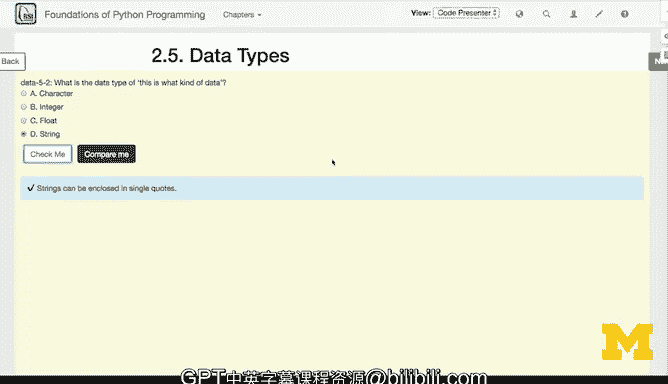

# 密歇根大学《Python3编程（课程1、2）》｜Python 3 Programming（Python for everyone进阶）（中英字幕） - P9：09_01_05_数据类型详解.zh_en - GPT中英字幕课程资源 - BV1CM411Z72u

If you're not sure what type a given value has， then Python has a nice function calledT。

 and what T does is it tells us what the type of a given value is。So for example。

 if we print out the value of type when called with the stringHello world as an argument。

 then Python is going to tell us that this is a string。It'll tell us that this is an int。

And then here， if we don't call the type function， we get the value itself。

But if we print out the type of 3。2， then we get that this is a float。So let's run our code。

And what you'll see is that when we print out the type of hello world。

Then Python has a way of telling us that this is a string。Print out the type of 17。

Python's telling us this is an integer。This is just us printing out the string hellello world itself。

 but if we print out the type of 3。2， then Python tells us that this is a floatat。

And this can be especially helpful in situations where you're not necessarily sure what type something has。

 so for example， here we have a value 17 and even though this is a number。

 because it's in quotation marks， the value of this expression is going to be a string。

 and so the type of this expression is going to print out class STR， same thing with this。

 so even though 3。2 is afloat because these are in quotation marks， this overall expression。

Is a string， so if I run my code， then I'll see that both of these are strings。

 Now there are a few other things to note when working with Python expressions first。

 as we'll learn when we cover strings in more detail。

 there are actually three different ways to create a string literal。One is using a single quotes。

 mark。Another is using double quotation marks。Another is using three double quotation marks or three single quotation marks。

Now the important thing to note is that even though all of these expressions create a string in a different way。

 if we ask what's the type of each of these， then Python is going to tell us that these are all strings。

 so even though we create strings in four different ways here。

All of these boil down to the same type in Python， which is a string。

So another thing to note when creating strings is that sometimes you want to include single or double quotation marks inside of a string。

 so for example， I might want to print out。The string， Bruce is。Beard。

Now here you'll note that I have an apostrophe in Bruces and when I try to run my code。

Then Python gives me a syntax error， and that's because to Python， it thinks that this is the string。

 because it thinks that this quotation mark starts the string and that the apostrophe is supposed to end it。

One way to get around this is by using double quotation marks if we know that we're going to have an apostrophe inside of our string。

So here this works。Conversely， if we had a string that we knew would contain double quotation marks。

Again， if I run this code， then I get a syntax error because Python thinks the string starts here and ends here。

 but one way around it is by。Using single quotation marks to create this string。

As we'll cover in more detail later on， we can also use triple quotation marks when we have a string that contains both single and double quotes。

So I might say something like， oh， no， she exclaimed。Ben's bike is broken。

We'll also learn that triple quotation marks allow us to create strings that span several lines。

But more on that later。Another thing to note when creating an integer is that in the US we often use comms every third digit in larger numbers。

 so for example we might indicate 42，000 in 500 using a comma like this but here if Python sees a comma inside of the integer it thinks that these are two separate values so it thinks that we're printing out 42 in then 500 as separate values。

 so when we're creating large numbers inython we shouldn't ever use commas to separate out every 3 digits。

 we need to write the integer like this and now we have the number 42，500 in one value。

And one more thing to note along those lines is that we can call print with any number of arguments and when we do。

 print decides to take every argument and print out its value separated by spaces instead of commas。

 so here we're printing out all of these values on one line。

And then all of these values on the next line。So let's do a few multiple choice。

How can you determine the type of a variable Well， one way to determine the type of the variable is by using the type function。

Next question is what is the data type of this is what kind of data so in other words。

 if we called type on this expression， then what would we get Well。

 Python would tell us that this is a string because it starts and ends with a single quotation mark。

That's all for now， until next time。