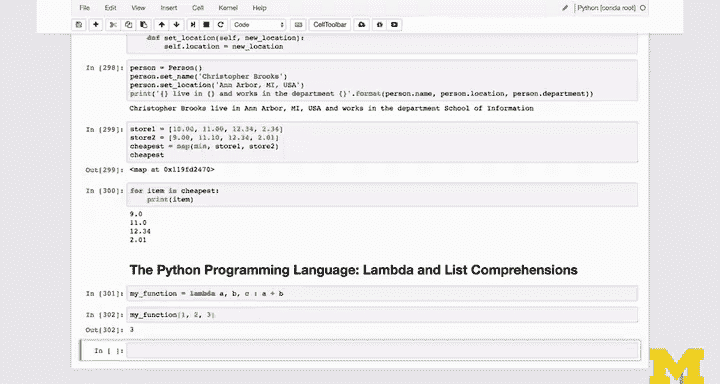
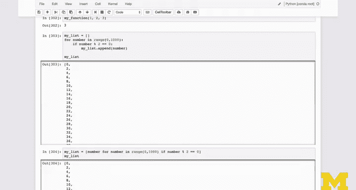

# 密歇根大学《Python用于数据科学实践（1-3课／共5课）｜Applied Data Science with Python 》deepseek翻译 - P10：9_Python Lambda表达式与列表推导式.zh_en - GPT中英字幕课程资源 - BV1U64y1L7VJ

You may have seen the keyword Lambda appear in this week's content。

 and you'll certainly see it appear more as you spend more and more time with Python and data science。

Lambdas are Python's way of creating anonymous functions。 These are the same as other functions。

 but they have no name。 The intent is that they're simple or short lived。

 and it's easier just to write out the function in one line instead of going to the trouble of creating a named function。

The Lambda syntax is fairly simple， but it might take a bit of time to get used to。

You declare a lambda function with the word lambda， followed by a list of arguments。

 followed by a colon， and then a single expression。 And this is key。

 Theres only one expression to be evaluated in a lambda。

 The expression value is returned on execution of the lambda。

The return of a lambda is a function reference， so in this case you would execute my function and pass in three different parameters。

Note that you can't have default values for Lambda parameters。

 and you can't have complex logic inside of the Lambda itself because you're limited to a single expression。

So Lambdas are really much more limited than full function definitions。

 but I think they are very useful for simple little data cleaning tasks。

 And you'll see lots of examples with them on the Web。

 So you should be able to read and write Lambdas。 Let's give it a try here。

We've learnt a lot about sequences in Python， tuupples， lists， dictionaries， and so forth。

Sequences are structures that we can iterate over， and often we create these through loops or by reading in data from a file。

Python has built in support for creating these collections using a more abbreviated syntax called L comprehensions。

Here's an example。 First， we write up a little for loop here， I'm iterating between 0 and 1000。

 and then checking with the modulus operator to see if the number divided by  two results in any decimals。

 If the modulus 2 of the number is 0， then I know it divides evenly。 So this must be an even number。

 and I'll add it to our list。We can rewrite this as a list comprehension by pulling the iteration on one line。

 We start the list comprehension with the value we want in the list。 In this case， it's a number。

 Then we put it in the for loop。 And then finally， we add any condition clauses。

You can see that this is much more compact of a format， and it tends to be faster as well。

Just like with Lambdas， list comprehensions are a condensed format。

 which may offer readability and performance benefits。

 and you'll often find them being used in data science tutorials or on stack overflow。

 but you're not required to use them in the assignments in this course。Here。

 why don't you try converting a function into a list comprehension？

