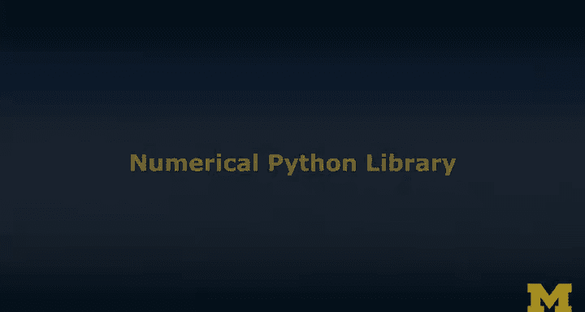
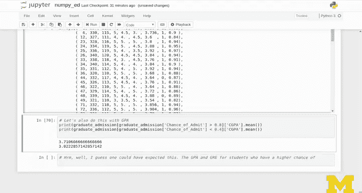

# 密歇根大学《Python用于数据科学实践（1-3课／共5课）｜Applied Data Science with Python 》deepseek翻译 - P11：10_数值计算库NumPy.zh_en - GPT中英字幕课程资源 - BV1U64y1L7VJ

Nempy is the fundamental package for numeric computing with Python。

 It provides powerful ways to create， store and manipulate data。

 which makes it able to seamlessly and speedily integrate with a wide variety of databases and data formats。

This is also the foundation that pandas is built on。

 which is a high performance data centric package that we're going to learn more about in this course。

In this lecture， we're going to talk about creating arrays with certain data types。

 manipulating arrays， selecting elements from arrays， and loading data sets into arrays。

 such functions are useful for manipulating data and understanding the functionalities of other common Python data packages。

So you'll recall that we import a library using the import keyword and NumpI's common abbreviation is NP。

 so let's import Numpy as NP and import math。Right。

As are displayed as a list or lists of lists and can be created through lists as well。

 when creating an array， we pass into it a list as an argument in a nuier array。

 So a equals MP dot array。 And I'm just going to create a list here 1，2，3。

 and we'll print out what a looks like。 and we can print out the number of dimensions of a list using this N dimm attribute。

 So print a dot n dimm。😊，If we pass in a list of lists into a N array。

 we create a multidimensional array， for instance a matrix。

 so here I'll say B equals MP dot array and I'm going to create a list and inside of it I'll pass two other lists。

 so1，2，3 is the first list and 45，6 is the second list and let's look at B。

So we can print out the length of each dimension by calling the shape attribute。

 which returns to tuple， so B dot shape。And we can also check the type of items in the array。

 so A dot D type。Now beside integers， floats are also accepted in Nier arrays。

 so C equals MP dot array and we could just put in some floating point numbers here， 2。2， maybe 5。

 maybe 1。1， and let's do C dot D type dot name。All right， so let's look at the data in our array。

 so see。Note that Numpy automatically converts integers like5 up to floats since there is no loss of precision。

 Numpy will try and give you the best data type format possible to keep your data types homogenous。

 which means that they're all the same in the array。

Sometimes we know the shape of an array that we want to create， but not what we want to be in it。

 Numpy offers several functions to create arrays with initial playsholders， such as zeros or ones。

 Let's create two arrays， both the same shape， but with different filler values。

 So I'm going to say D equals MP dot zeros。 And I'll give it a shape of2 comma 3， and we'll print D。

 And then E equals MP dot 1s。 and we'll give it the same shape 2 comma 3 and print E。

 And then we can see our arrays。😊，We can also generate an array with random numbers， so NP。

ran do Rand， and we give it a shape 2， comma 3。You'll see zeros， ones。

 and RA used quite often to create example arrays， especially in stack overflow posts and other discussion forums。

We can also create a sequence of numbers in an array with the arrange function。

 The first argument is the starting bound， and the second argument is the ending bound。

 and the third argument is the difference between each consecutive number。

So let's create an array of every even number from 10 inclusive to 50 exclusive。

 so F equals NP do range， we're going to start at 10。

 we're going to end at 50 remember this is exclusive and we're going to jump by twos and let's look at F。

If we want to generate a sequence of floats， we use something called L space。 In this function。

 the third argument isn't the difference between two numbers。

 but it's the total number of items that you want to generate。 So you want to watch out for that。

 So NP dot L space 02，15。 And what this really means is we want 15 numbers from 0 inclusive to 2 inclusive。

So we can do many things on arrays such as mathematical manipulation， addition， subtraction。

 square exponents， as well as Booolean arrays， which are binary values。

 And we can also do matrix manipulations such as product transpose， inverse and so forth。

 So let's see some of these。😊，Arithmetic operators on arrays apply elementwise。

 so let's create a couple of arrays I'll create A is NP dot array I'll just pass in a list 1020，30。

 40， and then B we'll do NP dot array 1，2，3， and 4。Now， let's look at a minus B。

 so C is equal to a minus B， and let's look at a times B， so D equals a times B。

So with arithmetic manipulation， we can convert current data to the way we want it to be。

 so here's a real world problem that I face。 I moved down to the United States about six years ago from Canada in Canada we use Celsius for temperatures and my wife still hasn't converted to the US system which uses Fahrenheit with Numbia I could easily convert a number of Fahrenheit values。

 say the weather forecast to Celsius for her。So let's create an array of typical Ann Arbor winter Fahrenheit values。

 so Fahrenheit equals NP dot array and sometimes it'll be 0 degrees Fahrenheit maybe10 minus5 minus 15 or 0。

 These are not atypical Ann Arbor winter values。And the formula for conversion is the temperature in Fahrenheit- 32 times 5 over 9。

 and this gives you the temperature in Celsius， so we'll just say Celsius equals Fahrenheit minus 31 times 5 over 9。

 and let's look at Celsius。Okay， great， so now she knows it's a little chilly outside this week。

 but it's not so bad。Another useful and important manipulation is the Boolean array。

 We can apply an operator on an array， and a boolean array will be returned for any element in the original。

 with true being emitted if it meets the condition。For instance。

 if we want to get a boolean array to check the Celsius degrees that are greater than -20 degrees。

 we would just say Celsius is greater than -20。There's our Boolean array， true， false， false。

 false and true。Here's another example， we could use the modulus operator to check numbers in array to see if they're even。

So Celsius mod 2 equals zero。Besides element wise manipulation。

 it's important to know that Numpy supports matrix manipulation。 Let's look at the matrix product。

 If we wanted to do element wise product， we use the asterisk sign。 So A equals MP dot array。

 well create an array here， and B equals MP dot array。 andll create it。

And let's print out the product of a times B。If we want to do the matrix product。

 we're going to use the at sign instead of the asterisk。

 so the asterisk is for element wise and this is really important actually the asterisk is for element wise and you can think of just the default as element wise comparisons or modifications but the at sign is going to use the dot product。

 so we'll print A at B。So you don't have to worry about complex matrix operations for this course。

 but it's important to know that NumpI is the underpinning of scientific computing libraries in Python。

 and that it's capable of doing both element wise operations。

 so theass as well as matrix level operations， so the at sign。

 and there's more on this in subsequent courses。So a few more linear algebra concepts are worth layering in here。

 You might recall that the product of two matrices is only plausible when the inner dimensions of the two matrices are the same。

 The dimensions refer to the number of elements， both horizontal and vertical in the rendered matrices that you've been seeing here。

 So we can use dumpy to quickly see the shape of the matrix。 So a dot shape， for instance。

 will give us this one was a two by two matrix。When manipulating arrays of different types。

 the type of the resulting array will correspond to the more general of the two types。

 and this is called upcasting。 And you saw an example of that before， but let's see another one。

 So let's create an array of integers， So array 1 equals MP dot array we'll do 123 and 456 and let's print out its data type to make sure that it's actually integers。

 now let's create an array of floats。 So array 2 equalsmp dot array 7。18。29。1。

 and then we'll give it a second list 10。411。2 and 12。3 and let's print out its data type。

So integers in are whole numbers only， and floating point numbers float can have a whole number portion and a decimal portion。

The 64 in this example refers to the number of bits that the operating system is reserving to represent the number。

 which determines the size or the precision of the numbers that can be represented。

So let's do addition for the two array， so array 3 is equal to array 1 plus array 2。

 and we'll print array 3 and then we'll print array 3 D type。

So notice how the items in the resulting arrays have been upcast into floating point numbers。Now。

 nupi arrays also have an interesting aggregation functions on them， such as some max， min and mean。

 so we can print out array 3， sum， array array3， max， array 3 min， and let's try array array3 mean。

For two dimensional arrays， we could do the same thing for each row or column。

 So let's create an array with 15 elements ranging from 1 to 15 with a dimension of 3 by 5。

 So B equals MP dot range 1， 16 and1。 And we're going to reshape this immediately to 3 by 5 unless print B。

Now， we often think about two dimensional arrays being made up of rows and columns。

 but you can also think of these arrays as just giant ordered lists of numbers and the shape of the array。

 the number of rows and columns is just an abstraction that we have for a particular purpose。

Actually， this is exactly how basic images are stored in computer environments。

So let's take a look at an example and see how Numpy comes into play in something like images。

For this demonstration， I'm going to use the Python Iaging library pill and a function to display images in the Jupiter notebook。

 so from P importm image and from i Python dot display importm display。

And let's just look at the image that I'm going to talk about。

 so I'm just going to open this image called Christot TF and display this image。Now。

 we can convert this pill image to a Ny array， so array equals MP dot array。

 and we just pass in the pill image。And we're going to print a dot shape。

 And then let's look at array array。So we see the shape is 200 by 200。

And then we see the values are all Us 8。 The U means that they're unside integers。

 So there's no negative numbers， and the8 means 8 bit per by。

 This means that each value can be up to 2 by 2 by， Well 2 to the 8，256 in size。

 But it's actually only 255， because we started 0， right？ That's computer science。

For black and white images， black is started zero and white has started as 255。

 so if we just wanted to invert this image， we could just use the nuy array to do so。Okay。

 so let's create an array the same shape。 So I'm going to create a mask。

 I'll call it an N dot full and array dot shape。 So I want it the same as our existing array。

 but I want it to be full of 255 valued Us。 Let's take a look at mask。 Okay。

 so this is like zeros or ones。 but full basically， let's set the value that you want everywhere。Now。

 let's subtract that from the modified array。 So we'll create a modified array。

 We'll take our main array， and we'll subtract the mask from it。 Remember。

 this is going to do element wise subtraction。 So all of the values in array。

 Let's say first values 100 minus mask 255 means it will be left with negative 155 in that cell。

 and we're going to do that for all cells in the array。

And let's just convert all of the negative values to positive values。

 so modified array is equal to modified array times negative 1。

 so it's going to take that negative1 and do again， element wise multiplication。

 so negative one times the first cell， negative1 times the second cell and so forth。

And as a last step， let's tell NumpI to set the value of the data type correctly。

 so we're going to say modified array is equal to modified array dot as type。

 so this is going to tell Numpy you should really trust us we know what the data type is in here and we're going to say NP do un8。

And let's look at mod array。All right， so that looks maybe as we expect。Lastly。

 let's display this new array so we can do this using the from array function in the Python imaging library to convert the Numpy array into an object that Jupiter can render。

 so display image dot from array， modified array。Cool， okay。

 remember how I started talking about how this could just be thought of as a giant array of bites and that shape was an abstraction。

 Well， we could just decide to reshape the array and still try and render。

Pilla is interpreting the individual roses lines so we can change the number of lines and columns if we want to。

 So what do you think that would look like。Well let's take a look。

 So we'll create something new reshaped equals NP dot reshape。

 and we're going to take our modified array。 So this is just our array from above before we've done the inversion and we're going to reshape it to 100 by 400。

 Now remember it was 200 by 200。 So we're changing both the width and the height here。

 but we're keeping the total number of cells the same。

 and let's print out just to convince ourselves that we've actually changed it the reshaped shape。

 and then let's display it in line。All， so I can't say I find that particularly flattering by reshaping the array to be only 100 rows high。

 but 400 columns， we've essentially doubled the image by taking every other line and stacking them out in width。

 and this makes the image look more stretched out to and maybe adds a little bit of weight to me。

So this isn't an image manipulation course， but the point was to show you that these numpy arrays are really just abstractions on top of data。

 and that data has an underlying format in this case， U and8。But further。

 we can build abstractions on top of that， such as computer code， which renders a byte。

 is either black or white， which has meaning to people。 And in some ways。

 this whole degree is about data and the abstractions that we can build on top of that data from individual byte representations through to complex neural networks of functions or interactive visualizations。

Your role as a data scientist is to understand what the data means， its context in a collection。

 and to transform it into a different representation to be used for sense making。Okay。

 let's get back to the mechanics of Ny。So indexing。

 slicing and iterating are extremely important for data manipulation and analysis because these techniques allow us to select data based on conditions and copy or update the data。

So first， we're going to look at integer indexing。 A one dimensional array works in similar ways to a list to get an element in a one dimensional array。

 we just use an offset index。 So we'll create some array， bunch of elements。

 and then we'll say a sub 2。 and we get the value 5 out for multidimensional arrays。

 We need to use integer array indexing。 So let's create a new multidimensionalal array。

 So we'll create this one2 by3。 and let's look at a。If we want to select one certain element。

 we can do so by entering the index， which is comprised of two integers。

 the first being the row and the second being the column， so a sub 1， comma 1。

 remember in Python we're starting at0。All right， so they're the value of four。

If we want to get multiple elements， for example， one， four。

 and6 and put them into a one dimensional array， we can enter the indices directly into the array function so we can create some new array and P dot array and in that we're going to pass it a list and from that list we're actually taking our other array and plucking out the values that we're interested in。

We can also do that using another form of array indexing。

 which essentially zips the first list and the second list up。

So we can take A and we can actually pass it to lists and it will zip these values up for us and so we get the one。

4 and six。Booolean indexing allows us to select arbitrary elements based on conditions。 For example。

 in the matrix we just talked about， we want to find elements that are greater than 5。

 So we set up a condition a greater than 5。 So let's just print。 what is a greater than 5。😊。

This returns a Boolean array showing the values in the corresponding index that are greater than5。

 And so here we get a bunch of falses and a bunch of trues。

So we can then place this array of Boolean values like a mask over the original array to return a one dimensional array relating to the true value。

So if we do a sub a greater than5， what's happening here is we'll take the greater than five operator we'll broadcast that。

 so we'll compare that across all of the elements of a creating a new matrix。

 and then we'll apply that as a mask over the outer A and emit the results。So as we can see。

 this functionality is essential in the pandas toolkit， which is the bulk of this course。

 so we'll be using this a lot。So slicing is a way to create a sub array based on the original array for one dimensional array。

 Slicing works in similar ways to a list to slice， we use the colon。For instance。

 if we want to put colon 3 in the indexing brackets， we get the elements from index 0 to index 3。

 so remember excluding index3， so we'll create some array just numbers0 through5。

 so that's six numbers and then we'll print a subco 3。And so we just get the first few elements。

 the first three。By putting two colon 4 in the brackets。

 though we could get elements from index 2 to index 4。 So again， excluding index 4。

 So print a sub2 colon 4 instead of just giving us the length now that will actually give us just those indexes。

For multidimensional arrays it works similarly， let's see an example。

 so a equals MP dot array and we're going to create a new list and in here we're going to put three lists in so let's take a look at this and we see that we've got three rows and four columns。

So first， if we put one argument in the array， for example， a sub colon 2。

 then we get all of the elements from the first， the zeroth and the second row， the1。

If we add another argument to the array， for example， a colon2 comma， so second argument。

 one colon 3， we're going to get the first two rows。

 but then the second and third column values only so let's give that a try a so we want all of the first two rows and then we want one colon3。

So in multidimensional arrays， the first argument is for selecting rows and the second argument is for selecting columns。

It's important to realize that a slice of an array is a view into the same data。

 This is really important。 This is called passing by reference。

 So modifying the subar will consequently modify the original array as well。

Here I'll change the element position 0，0， which is 2 to 50。

 Then we can see that the value in the original arrays change to 50 as well。

 So I'm going to create a subar， and I'm going to just use what we used before。 So a subcolon 2。

 So grab a couple of rows and then one colon 3。 So grab a couple of columns。

 and I'll print out the value of the subar sub0，0。 And then I'm going to set that to 50。

 I'm going to change it to 50。 and then we'll print out what the subar thinks it is。

 So that should be 50。 but then we're actually going to print our original array。

 So that's a as well。And remember， a here is zero comma1 because we've changed which rows sorry。

 which columns that we've taken out for our subet。 So when we took our sub and we did one column3 we got rid of the zeroth column in a。

 so zero column in sub is the first or the one column in a。Okay。

 now that we've learned the essentials of Dumpy， let's use it on a couple of data sets。

So here we have a very popular data set on wine quality and we're going to only look at red wines。

 the data fields include fixed acidity， volatile acids， residual sugars， chlorides， and so forth。

The important one here is the alcohol content and the quality。That's how I buy wine anyway。

To load a data set into NI， we can use the Gen from text function， we can specify data file name。

 the delimiter， which is optional， but we often use it and the number of rows to skip if we have a header row it's one here。

So the Genro text function has a parameter called D type for specifying data types for each column。

 and this parameter is optional without specifying the type。

 all types will be cast to a more general or precise type so there will be some inference done。

So wines equals NP。 gen from TXT we'll take in our CSV file。

 we'll set our delimiter to semicolon and we're going to skip our header right now and let's take a look at wines Allright。

 so a whole bunch of data here about wines。So recall that we can use integer indexing to get a certain column or row。

 for example， if we wanted to select the fixed acidity column， which is the first column。

 we could do so by entering the index into the array。Also remember that for multidimensional arrays。

 the first argument refers to the row and the second argument refers to the column。

 and if we just give one argument， then we'll get a single dimensional list back。Okay。

 so all rows are combined， but only the first column from them。

 that would be print integer 0 for slicing， so wines， sub colon， that means we want all rows， right。

 we haven't given any numbers to that parameter， comma 0， we just want to get the first columns。

But if we wanted to get the same values， but we wanted to preserve that they sit in their own rows。

 we can actually write wines， colon， and then the second is0 colon 1 So take a look at these two statements for a moment before we run them In the first one。

 we say we want one column， the zeroth column In the second statement。

 we say we want all the columns between index0 and1。

 which happens to only be the zeroth column because we never include the end。

But the result that Numpy gives us after we execute that actually looks different。

 All the numbers are the same。 The first one， though， gives us a single list of numbers。

 and the second one preserves the general shape that this is a single column。

So this is another great example of how the shape of data is actually just an abstraction。

 which we can layer intentionally on top of the data that we're working with。😊。

If we want a range of columns in order， say columns 0 through3 and recall this means first。

 second and third since we started0， and we don't include the training index value。

 we could do that too， so wines， subcolon comma 0， comma 3。

And what if we want several non consecutive columns， Well。

 we could place the indices of the columns that we want into an array and pass that array is the second argument。

 So here's an example。 We can take wines。 We want all rows， So colon。

 And then our second argument is actually a list of the indexes that we're interested in。

So we can also do some basic sumization of this data。For example。

 if we wanted to find out the average quality of red wine。

 we can select the quality column we could do this in a couple of ways。

 but the most appropriate is to use the minus1 value for the index as negative numbers means slicing from the back of a list。

And then we just call the aggregation functions on this data。

 so we could say wines the first parameter is colon the second one is minus one because we just want the last column and then we'll take the mean and just pause this for a minute and think do you understand what the minus one is so if not you'll want to revisit some of the basics on Python slicing and string slicing。

All right， so 5。6。Let's take a look at another data set this time on graduate school admissions。

 so it is fields such as GRE score， TOFL score， university rating and so forth。

 and it has a chance of admission at the end。With this data set。

 we can do data manipulation and basic analysis to infer what conditions are associated with higher chances of admission。

 so let's take a look。So we can specify data field names using Gen from text as it loads the CSV data and also we can have Dey try and infer this type of the column by setting the D type parameter to none as we've seen So graduate admission equalsmp do gen from text。

 We're going to load the data from datas s admission Pred do cv we'll set the D type to none。

 we're going to set the delimiter here to a comma， we're going to skip our header and instead we're just going to pass it the actual names of the column So I'm going to write them here。

 serial number， Gre score， TOEFL score ranking SOP a letters of recommendation Gpas research and the chance of admissions and let's take a look at what that graduate admission looks like。

So notice that the resulting array is actually a one dimensional array with 400 tuples in it。

 So let's look at the shape。 it's actually got 400 tuples and it's just one dimension。

So we can retrieve a column from the array using the columns name， for example。

 let's get the C GPPA column and only the first five values。

 So we'll take graduate admission sub C GPPA。 So this tells us we only want to get that one column。

 and then we want to get the first five values， so zero colon5。

So since the GPA in the data range from 1 to 10， and in the US it's more common to use a scale of 4。

 a common task might be to convert the GPA by dividing by 10 and then multiplying by4。

 so graduate admission C GPPAA is equal to the graduate admission subCGPA divided by 10 times 4。

 and let's look at the output of like 20 values there。

And it's important to keep in mind that we've actually changed now this data right。

 so we actually assigned graduate admission subCGPA that changes it on the underlying array。

 so we've normalized this to a four point scale。Remember boolean masking。 Well。

 we can use this to find out how many students have had research experience by creating a Boolean mask and passing it to the array indexing operator。

 So we'll take the graduate admission sub research will compare that to one。 if it's one。

 a true will be admitted。 otherwise a false will be admitted。

 that creates us a mask which we then pass into graduate admission using the indexing operator。

 So that will now just emit certain values that are true， and it will not admit all the false values。

 and then we're just going to calculate the length。

 and so we just the L of that array or the L of that it's just the same as if it were a list。

So since we've got the data field chance of admission， which ranges from zero to1。

 we can try and see if students with high chance of admission， let's say 80%。

 on average have higher GRE scores than those with lower chance of admission， let's say 40%。So first。

 we're going to use Boolean masking to pull out only those students that we're interested in based on their chance of admission。

 and then we pull out only their GPA scores and then we're going to print the mean values。

So let's print the value， so we'll take graduate admission sub chanceance of admit compared to 0。8。

 we're going to broadcast this out， take the GRE score and look at the mean。

 and we're going to do the same thing for the 0。4。So take a moment here to reflect。

 do you understand what's happening in the calls above？When we do the Boolean masking。

 we are left with an array with tus in it still， and nuumpy holds underneath this a list of the columns we specified and their name and indexes。

And so we could do graduate admission， sub graduateduate admission subchs of admit greater than 0。

8 in this case we're taking that we're creating the Boolean mask and then we're applying it to the graduate admission data and we see that the output is actually still in tus because there's many different columns being kept here。

And this， I think is a little bit more clear in pandas， which we'll talk about later in this course。

So let's also do this with GPA， so I'm just going to copy and paste the above。

 but I'm going to change the values to GPA。嗯。Well， I guess one could have expected this。

 the GPA and the GRE for students who have a higher chance of being admitted。

 at least based on our cursory low here， seem to be higher。

So that's a bit of a whirlwind tour of Numpy， the core scientific computing library in Python Now you're going to see a lot more of this kind of discussion using this library and we'll be focusing on this in this course on pandas。

 which is actually built on top of NumpI。Don't worry if this didn't all make sense the first time through。

 We're going to dig in a lot more over the next couple of weeks with pandas， but it's useful。

 And the point of this lecture is so that， you know that underneath nuy is used as a library and the capabilities of Numpy are available to you within pandas as we go forward。

