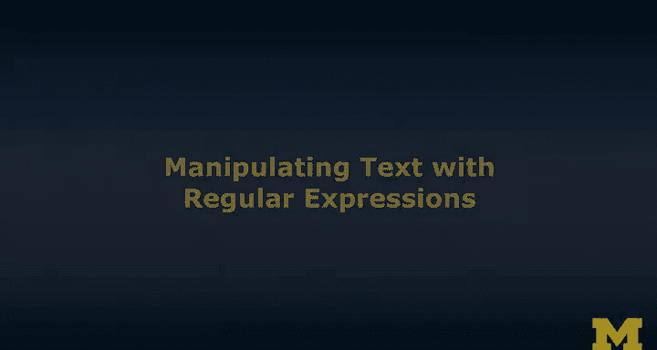
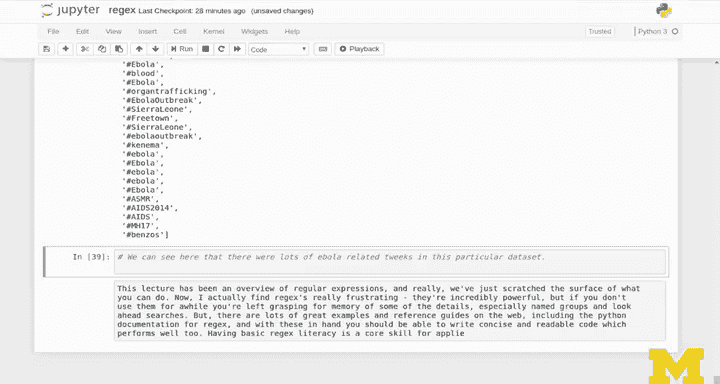
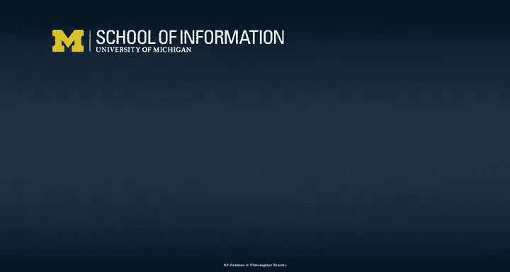

# 密歇根大学《Python用于数据科学实践（1-3课／共5课）｜Applied Data Science with Python 》deepseek翻译 - P12：11_正则表达式文本处理.zh_en - GPT中英字幕课程资源 - BV1U64y1L7VJ

In this lecture， we're going to talk about pattern matching and strengths using regular expressions。

Regular expressions or redx's are written in a condensed formatting language In general。

 you can think of regular expression as a pattern which you give to a RegX processor with some source data。

 the processor then pares that source data using the pattern and returns chunks of text back to the data scientist or a programmer for further manipulation。

There's really three main reasons you should want to do this to check whether a pattern exists within some source data to get all instances of a complex pattern from some source data。

 or to clean your source data using a pattern generally through string splitting。

RDexs are not trivial， but their foundational technique for data cleaning in data science applications and a solid understanding of REXs will help you quickly and efficiently manipulate text data for further data science application。

Now， you could teach a whole course on regular expressions alone。

 especially if you wanted to demystify how the REx parsing engine works and efficient mechanisms for parsing text。

In this lecture， I want to give you a basic understanding of how REX works enough knowledge that with a little directed sleuthing you'll be able to make sense of the REX patterns you see others using and you can build up your own practical knowledge of how to use REXs to improve your data cleaning。

By the end of this lecture， you'll be able to understand the basics of regular expressions。

 how to define patterns for matching， how to apply these patterns to strings。

 and how to use those strings for those patterns in data processing。Finally。

 a note that in order to best learn red Xs you need to write red Xs。

 I encourage you to stop the video at any time and try out new patterns or syntaxes you learn。

So first we'll import the re moduleule， which is where the Python stores regular expressions library。

 so import REE。There are several mean processing functions in Re that you might use。

 the first match checks for a string match that is at the beginning of the string and returns a Boolean。

 similarly search checks for a match anywhere in the string and returns a Boolean。

Let's create some text for an example， so text， this is a good day。

Now let's see if it's a good day or not， so we can do Fre。t search， look for good text。

 and the first parameter here is the pattern， and then we'll print wonderful if goods there。

 else we'll print alas in a frownny face。So in addition to checking for conditionals。

 we can segment a string， the work that ReEX does here is called tokenizing。

 where the string is separated into substrs based on patterns。

Tokenizing is a core activity in natural language processing， which we won't talk much about here。

 but you'll study in the future。The find all in split functions will parse the string for us and return chunks let's try an example。

 so text Amy works diligently， Amy gets good grades， our student Amy is successful。

 and this sounds like a very positive thing。So this is a bit of a fabricated example but let's split on this all instances of Amy。

 so RE E dot split， Amy is the pattern we want to match and text is our text。

You'll notice that split has returned an empty string followed by a number of statements about Amy。

 all his elements of a list， if we wanted to count how many times we have talked about Amy。

 we could use find all， so R dot find all， Amy and textex。Okay。

 so we've seen that search looks for some pattern and returns a Boolean。

 that split will use a pattern for creating a list of substrs and that find all will look for a pattern and pull out all occurrences。

Now we know how the Python ReggX API works， let's talk a little bit more about complex patterns。

 the ReggX specification standard defines a markup language to describe patterns in text。

Let's start with anchors。Anchors specify the start and or end of the string that you're trying to match。

The carrot character means start and the dollar sign character means and。

And if you put carrot before a string， it means that the text that the Regx processor retrieves must start with the string you specify。

For ending， you have to put the dollar sign character after the string。

 it means that the text rejectx or retrieves must end with the string you specify。Here's an example。

 so text Amy works diligently， Amy gets good grades， and our student Amy is successful。

Let's see if this begins with Amy， so we can do RE search and then inside quotes is our pattern and we'll put cart Amy so we want to match Amy at the beginning and then text。

Notice that ADt's search actually returned to us a new object called an RE matchch object。

 an RE matchch object always has a Boolean value of true as something was found。

 so you can always evaluate it in an if statement like we did earlier。

The rendering of the match object also tells you what pattern was matched， in this case。

 the word Amy and the location the match was in as in the span。

Let's talk more about patterns and start with character classes。

 let's create a string of single learners grades over a semester in one course across all of their assignments。

 so grades equals and I'll just put a string of A's， B's and C's， no D's for this student。

If we want to answer the question how many B's were in the grade list。

 we could just use B as our pattern， so RE do find all B and grades， we see that there's three here。

If we wanted to count the number of A's or B's in the list。

 we can't use A and B since this is used to match all A's followed immediately by a B。

 instead we put the characters A and B inside square brackets， so we do RE dot find all。

 and then we do square brackets， A B， and then passing grades。

And here we can see the whole list of A's and B's that are found。This is called the set operator。

 you can also include a range of characters which are ordered alpha numericalmerly。For instance。

 if we want to refer to all lowercase characters， we could use a dash Z in the square brackets。

 let's build a simple redx to parse out all instances where the student receive an A followed by a B or a C。

So already do find all， and then we'll use the set operator with A and the set operator with B dash C。

 and passing the grades。Notice how the AB pattern describes a set of possible characters which could be either A or B。

 while the A and then followed by the B dash C pattern denotes two sets of characters。

 which must have been matched back to back。You can write this pattern by using the pipe operator。

 which means or。So we could do RE dot find all， A B or AC in quotes directly as our pattern with grades。

We can use the cart with the set operator to negate our results， for instance。

 if we wanted to parse out only the grades which were not A's， we would do re dot find all。

 and then we would use the set operator， this is important cart A and grades。

And here we only have Bs and C's。So note this carefully。

 the Corette was previously matched to the beginning of a string as an anchor point。

 but inside of the set operator， the Corette and its other special characters we'll be talking about。

 they lose their meaning and this can be a bit confusing what do you think the result of this operation would be。

 so we'll do RA do find all cart set operator then another cart a and grades， just take a minute。

 look at that and reflect on what we just talked about and what do you think it would be？

So it's an empty list because the Redex is saying we want to match any value at the beginning of the string。

 which is not an A， and our string starts with an A， so there's no match found。

And remember when you're using the set operator， you're doing character based matching。

 so you're matching individual characters in an orR method。Okay。

 so we talked about anchors and matching to the beginning and end of patterns。

 and we've talked about characters using sets with the set notation。

 and we've talked about character negation and how the pipe of character allows us to use or in our operations。

 let's move on to quantifiers。Quantifiers are the number of times you want a pattern to be matched in order to actually count as a match the most basic quantifier is the expression of E curly bracece M and curly bracece。

 where E is the expression or character matching， M is the minimum number of times you want it to be matched。

 and n is the maximum number of times the item could be matched。Let's use these grades as an example。

 how many times has this student been on a back to back a streak so we do this with R do find all where the character we're interested in is a so that takes the place of E curly brace。

 we want to have at least two of them so that's our M value of two and we'll just have some big value we use 10 here and we'll pass this in as our grades so we're using two as our min but 10 as our max。

So we see that there were two streaks， one where the student had four A's and one where they only had two A's。

We might try and do this using single values and just repeating the pattern， so we might try re。

 find all， and then we've got capital A， and we want minimum max match of one for those。

 capital A minimum max match of one for those or grades。As you can see。

 this is different than the first example。 The first pattern is looking for a combination of two A's up to 10 A's in a row。

 So it sees four A's as a single streak。 The second pattern is looking for two A's back to back。

 So it sees two A's followed immediately by two more A's。

 We say that the redx processor begins at the start of the string， and it consumes variables。

 which match patterns as it does。It's important to note that the ReggX quantifier syntax does not allow you to deviate from the MN pattern。

In particular， if you've got an extra space in between the braces， you'll get an empty result。

 so already find all a brace2， comma space2。We see that that's an empty result。

And as we've already seen， if we don't include a quantifier when the default is 11。

 so already find all， we can just use AA if we just want to match one。Oh。

 if you have one number in the braces， it's considered to be both the M and the n value。

 so RE dot find all a brace2，2 is the min and the max。

So using this we could find a decreasing trend in a student's grades for instance。

 so already do find all and we'll look for A's， any number of A's。

 we'll use 10 as a max here as well， B's， any number， C's， any number。

 and then we'll pass in grades as our string。Now that's a bit of a hack because we included a maximum that was just arbitrarily large。

 and there are three other quantifiers that are used to shorthand that we could think about using here。

 and asterisk is used to match zero or more times， a question mark to match one or more times。

 or a plus sign to match one or more times。Let's look at a more complex example and load some data scrape from Wikipedia。

So with we'll open a data set called FRPpa。txt， this is the FERPA article on Wikipedia as a file。

And we'll read this into a variable called Wiki。And let's just print this out to the screen。

So scanning through this document， one of the things we notice is that the headers all have the word edit in braces behind them or rather square brackets behind them。

 followed by a new line character， so if we wanted to get a list of all the headers in this article。

 we could do so using re dot find all so re do find all and then we could say here well we're interested in all characters that are lowercase A through Z or capital case A through Z。

 we're interested in somewhere between one and100 of those characters。

 as long as they're followed by edit and we have to escape the square braces here， unfortunately。

 which makes it a little bit messier， but we don't want to move into the set notation。Okay。

 so that didn't quite work， it got all of the headers but only the last word of the header。

 and it really was quite clunky， so let's iteratively improve on this。

 First we can use slashW to match any letter including digits and numbers。

So if we do re do find all and then we want character and we want to match slash W。

 so we're not going to worry about the A3s adss and the lowercase capital case。

 we just want any word character and somewhere between one and 100 of those followed by edit。

So this is something new， slashW is a metacharact and it indicates a special pattern of any letter or digit。

There are actually a number of different metacharacters listed in the documentation， for instance。

 slash S matches any white space character。Next， there are three other quantifiers that we can use。

 which shorten up the curly brace syntax。 We can use the asterisks to match 0 or more times。

 So let's try that。 So R E dot find all。 We want to match any word character any number of times。

 So we'll just use an asterisk。 So this removes our top hundred0 limit， followed by edit。

Now that we've shortened the redx， let's improve it a little bit。

 we can add in spaces using the space character， so we can do RA do find all and in our set notation we want to match either word characters or space characters any number of times followed by edit。

Okay， so this gets us a list of section titles in the Wikipedia page。

You can now create a list of titles by iterating through this and applying another redjaX。

So it's quite common to do， for instance， for title in re dot find all we put in our redxx which is matching all of the titles and now we're going to take the intermediate result and split on the square bracket and just take the first result so we'll just print re dot split and then we'll search and the character we're looking for as a square bracket so we have to escape it so it looks a little nasty and then we just want to take the first value of this list which will be the actual title。

Okay， this works， but it's a bit of a pain to this point we've been talking about Regx as a single pattern which is matched。

 but you can actually match different patterns called groups at the same time and then refer to these groups later as you want to。

To group patterns together use parentheses， which is actually pretty natural。

 so let's rewrite our find all using groups， so RE dot find all and then we start our pattern string and we want the first group so first parentheses will be the first part of our pattern so that would be any word character or space any number of times and the second group will actually just be this edit tag that denotes to us that it's a header。

Nice， we see that the Python RE module breaks out the result group by group。

 and we can actually refer to groups by the number as well with the match objects that are returned。

But how do we get back a list of match objects thus far we've seen that find all return strings and search and match return individual match objects。

 but what do we do if we want a list of match objects？In this case， we use the function find iter。

So for item in re。 find iter， and then we pass it in this pattern that we're interested in。

 and then we can print item。t groups， and so this is the groups for a specific match item and we're iterating over all of them。

So we see here that the group's method returns a tuple of the group we can get an individual group using group sub numberumber where group sub0 is the whole match and the other number is the portion of the match we were interested in。

In this case， we want group sub one， so we don't want the whole match。

 we want the first item in the match。So for item in RE dot find it。

 so we'll pass in our whitespace or word character any number of times is the first group and edit is the second group。

 and we'll just print out item Dog group and parameter one。

One more piece to rejectexx groups that I rarely use but is a good idea is labeling or naming groups。

In the previous example I showed you how you can use the position of the group。

 but giving them a label and looking at the results as a dictionary is actually pretty useful and for that we use this syntax where we have parentheses then a question mark a capital P and then the name inside of these angle brackets。

 where the parenthesesis starts the group， the question mark capital P indicates that this is an extension to basic redjaes and the name in the angle brackets is the dictionary key that we use and it's wrapped in those angle brackets。

So for item in R。 find data， we could use as our pattern， our first group， so parentheses。

 we want to name it so question mark P and I'll name this title so you see that we keep these angle brackets and then we actually put our pattern so we want the set operator which indicates character matching and we want to do any word so slash W any word character as well as spaces we'll put the space in there any number of times so we've got an asterisk for that then the second group we want to name this as well question mark P and we will call this edit link for lack of a better word and then our pattern here which we have to escape the square brackets。

So we can get the dictionary return for the item using the dot group D， so print item dot group di。

 this is a dictionary so we can just do subtitle， which is our key。Of course。

 we could print out the whole dictionary for the item two and see that the edit string is still in there。

 so here's the dictionary kept for the very last match so print item group dit。

 and there's our actual full dictionary。Okay， so we've seen how we can match individual character patterns with the set operator。

 how we can group matches together using parentheses。

 and how we can use quantifiers such as asterisks question mark or Embrace N to describe patterns。

Something I glossed over in the previous example was sW， which stands for any word character。

 and so there are a number of shorthands that can be used with redx's for different kinds of characters。

 including a period for any single character which is not a new line， a/ D for any digit。

 and/ S for any whitespace character like spaces and tabs。

 and there are more in a full list can be found in the Python documentation for redxs。

One more concept to be familiar with is called Look ahead and Look Bi matchingching。In this case。

 the pattern being matched to the Redx engine is for the text either before or after the text that we're actually trying to isolate。

For example， in our headers we want to isolate the text， which comes before the edit rendering。

But we actually don't care about the edit text itself， thus far we've been throwing the edit away。

 but if we want to use them to match， but don't want to capture them。

 we could put them in a group and use Look ahead instead with the question mark equal syntax。

So let's see an example of this for item in R。 find it， we're going to match two groups。

 the first group is going to be a named group called title， and we're just copying that from before。

 but the second group is actually one of these throwaway groups that is look ahead。

So we're just looking for edit， but we're actually not matching on it。

So what this redx says is to match two groups， the first will be named and called title and we'll have any amount of white space or regular word characters。

 and the second will be the characterss edit， but we don't actually want this item put in our output match objects。

 and so we can print that item。And we see that we have three match objects， their spans。

 and the actual values that they matched。Let's look at some more Wikipedia data。

 here's some data on universities in the US which are Buddhist based， so with open from datas。

 Buddhist。taxt as fileile， and we'll read this into a variable called wki and for good measure let's print this variable output to the screen。

We can see that each university follows a fairly similar pattern with a name followed by an MDash。

 then the words located in， followed by the city and the state。

I'm actually going to use this example to show you the verbose mode of Python red axis。

The verbose mode allows you to write multiline redxes and increases readability。For this mode。

 we have to explicitly indicate all white space characters。

 either by preventing them with a slash or by using the slash as special value。However。

 this means that we can write our redexX a bit more like code and we can even include comments with the pound sign。

So pattern equals and we'll use this triple quoted string which means we can go on multiple lines so the first group we want to match is the title and so here I'm going to say I want it to be a named group called title and I want any number of characters and I'll just use a dot star and we'll add a comment the university title。

The next group is going to be a space or sorry the MDash followed by a space。

 so I'm escaping that in this case， located space in space。

 so this is just some indicator of the location and I don't care about this so I'm not naming this group。

The next one we'll make is the named group City， and this is any number of word characters。

 and so this is the city that the university is in。

Then we have some separator comma space that we see is a common pattern and I don't care about these。

 so I won't name this group， and then we'll name another group， the state， and it's just like city。

 any number of word characters， so the state the city is in。

 and then we'll end the triple coded string。So now when we call find it。

 we just pass the re dot verboose flag as the last parameter。

 and this makes it much easier to understand large redxes。

 so we just use this like previous and we say for item in re dot find It， we pass in the pattern。

 we pass in our source text but because it's this multiline verboose mode， we say RE。

 verboose to let the processor know。And we can get the dictionary returned to us for the item with the dot group dit value。

 so we print item dot group di。And so there we see our output is a set of universities。

 their cities and their states， and all of the groups that we didn't name are just they're matched。

 so they're consumed by the processor， but they're thrown away。

Here's another example from the The New York Times， which covers health tweets on news items。

This data came out of the UC Irvine Mach Learning repository。

 which is a great source of different kinds of data。So with open datas， New York Timeshealth。

txT is file and we'll read everything into a variable and take a look at it， so health equals file。

read and we'll look at health。That's a lot of tweet data。

So here we can see there are tweets and the fields are separated by pipes let's try and get a list of all of the hashtags that are included in this data now in Twitter a hashtag begins with a pound signed or the hash mark and continues until some white space is found。

So let's create a pattern， we want to include the hash sign first and any number of alphanumeric characters and we end when we see some white space。

 so our pattern is equal to the hash mark followed by word characters or digits and and asterisks。

 any number of those and then we'll use a look ahead just looking for any white space。

 so we'll use slash S in this case， we could have used space if we weren't worried about tabs and so forth。

Notice that the ending is a look ahead because we're not actually interested in matching this white space and returning the value。

 and also notice that I used an asterisk instead of the plus for matching of alphabetical characters or digits because a plus would require at least one of each。

So let's search and display all of the hashtags， so RE dot find all， pattern and health。

So we can see that here there are lots of Ebola related tweets in this particular data set。

This lecture has been an overview of regular expressions and really we've just scratched the surface of what you can do Now I actually find Redx is really frustrating。

 they're incredibly powerful， but if you don't use them for a while。

 you're left grasping for memory of some of the details。

 especially named groups and look ahead searches。But there are lots of great examples and reference guides on the web。

 including the Python documentation for RedjaX， and with these in hand。

 you should be able to write concise and readable code which performs well too。

Having basic RegX literacy is a core skill for applied data scientists。

