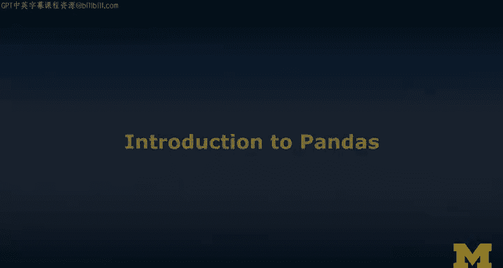
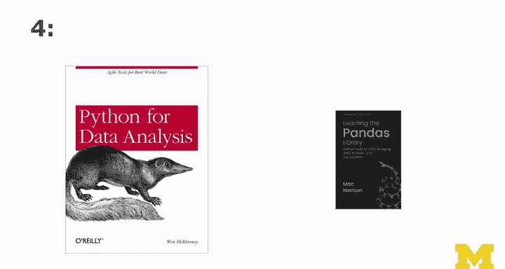

# 密歇根大学《Python用于数据科学实践（1-3课／共5课）｜Applied Data Science with Python 》deepseek翻译 - P13：12_Pandas库入门.zh_en - GPT中英字幕课程资源 - BV1U64y1L7VJ

This week， we're going to deepen our investigation into how Python can be used to manipulate。

 clean and query data by looking at the panndas data toolkit。

Pands was created by West McKinney in 2008， it is an open source project under a permissive license。

As an open source project， it has a strong community with more than 100 software developers committing code to help make it better。

Now， you should use the tools within the course to engage with the instructor。

 the course assistants and your peers in order to get help with pandas。

 but I also want to encourage you to go beyond this and frankly。

 you'll probably have to and use question and answering sites such as stack overflow。

Stack Overflow is used broadly within the software development community to post questions about programming。

 programming languages， and programming toolkits。What's special about stock overflow is that it's heavily curated by the community。

 and the pandas community in particular， uses it as their number one resource for helping new members。

It's quite possible if you post a question to stack overflow and tag it is being pandas and Python related。

 that a pandas developer will respond to your question。In addition to posting questions。

 stock Overflow is a great place to see what issues people are having and how they can be solved。

A second resource you might want to consider are books In 2012。

 Wests McKinney wrote the definitive Panda's reference book called Python for Data Analysis and published by O'Reilly。

 and this was updated in 2017 to the second edition。

I consider this the GoTo textexbook for the class and an important resource in understanding how Padas works。

But I also appreciate the more brief book Learning the Padas Library by Matt Harrison。

It's not a comprehensive book on data analysis and statistics。

 but if you just want to learn the basics of pandas and want to do it quickly。

 I think it's a well laid out volume。

The field of data science is rapidly changing。 There is new toolkits and methods being created every day。

 It can be tough to stay on top of all of this。 Marco Rodriguez and Tim Golden maintain a wonderful blog aggregator site called Planet Python。

 You can visit the web page at Planet Python dot org。

 Sub with an RS S reader or get the latest articles from the Planet Python Twitter feed。😊。

There are lots of regular Python data science contributors。

 and I highly recommend that you follow it if you're in RSS feeds。Similarly， if you're into podcasts。

 I like Python Bs by Michael Kennedy and Brian Oen。

Their episodes are short and more Python news related。

 and this is a great way to keep up with some of the activity in the Python ecosystem。Al right。

 here's my last plug on how to deepen your learning。

 Kyle Polock runs an excellent podcast called data Stic。 And while it is Python based per se。

 it is well produced and has a wonderful mixture of interviews with experts in the field。

 as well as short educational lessons。 Much of the work he describes is specific to machine learning methods and will serve you well throughout this degree。

😊，With all of this in hand， let's jump into learning more about the Python data Manulation toolkit。

 Pandas。

