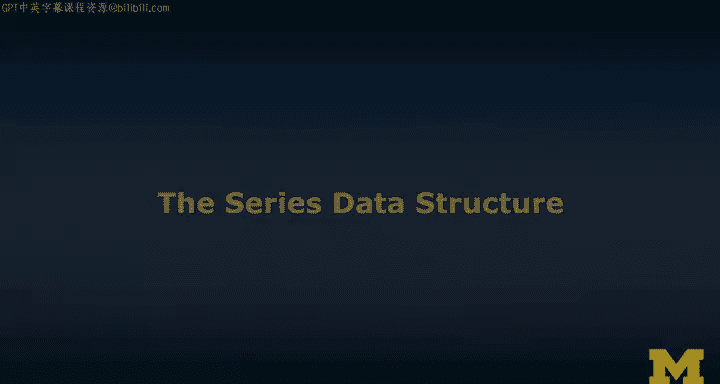
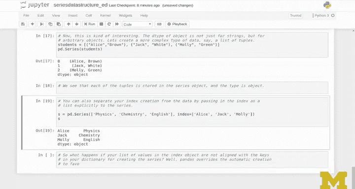

# 密歇根大学《Python用于数据科学实践（1-3课／共5课）｜Applied Data Science with Python 》deepseek翻译 - P14：13_Series数据结构.zh_en - GPT中英字幕课程资源 - BV1U64y1L7VJ

In this lecture we're going to explore the pans series structure by the end of this lecture you should be familiar with how to store and manipulate single dimensional indexed data in the series object。

The series is one of the core data structures in pandas you can think of it as a cross between a list and a dictionary。

 the items are all stored in an order and there's labels with which you can retrieve them an easy way to visualize this is two columns of data the first is the special index a lot like keys in a dictionary while the second is your actual data it's important to note that the data column has a label of its own and can be retrieved using the dot name attribute。

This is different than with dictionaries is useful when it comes to merging multiple columns of data。

 and we'll talk about that later on in the course。Let's import pandas to get things started。

 so import pandas as PD。As you might expect， you can create a series by passing in a list of values When you do this。

 Pandas automatically assigns an index starting with zero and sets the name of the series to none Let's work on an example of this。

One of the easiest ways to create a series is to use an like object like a list。

So here I'll make a list of three of the students， Alice， Jack and Molly， all his strings。

 so students equals list Alice， Jack and Molly。Now we just call the series function in pandas and pass in the students。

 so PD。t series， so series is a top level or a module function， and we pass in students。

The results is a series object which is nicely rendered to the screen。

 we see here that the pandas has automatically identified the type of data in the series as object and that it set the D type parameter as appropriate。

We see that the values are indexed with integers starting with zero。

Now we don't have to use strings if we passed in a list of whole numbers for instance。

 we could see that panda sets the type to int64 underneath Pada stores series values in a typed array using the NumpI library。

 this offers significant speedup when processing data versus traditional Python lists。

Let's create a little list of numbers， so here numbers equals and I'll just throw in three integers。

  one， two， and three。And now let's turn that into a series， so again， PD。t series。

 module level function passing numbers。And we see that on my architecture。

 the result is a detype of N64 objects。There's some other typing details that exist for performance that are important to know。

The most important is how Numpy and thus pandas handle missing data。In Python。

 we have the nun type to indicate a lack of data， but what do we do if we want to have a typed list like this in the series object？

Underneath panndadas does some type conversion for us。

 if we create a list of strings and we have one element， a nun type。

 pandas inserts it as a nun and uses the type object for the underlying array。Okay。

 let's recreate our list of students， but let's leave out the last one and we'll just set it to none。

 so students equals Alice， Jack and then we'll just have a nun。

 and now let's convert that into a series to see what happens。So PDd。sri students。

So if we create a list of numbers， integers or floats and put in a nu type。

 pandas automatically converts this into a special floating point value designated as NAN。

Which stands for not a number。So let's see an example of this。

 we'll create a list with a nu value in it， so numbers equals one，2 and none。

 and we'll turn that into a series object， so PD dot series numbers。You'll notice a couple of things。

First， N A N is a different value。 Second， panda set the D type of this series to a floating point numbers instead of an object or inse。

 That's maybe a bit of a surprise。 Why not just leave this as an integer。

Underneath pandas represents NAN as a floating point number。

 and because integers can be typecast to floats， pandas went and converted our integers to floats automatically。

So when you're wondering why the list of integers you put into a series is not floats。

 it's probably because there is some missing data。For those who might not have done scientific computing in Python before。

 it's important to stress that N and NAN might be used by this data scientist in the same way to denote missing data。

 but that underneath these are not represented by pandas in the same way。It is。

 NAN is not equivalent to none， and when we try the equality task， the result is false。

Let's bring in NumpI which allows us to generate an NAN value， so we'll import NI as NP。

And now let's compare it to none， so just NP。naN and does this equal to none？

It turns out that you actually can't even do an equality test of NAN to itself when you do the answer is always false。

 so if we just do NP。naN equals NP。naN， we also get false。Instead。

 you need to use special functions to test for the presence of not a number。

 such as the NI library is atAN。So we can usemp。isnN， this function， and pass itmp。

naN and we see that the result is true。So keep in mind that when you see NAN。

 its meaning is similar to none， but it's a numeric value and treated differently for efficiency reasons。

Let's talk more about how pannda's series can be created while my list might be a common way to create some play data。

 often you have label data that you want to manipulate。

A series can be created directly from dictionary data if you do this。

 the index is automatically assigned to the keys of the dictionary that you provided and not just incrementing integers。

Here's an example using some data of students in their classes。

 so I'll create a new dictionaries called Student scores， I'll have the keys name， so Alices physics。

 then I'll make Jack Chemistry and Molly you're in English and now I'm going to create some new series。

 so PD。t series and pass in the scores and I'll assign this to S and then just like printout S。

We see that since it was string data， pannda set the data type of the series to object。

 and we see that the index， the first column is a list of strings。Once this series has been created。

 we can get the index object using the index attributes so if we just do SOt index， for instance。

As you play more with pandas， you'll notice that a lot of things are implemented as Numpy arrays and that they have the D type value set this is true of indices and here panndadas inferred that we're using objects for the index and that's kind of cool。

Now this is kind of interesting because the d type of object is not just for strings。

 but for arbitrary objects， so let's create a more complex type of data， say a list of tus。

 so we'll say students is a list and we'll just say first name last name so Alice Brown as the first tuple。

 Jack White is the second Tple and Molly Green as the third one。And then we'll do PD。

t series with students。So we see that each of the tuples is stored in the series object and the type is of type object。

You can also separate your index creation from the data by passing in an index as a list explicitly to the series。

So here we'll create a new series S， PD。t series， we'll pass in physics。

 chemistry and English as three subjects that we're interested in。

 and then we'll use the index parameter as a list of Alice， Jack， and Molly。And let's print outass。

So what happens if your list of values in the index object are not aligned with the keys in your dictionary for creating the series？

Well， pans overrides the automatic creation to favor only and all of the index values that you provided。

So we'll ignore from your dictionary all keys which are not in your index。

 and pandas will add none or NAN type values for any index value you provide。

 which is not in your dictionary key list。Here's an example。

 I'll pass in a dictionary of three items， in this case the students and their courses。

 so I'll create student scores， again， Alice in physics。

 Jack and chemistrystry and I think we had Molly in English。When I create the series object though。

 I'll only ask for an index with three students and I'll exclude Jack。So let's do PD。t series。

 pass in all of the student score， so this big dictionary now you can imagine that this is actually really big and that it came from some data file somewhere。

 but that at our index we're only interested in a couple of students， so Alice， Molly。

 and we'll make up some new ones， Sam。The result is that the series object doesn't have Jack in it。

 even though he was in our original data set， but it explicitly does have Sam in it。

 but as a missing value。In this lecture we've explored the Panda series data structure you've seen how to create a series from lists and dictionaries。

 how indices work on data work， and the way that panndas typecasts data including missing values。

