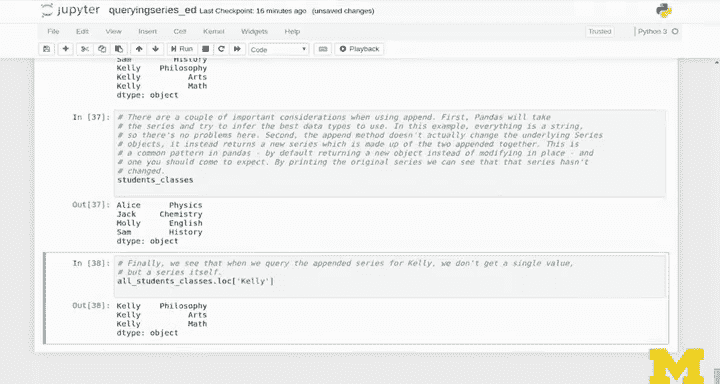

# 密歇根大学《Python用于数据科学实践（1-3课／共5课）｜Applied Data Science with Python 》deepseek翻译 - P15：14_Series查询方法.zh_en - GPT中英字幕课程资源 - BV1U64y1L7VJ

In this lecture， we'll talk about one of the primary data types of the pandas library， the series。

 you'll learn about the structure of the series， how to query and merge series objects together。

 and the importance of thinking about parallelization when engaging in data science programming。

Appendix series can be queried either by the index position or the index label if you don't give an index to the series when querying。

 the position and the label are effectively the same values。To query by numeric location。

 starting at zero， use the IL attribute， to query by the index label， you can use theL attribute。

So let's start with an example， we'll use students enrolled in classes coming from a dictionary。

 so first we'll import pandas as PD as his norm， and then we'll create a dictionary called Student Classes and we'll take Aliceison and Puter in physicsic。

 Jack in Chemi， Mollin， English， and Sam in history。

And now we'll create some new series from this dictionary with PD dot series and print that to the screen。

So for this series， if you wanted to see the fourth entry。

 we could use the ILC attribute with the parameter 3， so S dot ILC sub3。Remember。

 we always start from zero。If you wanted to see what class Molly has。

 we would use the lock attribute with a parameter of Molly， so Stt Lo submolly。

So keep in mind that IL and lock are not methods， theyre attributes。

 so you don't use parentheses to query them， but square brackets instead。

 and this is called the indexing operator。In Python。

 this calls a get or a set for an item depending on the context of its use。

This might seem a bit confusing if you're used to languages where encapsulation of attributes。

 variables and properties is common， such as in Java。

Pands tries to make our code a bit more readable and provides a sort of smart syntax using the indexing operator directly on the series itself。

For instance， if you pass in an integer parameter， the operator will behave as if you want to query via the IL attribute。

 so we'll do S sub3。And it's just as if we use S dot IL sub3。And if you pass in an object。

 it will query as if you wanted to use the label based on the lock attribute。

 so S submoli actually queries as if we did S dot lock submoli。

So what happens if your index is actually a list of integers and this is a bit complicated and pandas can't determine automatically whether you're intending to query by index position or index label。

 so you need to be careful when you're using the indexing operator on the series itself the safer option is to be more explicit and to use the ILC and lock attributes directly。

Here's an example using classes and their class code information where classes are indexed by class codes in the form of integers。

 so let's create some new dictionary class code， we'll say 99 maps to physics， 100 to chemistry。

 101 to English and 102 to history， and we'll create some new series。If we try and call S sub0。

 we're going to get a key error because there's no item in the class list with an index of zero。

 instead we have to call ILC explicitly if we want the first item。So S sub0。

 and that gives us this nasty looking key。So that didn't call St IL sub0ro underneath as one might expect。

 and instead it generated this error。Now we know how to get data out of this series。

 let's talk about working with the data。A common task is to want to consider all of the values inside of a series and do some sort of operation。

This could be trying to find a certain number or summarizing the data or transforming the data in some kind of way。

A typical programmatic approach to this would be to iterate over all of the items in the series and invoke the operation one is interested in。

 For instance， we could create a series of integers representing student grades and just try and get the average grade。

So let's do that， grades equals PD。 series and we'll pass in a list of all the grades 9080， 70， 60。

Then we create some counting variable total and then we'll just iterate， so for grade and grades。

 total is equal to itself plus the grade， and then we're just going to print out the total divided by the length of grades。

 so just a very simple averaging function。This works， but it's slow。

 modern computers can do many tasks simultaneously， especially。

 but not only tasks involving mathematics。Pandndas in the underlying NumpI library support a number of methods for computation and vectorization。

 in particular， works with most of the functions in the NumpyI library， including the sum function。

So here's how we would really write the code using the NumpI sum method first we need to import the NumpI module。

 so import NumpI as NP。Then we'll just call NP。 sum and pass in an iterable item， in this case。

 our pan series。So we say total equalsmp。 sum and we pass in grades and then we just print out the total divided by the length of grades。

Now， both of the methods I just showed create the same value， but is one actually faster？

The Jupiter notebook has a magic function which can help。

So first let's create a big series of random numbers and this is actually used a lot when demonstrating techniques with pandas so you should get used to seeing this so numbers equals and we'll just do PD dot series and then here we just call NP。

t random。 random int and we pass it some parameters indicating how many random numbers we want and what we want those numbers between so here I'm asking for 10。

000 random numbers between zero and 1000。Now let's look at the top five items in this series to make sure they actually seem random and we can do this with the head function。

 so if we do numbers dot head， remember this is a series。

 we're able to see what the first five numbers are。

And we can actually verify the length of the series is correct using the L function。

 so if we do land numbers in the series， we get 10，000， which is what we were looking for。Okay。

 so now we're confident that we have a big series， the i Python interpreter has something called magic functions that begin with a percentage sign if we type this sign and hit the tab key。

 you can see a list of the available magic functions。You could write your own magic functions too。

 but that's a little bit outside of the scope of this course。

So here we're actually going to use a cellular magic function。

 these start with two percentage signs and wrap the code in the current Jupiter cell。

The function we're going to use is called timeIt this function will run our code a few times to determine on average how long it takes。

So let's run time it with our original iterative code。

 you can give timeit the number of loops that you would like to run by default it's 1 thousand loops。

 I'll last time it here to use 100 runs because we're recording this。

Note that in order to use the cellular magic function， it has to be the first line of each cell。

So two percentage signs， time it is the function that we're interested in running and will pass in a parameter of 100。

Now we'll just write our cell as normal， so we'll set total equals to zero for number in numbers。

 total， we're just incrementing it， and now we're going to divide total by the length。

 so this is just the function we saw before。All right。

 not bad time it round the code and it doesn't seem to take very long at all。

 Now let's try with vectorization。So we'll just use time it with two percentage signs at the beginning。

 we'll pass in a parameter of 100 again， we'll make the total equal to NP dot sum the numbers and we'll divide total by the length of numbers。

 and we'll give this a run。Wow， this is a pretty shocking difference in the speed and demonstrates why one should be aware of parallel computing features and start thinking in functional programming terms。

Put more simply， vectorization is the ability for a computer to execute multiple instructions at once。

 with high performance chips， especially graphics cards， you can get dynamic speedups。

Modern graphics cards can run thousands of instructions in parallel。

A related feature in pandas and Ny is called Broading with broadcasting we can apply an operation to every value in the series changing the series。

 For instance， if we wanted to increase every random variable by  two。

 we could do so quickly using the plus equals operator directly on the series object。

Let's look at the head of our series， so Asdot had。

And now let's just increase everything in the series by 2， so s plus equals 2。

 so here we're applying the plus equals operator directly to the series object， not a single value。

 and now let's look at the head。The procedural way of doing this would be to iterate through all of the items in the series and increase the values directly Pandas does support iterating through the series much like a dictionary。

 allowing you to unpack values easily。So we can use the it items function in particular。

 which returns a label and value， so for label and value in S dot it items。

 now for the item which is returned let's call the set value， so S dot set value。

 we indicate the label and we say the value we just want to increment that by two and then let's check the result of this for loop computation by looking at the head。

So the result is the same， though you may notice a warning depending on the version of pandas being used。

 but if you find yourself iterating pretty much any time in pandas。

 you should question whether you're doing things in the best possible way。

Let's take a look at some speed comparisons first let's try five loops using the iterative approach。

 so we'll call timeit minus n and I'll use 10 here。

We'll create a blank new series of items to deal with。

 always good when timing to create a new series， so well use our NP。random。

ranand end with our three parameters， the first two being the range。

Of our data values and the next one being the number of values， we add a thousand items in there。

And we'll just rewrite our looppro above， so for label value in SOt it items。

 SOt lock label equals value plus 2。Now let's try using that broadcasting method。

So we'll time it with 10 loops again， we need to recreate the series。

 so S equals PDd dot series and we'll pass in our values。

 and now we're just going to broadcast with plus equals， so S plus equals2。Amazing。

 not only is it significantly faster， but it's more concise and even easier to read to。

 the typical mathematical operations that you would expect are vectorized and the Ny documentation outlines what it would take to create vectorized functions of your own。

😊，One last note on using the indexing operators to access series data。

 the dot lock attribute lets you not only modify data in place， but also add new data as well。

 if the value you passed in as the index doesn't exist。 then a new entry is created。

 And keep in mind， indices can have mixed types， while it's important to be aware of the typing going on underneath。

 pandas will automatically change， the underlying Nmpy types is appropriate。

Here's an example using a series of a few numbers， so S equals PD dot series， 1，2 and3。

Let's add some new value， maybe a university course， so Sdot Locke subhistory equals 102。

 let's look at S。We see that mixed types for data values or index labels are no problem for pandas。

 since history is not in the original list of indices。

 EDOt Lock subhistory essentially creates a new element in the series with the index name of history and the value of 102。

Up until now， I've shown only examples of a series where the index values were unique。

I want to end this lecture by showing an example where index values are not unique。

 and this makes the Pas series a little different conceptually than， for instance。

 a relational database。Let's create a series with students and courses which they' have taken。

 so student classes equals PDOD series， Alice in physicsic will put Jack in Chetry， Molly in English。

 and salmon history， and let's print out those student classes。

Now let's create a series just for some new student Kelly。

 which lists all of the courses that she's taken we'll set the index to Kelly and the data to be the names of the courses。

 so we'll create some new series of Kelly classes will say she's taken philosophy。

 arts and math and the index for this will just be Kelly， Kelly and Kelly。

 and let's take a look at what that looks like。Okay， finally。

 we can append all of the data in this new series to the first using the dot append function。

 so it'll create some variable all student classes， and it's just equal to student classes。

 dot append Kelly classes and this creates a series which has our original people in it as well as all of Kelly's courses and let's take a look at that。

There are a couple of important considerations when using dotendd。First。

 pandas will take the series and try to infer the best data types to use in this example。

 everything is a string， so there's no problems here。Second。

 the append method doesn't actually change the underlying series objects。

 It instead returns a new series， which is made up of the two appended together。

 And this is actually a common pattern in pandas。 By default returning a new object instead of modifying one in place。

 And it's one that you should come to expect。 by printing the original series。

 we can see that that series hasn't changed。 So here， we'll take a look at it。Finally。

 we can see that when we query the appended series for Kelly， we don't get a single value。

 but a series itself。And so if we take all student classes。lockeskely。

 we actually get a series itself。

In this lecture， we focused on one of the primary data types of the pandas library， the series。

 you learned how to query the series with Lock and ILC， that the series is an index data structure。

 how to merge two series objects together with aend and the importance of vectorization。

There are many more methods associated with the series object that we haven't talked about。

 but with these basics down we'll move on to talking about pannda's twodimensional data structure。

 the data frame， the data frame is very similar to the series object but includes multiple columns of data and is the structure you'll spend the majority of your time working on when cleaning and aggregating data。

