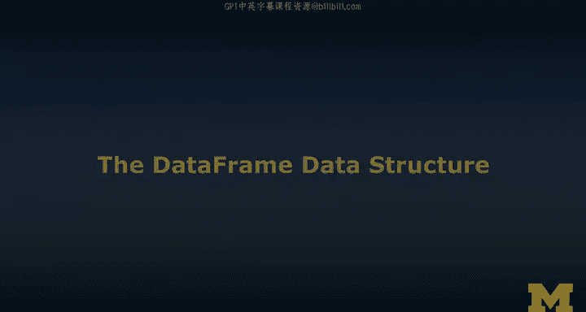
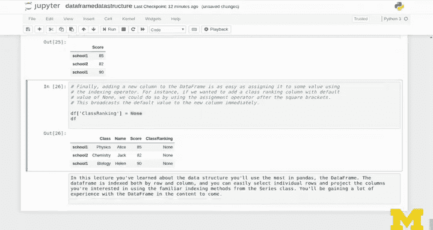

# 密歇根大学《Python用于数据科学实践（1-3课／共5课）｜Applied Data Science with Python 》deepseek翻译 - P16：15_DataFrame数据结构.zh_en - GPT中英字幕课程资源 - BV1U64y1L7VJ

The data frame data structure is the heart of the Pas Library。

 it's a primary object that you'll be working with in data analysis and cleaning tasks。

The data frame is conceptually a two dimensional series object where there's an index and multiple columns of content with each column having a label。

In fact， the distinction between a column and a row is only a conceptual distinction。

 and you can think of the data frame itself as simply a two axis labeled array。

Let's start by importing our panndas library， so import pandas as PD。

I'm going to jump in with an example， let's create three school records for students and their class grades。

 I'll create each is a series which has a student name。

 the class name and the score so record one is PD。 series and we'll use a dictionary here and we'll say the student's name is Alice。

 the class is physics and the score she got was 85 record two， the name is Jack。

 the class is chemistry， the score is 82 and for record3 will set the name of the student to Helen。

 the class is biology and the score is 90。So like a series the data frame object is indexed I'll use a group of series where each series represents a row of data just like the series function。

 we can pass in our individual items in an array and we can pass in our index values as second arguments so DF is a common name for a data frame equals PD do data frame and we pass in record1。

 record2， record3 as our arrays and we'll just say our index is school1， school2 and school1。

And just like the series， we can use the head function to see the first several rows of the data frame。

 including indices from both axes， and we can use this to verify the columns and the rows。

 so DF dot head。You'll notice here that Jupiter creates a nice bit of HTML to render the results of the data frame。

 so we have the index， which is the leftmost column and is the school name。

 and then we have the rows of data where each row has a column header which was given in our initial record directories。

An alternative method is that you could use a list of dictionaries where each dictionary represents a row of data。

 so students equals， and then we'll make a dictionary in this list and we'll say Alice Phic and the score。

 and then the next dictionary is Jack Che and the score， and then Helen Bi and her score of 90。

And then we pass this list of dictionaries into the data frame function， so DF equals P。

t data frame and we just pass the list of students and we say we want to index them as school one。

 school2， and School one。And let's print this again with DF dot head。So similar to the series。

 we can extract data using the IL and lock attributes because the data frame is two dimensional。

 passing a single value to the lock indexing operator will return the series if there's only one row to return。

For instance， if we wanted to select data associated with school2。

 we would just query the dot lock attribute with one parameter， so DF dot lock， it's our index。

 so the value we're looking for is school2。You'll note that the name of the series is returned as the index value。

 while the column name is included in the output。We can check the data type of the return using the Python type function。

 so just type DF。 lock subchool2。And we can see here it's pandas。cor。sries。 series。

It's important to remember that the indices and column names along either axes。

 horizontal or vertical， could be non unique。In this example。

 we see two records for school one as different rows。

If we use a single value with the data frame lock attribute。

 multiple rows of the data frame will be returned， not as a new series， but as a new data frame。

So let's query for School1 records， so Df。lock， sub School1。

And here we can see the type of this is actually different too， so type df。lock subschool run。

 and that's actually app pans。co。frame。 datata frame。

One of the powers of the pandas data frame is that you can quickly select data based on multiple axes。

For instance， if you wanted to just list the student names for school one。

 you could supply two parameters to dot lock， one being the row index and the other being the column name。

So for instance， if we're only interested in school1 student names， we could say DF dot lock。

 subcho1 as the first parameter and name as the second parameter。Remember， just like the series。

 the pandas developers have implemented this using indexing operators and not parameters to a function。

So what would we do if we wanted to select a single column though Well there's a few mechanisms first we could transpose the matrix。

 this pivots all of the rows into columns and all of the columns into rows and is done with the T attribute。

So DF dot capital T。Then we could use the dot lock on the transpo to get the student names only。

 so DF dot T dot lock subname。However， since ILC and Lock are used for row selection。

 Panda reserves the indexing operator directly on the data frame for column selection in a pannda's data frame。

 columns always have a name。So this selection is always label based and is not as confusing as it was when using the square bracket operator on the series objects。

For those familiar with relational databases， this operator is analogous to column projection。

So Df sub name。And that projects the name column and you'll note the index is still in there。

In practice， this works really well since you're often trying to add or drop new columns， however。

 this means that you can get a key when you try and use the dot lock with a column name。

 so DF dot lock subname and that produces this big nasty looking key。

Note too that the result of a single column projection is a series object。

 so we look at type of DF subname。We see it's a panda。cort series。 series。

Since the result of using the indexing operators， either a data frame or series。

 you can chain operations together， for instance， we can select all of the rows which related to school1 using dot lock。

 then project the name column for just those rows， so DF dot lock subcho1 so that's our row we only want those that involve school 1 based on the index。

 but then we'll project using subname at the very end just the name column。If you get confused。

 you can use type to check the responses from resulting operations， so if you print the type of DF。

 lock subschool1， this should be a data frame and if you print the type of DF。

 lock subchool1 subname， this should be a series。Chaining by indexing on the return type of another index can come with some costs and is best avoided if you can use another approach。

In particular， chaining tends to cause pandas to return a copy of the data frame instead of a view on the data frame。

For selecting data， this is not a big deal， though it might be slower than necessary。

If you are chain data， though， it's an important distinction because this can be a source of error。

Here's another approach， as we saw， dot lock does row selection and it can take two parameters。

 the row index and the list of column names。The dot lock attribute also supports slicing。

If we wanted to select all rows， we can use a colon to indicate a full slice from beginning to end。

 this is just like slicing characters in a list in Python。

Then we can add the column name as the second parameter as a string。

If we wanted to include multiple columns， we could do so in a list and pandas will bring back only the columns that we've asked for。

Here's an example where we ask for all of the names and scores for all schools using the dot lock operator。

 so DF dot lock， and I want all schools， so I'm just going to put a colon as the first parameter。

 the row index selection， and then is the second parameter。

 I want to project the name and the score as columns。Take a look at that again。

 the colon means that we want to get all of the rows and the list in the second argument position is the list of the columns that we want to get back。

Thus selecting and projecting data from a data frame based on row and column labels。

 the key concepts to remember are that rows and columns are really just for our benefit。

 underneath this is just a twoax labeled array and transposing the columns is easy。Also。

 consider the issue of chaining carefully and try to avoid it as it can cause some unpredictable results where your intent was to obtain a different view of the data。

 but instead panndas returns to you a copy。Before we leave the discussion of accessing data and data frames。

 let's talk about dropping data， it's easy to delete data in series and data frames and we can use theD function to do so。

This function takes a single parameter， which is the index or row label to drop。

This is another tricky place for new users， the drop function doesn't actually change the data frame by default。

 instead the drop function returns to you a copy of the data frame with the given rows removed。

So if we do DF。 drop school1， it looks like a nice changed data frame。

 but if we look at our original data frame， we see the data is actually still intact， D。

Drop as two interesting optional parameters， the first is called in place， and if it's set to true。

 the data frame will be updated in place instead of a copy being returned。

The second parameter is the axes， which should be dropped by default this value is zero indicating the rh axes。

 but you could change it to one if you wanted to drop a column。For example。

 let's make a copy of a data frame using the dot copy function， so copy DF equals Df dot copy。

Now let's drop the name column in this copy， so copy DF。 drop。

 we say the column we want to drop name， we set in place equals to true。

 and then we set the aes because it doesn't know that this is a column。

 we set the aes equals to one to tell it that this is a named column and then print out copy DF。

There's a second way to drop a column and that's directly through the use of the indexing operator using the Dell keyword。

 this way of dropping data however takes immediate effect on the data frame does not return a view。

 so if we just say Dell copy DF subclass and then print out copy DF， we see the class is gone。

Finally， adding a new column to the data frame is as easy as assigning it to the sum value using the indexing operator for instance。

 if we wanted to add a class ranking column with default value of none。

 we could do so by using the assignment operator after the square brackets。

This broadcasts the default value to the new column immediately。

 so D subclass ranking equals none and print DF。In this lecture。

 you've learned about the data structure you'll use the most in pandas， the data frame。

 the data frame is indexed both by row and column and you can easily select individual rows and project the columns you're interested in using the familiar indexing methods from the series class。

You'll be gaining a lot of experience with the data frame in the content more to come。

