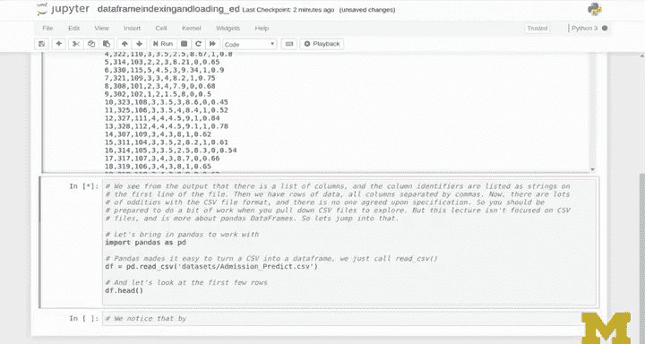

# 密歇根大学《Python用于数据科学实践（1-3课／共5课）｜Applied Data Science with Python 》deepseek翻译 - P17：16_DataFrame索引与数据加载.zh_en - GPT中英字幕课程资源 - BV1U64y1L7VJ

In this course， we'll largely be using smaller or moderate sized data sets。

 A common workflow is to read the dataset set in， usually from an external file。

 then begin to clean and manipulate the data for analysis。 In this lecture。

 I'm going to demonstrate how you can load data from a comma separated file and into a data frame。

Let's just jump right in and talk about comma separated files。 You've undoubtedly used these。

 any spreadsheet software like Excel or Google sheetets can save output in CSV format。

 It's a pretty loose as a format， and it's incredibly lightweight， and it's totally ubiquitous。😊，Now。

 I'm going to make a quick aside because it's convenient here。

 The Jupiter Notes use I Python as the kernel underneath。

 which provides convenient ways to integrate lower level shell commands。

 which are programs run in the underlying operating system。If you're not familiar with the shell。

 don't worry too much about this。 But if you are， this is super handy for integration of your data science workflows。

I want to use one shell command here called cat for concateate。

 which just outputs the contents of a file In eye Python。

 if we proppenend the line with an exclamation mark。

 it will execute the remainder of the line as a shell command。

 So let's look at that in the contents of a CS SV file。

 So I'll just type Xclaim cat and then data sets。 and I'll use the admission predictions dot CSV。

We see from the output that there's a list of columns and that the column identifiers are listed its strings on the first line of the file。

 Then we have rows of the data。 All columns are separated by commas。Now。

 there's lots of oddities with the CSV file format。

 and there is no one agreed upon specification or standard。

 so you should be prepared to do a little bit of work when you pull down CSV files to explore。

But this lecture isn't focused on CSV files per se and is more about panda's data frames。

 so let's jump into that。Let's bring in pandas to work with， so I'll import pandas as PD。

pans makes it easy to turn a CSV into a data frame， we just call the read CSV function。

 so DF equals PD。read CSV and we'll pass in data sets in the admissionpredict do CSV and note here we're not calling anything on the data frame we're calling it on the pandas module。

And let's look at a few of the first rows， so that's just Df dothead。We notice that by default。

 the index starts with0 while the student's serial number starts from1。

If you jump back to the CSV output， you'll deduce that pandas has created new index。 Instead。

 we can set the serial number as the index if we want to by using the index call。

 So we can say D F equals P D dot read CSV。 we pass in our string to our admissions predictions。

 And then we pass in a parameter index call。 And we tell it which column we're interested in this case 0。

 let's print the head of that。😊，Notice that we have two columns， S， O P and L O R。

 and probably not everybody knows what they mean。 So let's change our column names to make it more clear In pandas。

 we can use the rename function。 It takes a parameter called columns。

 and we need to pass in a dictionary， which are the keys of the old column name and the value of the corresponding new name。

So I'll create some new data frame variable new DF and DF do rename and then I'll just in line pass in a dictionary for columns so GreE score will leave it the same ToOEFfl score will leave it the same university rating will leave it the same。

 Here's our statement of purpose SOP and our LOR letter of recommendation so we'll change those we'll leave the cumulative GPA and the research experience and we'll leave the chance of admit as well。

 and so let's take a look at this new data frame。From the output。

 we can see that only the S O P has changed， but not L O R。 So why is that。

 So let's investigate this a bit。 First， we need to make sure we got all the column names correct。

 We can use the columns attribute of the data frame to get a list。 So I'll type new D F dot columns。

 And I'll be honest。 I often on the data frame， call this as a function， but it's not。

 It's an attribute。If we look closely at the output。

 we can see that there's actually a space right after L O R and a space right after chance of admit。

 Pre sneaky， So this is why our renamed dictionary does not work for L O R。

 because the key that we used is just three characters instead of four characters， L O R space。

There's a couple of ways that we could address this。

 One way would be to change a column by including the space in the new name。

 So we'll do new D F equals new D F dot rename。 we pass in the columns dictionary here。

 We're just going to pass in the one that we want changed。

 So you don't have to pass in the full dictionary each time。 L。

 O R space and letter of recommendation。 And let's look at the head of that。So that works well。

 but it's a bit fragile。 What if that was a tab instead of a space or two spaces？

Another way is to create some function that does the cleaning and then tell rename to apply that function across all of the data。

Python comes with a handy string function to strip white space called strip。

When we pass this in to rename， we pass the function as the map or parameter and then indicate whether the axes should be the columns or the index that's the row labels。

So here's an example。 So new Df equals new Df dot rename。 We pass in the mapper。 In this case。

 we're passing in a reference to a function。 So STR dot strip。 No， we're not calling the function。

 We're just passing a reference to that function。 and pandas will call it。

 And we tell it the axis that we want to call this on is across the columns， not the rows。

 And now let's take a look at the results。 So new D F dot head。All right， Now we've got it。 Both S。

 O P and L O R have been renamed and chance of admit has been trimmed up。 Remember， though。

 that the rename function isn't modifying the data frame。 In this case。

 D F is the same as it always was。 there's just a copy of new D F with the change names。

 So if we do D F dot columns， we can see that those still include our columns that are poorly named with lots of extra white spaces。

 And I'll be honest， these white spaces in column names， This is really common。

 You'll be doing this any time you're importing a CV having to tweak out extra white space。

We can also use the DF。t columns attribute by assigning it to a list of column names which will directly rename the columns。

This will directly modify the original data frame， and it's very efficient。

 especially when you have a lot of columns and you only want to change a few。

This technique is also not affected by subtle errors in the column namess。

 a problem that we just encountered with a list， you could just use the list index to change a certain value or use a list comprehension to change all of the values。

So as an example， let's change all of the values of the column names to lower case。

 so first we need to get our list， so I'll make some new attribute calls is equal to the list of DF dot columns。

 so DF dot columns is actually an indexing variable and I just want to convert it to a list。

Then I'm going to write a little list comprehension。

 so I'll make calls as equal to and then I start my list comprehension。

 and in there I want to say x dot lower dot strip so I'm going to convert x to lowercase。

 then call strip on it where x is a string and for x in calls。

 so we're just iterating over everything and calls。

And then we just want to overwrite what is already in the dot columns attribute。

 So DF dot columns equals calls， and then let's take a look at our results。 so DF dot head。

In this lecture， you've learned how to import a CSV file into a pandas data frame object and how to do some basic data manipulation with the column names。

 the CSV file import mechanisms in pandas have lots of different options。

 and you really need to learn these in order to be proficient at data manipulation。

Once you've set up the format and changed the shape of a data frame。

 you have a solid foundation to further actions such as conducting data analysis and modeling。Now。

 there are other data sources that you can load directly into data frames as well。

 including HTML web pages， databases and other file formats。

 but the CSV is by far the most common data format you'll run into。

 and it's an important one to know how to manipulate in pandas。

