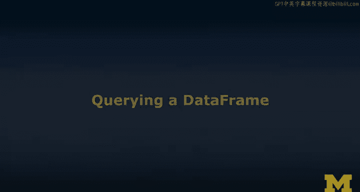
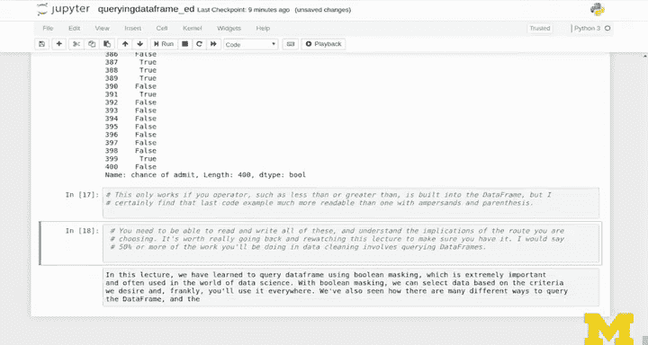

# 密歇根大学《Python用于数据科学实践（1-3课／共5课）｜Applied Data Science with Python 》deepseek翻译 - P18：17_DataFrame查询技术.zh_en - GPT中英字幕课程资源 - BV1U64y1L7VJ

In this lecture， we're going to talk about querying data frames。

 The first step in the process is to understand boolean masking。

 A Boolean asking is at the heart of fast and efficient querying in both nuy and in pandas。

 And it's analogous a bit too bit masking， which is used in other areas of computer science。

 By the end of this lecture， you'll understand how boolean masking works and how to apply this to a data frame to get out the data that you' are interested in。

Now， a booleium mask is an array， which can be thought of as a one dimension。

 like a series or two dimensions like a data frame。

 where each of the values of the array are either true or false。

 This array is essentially overlaid on top of the other data structure that we're querying。

 and any cell aligned with the true value will be admitted into our final result。

 and any cell aligned with the false value will not。 Let's take a look。

So let's start with an example and import our graduate admissions dataset set。

 So first we'll bring in pans so import pandas as PD， then we'll load in our CSv data file。

 so we'll make a new variable Df is equal to PD do read CSv and remember we're going to use our index column0 and then we're going to clean this up and fix a couple of the poorly named columns like we did in previous lecture and so I'm going to use our list comprehension here x do lower dot strip for x in Df dot column So this is just iterating over a bunch of strings and turning the lowercase and stripping out whitespace from either side and let's take a look at the results。

So Booleing masks are created by applying operators directly to the pandas series or data frame objects。

 For instance， in our graduate admission dataset set。

 we might be interested in seeing only those students that have a chance higher than 0。

7 of being admitted。😊，To build a boolean mask for this query。

 we want to project the chance of admit column using the indexing operator and apply the greater than operator with a comparison value of 0。

7。This is essentially broadcasting a comparison operator greater than with the results being returned as a boolean series。

 The result in series is indexed where the value of each cell is either true or false。

 depending on whether a student has a chance of admission higher than 0。7。

So we'll create this thing called an admit mask and we'll say Df subchance of admit。

 and then we're going to broadcast against this column。

 remember we're just projecting a single column， the greater than operator and pass it a value of 0。

7 and let's take a look at what that admit mask is。So this is pretty fundamental。

 So take a moment to look at this。 The result of broadcasting a comparison operator is a boolean mask。

 true or false values， depending on the results of the comparison。

Underneath pandas is applying the comparison operator that you specified through vectorization。

 So it's efficiently and in parallel to all of the values in the array that you specified。

 which in this case， is the chance of admit column of the data frame。

 The result is a series object since only one column is being operated on filled with either true or false values。

 which is what the comparison operator returns。So what do you do with the Boolean mask once you formed it。

 Well， you could just lay it on top of the data to hide the data that you don't want。

 which is represented by all the false values。We do this by using the dot where function on the original data frame。

 so DF dot where and we just pass in a single parameter， the admit mask。

 and let's take a look at what that data frame looks like and we'll add the dot head。

So we see that the resulting data frame keeps the original indexed values。

 and only data which met the condition was retained。 All of the rows。

 which did not meet the condition have NAN data instead。

 but these rows weren't dropped from our data set。 They're still there。 They're just not a numbers。

The next step is， of course， if we don't want the NN data that we use DN A function。

 and this is quite common， so we actually do DF dot wear passing the admit mask and then on that resultant data frame called dot droprop and A and then on that called dot head。

So the return data frame now has all of the NN rows drop。

 notice that the index now includes one through four and6， but not5。Despite being really handy。

 where isn't actually used that often。 Instead， the panda devs created a shorthand syntax。

 which combines wear and drop in a doing both at once。 And in typical fashion。

 the just overloaded the indexing operator to do this。 So here's an example。 So we do D F。

 And then inside of the indexing operator， we actually put our computation for the Booleing masks。

 So D F subch of admit greater than 0。7 dot head。😊，So I personally find this much harder to read。

 but it's super common when you're reading other people's code。

 so it's important to be able to understand it and to write it。

 just reviewing this indexing operator on the data frame， it now does three things。So first。

 it can be called with a string parameter to project a single column。

 So if we do D F sub G R score dot head， we get a single column。

 or you can send it a list of columns as strings。 So D F sub G R score and toOEFfl score as a sub parameterameter list。

Order now you can send it a Boolean mask， so DF， and then we put in here。

 let's say DF sub GRE score is greater than 320 and look at the head of that。

And each of these is mimicking functionality from either dot lock or dot where dot drop in A。

Before we leave this， let's talk about combining multiple Boolean masks。

 such as multiple criteria for including。In bit masking in other places in computer science。

 this is done with and if both masks must be true for a true value and to be in the final mask or or if only one needs to be true。

Unfortunately， it doesn't feel quite as natural in pandas。 For instance。

 if you want to take two Boolean series and and them together。

 so here we do DF subchance of admit greater than 0。7。

 and let's say we want DF subchance of admit less than 0。9。

 so maybe these are the people who got close to getting admissions and we want to encourage them to apply again。

But that didn't work。 And despite using pandas for a while。

 I actually find I regularly try and do what I just did。 The problem is。

 is that you have a series object and the Python underneath doesn't know how to compare two series using and or or。

 Instead， the pandas authors have overwritten the pipe and Anpersand operators to handle this for us。

 So we actually have to write D F subchance of admit。

 And then we use the anpersan sign to end these together。

And so here we can see this is the combination， the bitwise and of our two Boolean masks。

So one other thing to watch out for is the order of operations。 And this gets me regularly as well。

 A common error for new pandas users is to try and do boolean comparisons using the n percent operator。

 but not putting parentheses around the individual terms you are interested in。

 So we could just write what we wrote before。 But this time without parentheses。

 So D F subchance of admit greater than 0。7 and percent Df chance of admit less than 0。9。

And we see that there's an error for this， as well。

The problem is that Python is trying to bit wise and a 0。

7 and a pandas data frame when you really want a bitwise and broadcast data frames together。

Another way to do this is actually just to get rid of the comparison operator completely。

 and instead to use the built in functions， which mimic this approach。

 so we could say DF subchance of admit dot GT for greater than 0。7。

 and then bitwise and this with the DF chance of admit dot LT of 0。9。

So these functions are built right into the series and data frame objects。

 so you can actually chain them too， which results in the same answer and the use of no visual operators。

 You can decide what looks best for you。 So Df subchance of admit do GT 0。

7 actually returns our item and then we can say dot LT 0。9 right on that。

 And so we can chain these together。So this only works if your operator。

 such as the less than or greater than， is built into the data frame。

 but I certainly find the last code example to be much more readable than the one with the ampersans in the parentheses。

 so you might want to consider using this。You need to be able to read and write all of these and understand the implications of the route you're choosing。

 It's worth really going back and rewatching this lecture to make sure that you have it。

 I would say 50 per cent or more of the work you'll be doing in data cleaning involves querying data frames。

In this lecture we've learned to query data frames using Boolean masking。

 which is extremely important and often used in the world of data science。With Booolean masking。

 we can select data based on the criteria we define， and frankly。

 you're going to use this everywhere。We've also seen how there are many different ways to query the data frame and interesting site implications that come up when doing so。

