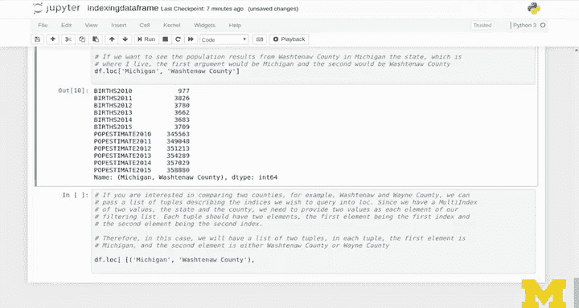

# 密歇根大学《Python用于数据科学实践（1-3课／共5课）｜Applied Data Science with Python 》deepseek翻译 - P19：18_DataFrame索引操作.zh_en - GPT中英字幕课程资源 - BV1U64y1L7VJ

As we've seen， both series and data frames can have indexes applied to them。

 the index is essentially a row level label and imp pandas the rows correspond to axy0。

Indices can either be auto generated， such as when we created a new series without an index in which case we get a numeric value。

 or they can be set explicitly， like when we use the dictionary object to create the series。

 or when we load data from the CSV file and set appropriate parameters。

Another option for setting an index is to use the set index function this function takes a list of columns and promotes those columns to an index in this lecture we'll explore more about how indexes work in pandas。

The set index function is a destructive process and it doesn't keep the current index If you want to keep the current index。

 you need to manually create a new column and copy into it values from the index attribute。

So let's import pandas in our admissions data， so import pandas as PD。

We'll create a new data frame Df equals PD。readcsv， datas/admissions predictect。csv。

 and we'll set the index column to zero and let's look at the head of this。

So let's say that we don't want to index the data frame by serial numbers。

 but instead by chance of admission。But let's assume we want to keep the serial number for later。

 so let's preserve the serial number in a new column。

 we can do this using the indexing operator on the string that has the column label。

 then we can use the set index to set the index of the column to the chance of admit。

So we copy the index data into its own column， so Df sub serialial number equals DF dot index。

 so we just make a copy of that into a column that we've labeled serial number。

 then we set the index to another column so DF equals DF dot set index chance of admit and D dot head。

You'll see that when we create a new index from an existing column， the index has a name。

 which is the original name of the column。We can get rid of the index completely by calling the function Re index。

 This promotes the index into a column and creates a default numbered index。

 so Df equals Df do reset index and then DF dot head。

 and we see that chance of admit is now promoted back into a column and we have a numeric index。

One nice feature of pandas is multilevel indexing， this is similar to composite keys in relational database systems To create a multilevel index we simply call set index and give it a list of columns that we're interested in promoting to an index。

Ps will search through these in order， finding the distinct data and form composite indexes a good example of this is often found when dealing with geographical data which is sorted by regions or demographics。

Let's change data sets and look at some census data for a better example。

This data is stored in the file census。 CSv and comes from the United States Census Bureau in particular this is a breakdown of the population level data in the US county level。

 it's a great example of how different kinds of data sets might be formatted when you're trying to clean them so let's import and see what the data looks like so DF equals PD。

 read CSsv and from data census。csv and we'll look at the head。In this data set。

 there are two summarized levels， one that contains summary data for the whole country。

 and one that contains summary data for each state。

I want to see a list of all the unique values in a given column in this data frame we see that the possible values for the sum level are using the unique function of the data frame。

 and this is similar to the SQL Dis operator。So here we can run unique on the sum level of our current data frame。

 so DF and we'll just project our sum level and dot unique to see the unique values there and so we see that there's actually only two different values of 40 and a 50。

Let's exclude all of the rows that are summaries at the state level and just keep the county data。

So'll overwrite our data frame， Df equals Df sub， and we want to do that where Df sub sum level is equal to 50。

 and let's look at the head of that。Also， while this data is interesting for a number of different reasons。

 let's reduce the data that we're going to look at to just the total population estimates and the total number of births。

 we can do this by creating a list of column names that we want to keep then project those and assign the resulting data frame to our D variable。

So columns to keep and we'll write ST names， city name births for 2010， 2011， 1213， for 2014， 15。

 and then our P estimates for 10， 11， 12， 13， 14 and 15。

 and so our data frame is just data frame subcolumns to keep and let's look at the head of that。Okay。

 so smaller data frame still plenty big。The US。 census data breaks down population estimates by both state and county we can load the data and set the index to be a combination of the state and county values and see how PADS handles it in a data frame。

We do this by creating a list of the column identifiers that we want to make up the index and then calling set index with this list and assigning the output as appropriate we can have a dual index so first the state name and second the county name so data frame equals DF do set index and then I'm going to pass it a list and I want to have first the state name and then the county name and let's look at the head of that。

That's a nice rendering as well of how the counties are kept within the state。

An immediate question which comes up is how we can query this data frame。

 we saw previously that the lock attribute of the data frame can take multiple arguments and it could query both the row and the columns When you use a multi indexex。

 you must provide the arguments in order by the level you wish to query。Inside of the index。

 each column is called a level and the outermost column is level zero。

So if I wanted to see the population results from washtenaw County in Michigan。

 the state which is where I live， the first argument would be Michigan and the second would be washhtennaw County。

 so Df。lock， sub Michiganchigan， comma， washaw County。If you're interested in comparing two counties。

 for example， Wasaw and Wayne County， we can pass a list of tus describing the inices that we wish to query into the Lock attribute。

Since we have a multi indexex of two values， the state and the county。

 we need to provide two values as each element of our filtering list。

 each tuple should have two elements， the first element being the first index。

 and the second element being the second index。In this case we want to have a list of two tuples in each tuple the first element is Michigan and the second element is either Waston County or Wayne County。

 so DF。 Lock and remember we use the set operator or the indexing operator on Lock and then we actually create a list inside there and the first is the Tupple Michigan and Was County and the second is the Tupple Michigan and Wayne County。

Okay， so that's how hierarchical indices work in a nutshell。

 They're a special part of the pandas library which I think can make management and reasoning about data easier。

 Of course， hierarchical labeling isn't just for rows， for example。

 you can transpose this matrix and now have hierarchical column labels and projecting a single column which has these labels works exactly the way that you would expect it to。

Now in reality， I don't tend to use hierarchical indices very much。

 and instead just keep everything as columns and manipulate those。

 but it's a unique and sophisticated aspect of pandas that's useful to know。

 especially if viewing your data in a tabular form。

