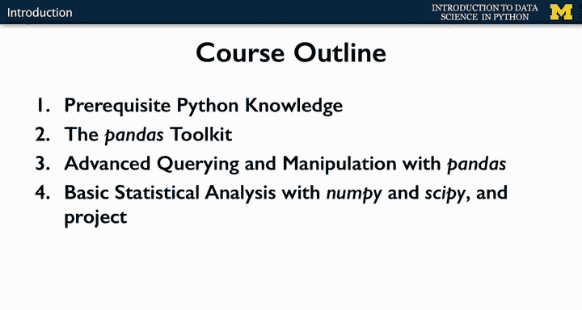

# 密歇根大学《Python用于数据科学实践（1-3课／共5课）｜Applied Data Science with Python 》deepseek翻译 - P1：0_专项课程导论.zh_en - GPT中英字幕课程资源 - BV1U64y1L7VJ

Welcome to an introduction to data science with Python。

 This course is the first course out of  five in a larger Python in data science specialization。

 Each course progressively builds on your knowledge from previous courses to give you a well rounded view of what data science is while helping you to develop skills to practice data science。

This specialization is of an intermediate level or difficulty。

 and we expect that you have studied some basic programming and statistics in the past。

In this specialization， we're focused on teaching applied skills using the Python programming language。

 There are many other tools that one can use in data science。

 such as specialized statistical analysis languages like R or more general purpose programming languages like Java and C。

We chose Python as the basis for this specialization for three reasons。 First， it's easy to learn。

 Python is now the language of choice for introducing university students to programming and is used in 8 out of 10 of the US's top computer science programs。

Python programs tend to have minimal templating that you might have seen in other languages and have more natural constructs for typical tasks you might need to accomplish。

If you have programming experience but not Python specific experience。

 you can pick up Python very quickly。Second， it's full featured。

 Python is a very general programming language with a lot of built in libraries and excels at manipulating data。

 network， programming and databases。 It's mature， and there's plenty of resources available from books to online courses。

Finally， Python has a significant set of data science libraries。 One can use。

 The base of these is called the Psi Pii ecosystem， and it even has its own conference series。😊。

Both the interface that we're going to use for doing assignments called Jupiter Note bookss and the main libraries for the first two courses。

 Padas and Matteplotlibb are part of the sip Pi stack and providing an excellent basis for moving into machine learning。

 text mining and network analysis。This first course is broken into four modules。

 The first module focuses on getting prerequisites in place and reviews some of the basics of the Python language。

Don't worry， if you already have Python down and you want to be challenged。

 we have some advanced Python in here as well。 The advanced Python isn't strictly necessary for the rest of the specialization。

 but many of these examples you might see on the Web or broader data science topics like big data and real time analytics might require a knowledge of some of them these more specialized features。

In the second module， we're going to dig into the pandas toolkit。

 The pandas toolkit is a fundamental in Python data science and provides a data structure for thinking about data in a tabular form。

This toolkit helps bring functionality that exists in R into the Python world and has seen significant adoption over the last five years。

😊，Much of the thinking behind pandas is similar to relational theory。

 So if you have a background in databases， you'll find the pandas environment fairly natural to work in。

At the same time， some of the more advanced ways to query。

 manipulate panda's data frames like Boolean masking and hierarchical indexing are different than in databases and requires some careful discussion。

 So we'll discuss these in module 3 of this course。

The final module of the course is dedicated to the course project， where you'll take some data sets。

 merge and clean them， then process the data and answer the questions。 In this week。

 we'll discuss basic statistical tests and methods and ensure you have a solid grasp going forward into the next course。

 At the same time， the intent is for your course project to be a demonstration of the skills that you've gained in manipulating messy data into something of coherence。

Before we go into programming fundamentals， though。

 we'll talk a bit more about what data science is and why it's sweeping over the world。

