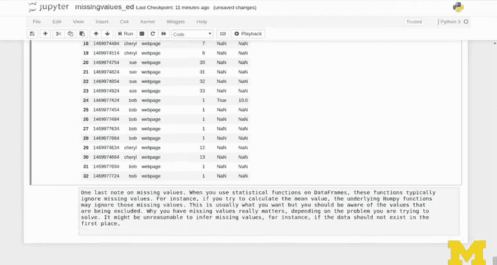

# 密歇根大学《Python用于数据科学实践（1-3课／共5课）｜Applied Data Science with Python 》deepseek翻译 - P20：19_缺失值处理.zh_en - GPT中英字幕课程资源 - BV1U64y1L7VJ

We've seen a preview of how pandas handles missing values using the nun type and the nuumpy N A N keywords。

Missing values are pretty common in data cleaning activities。

 and missing values can be there for any number of reasons and I just want to touch on a few of those here。

For instance， if you're running a survey and a respondent didn't answer a question。

 the missing value is actually an omission。 This kind of missing data is called missing at random。

 If there are other variables that might be used to predict the variable， which is missing。

In my work， when I deliver surveys， I often find that missing data。

 say interest in being involved in a follow up study。

 often has some correlation with other data like gender or ethnicity。

 If there' is no relationship to other variables， then we call this data missing completely at random。

So these are just two examples of missing data， and there's many more。 For instance。

 data might be missing because it wasn't collected。

 either because the process responsible for collecting the data。

 such as the researcher or because it wouldn't make sense if it were to be collected。

 This last example is extremely common when you start joining data frames together from multiple sources。

 such as joining a list of people at a university with a list of offices in a university。

 students don't generally have offices， but they're still people at a university。

So let's take a look at some ways of handling missing data in pandas。So let's import pandas。

 import pandas is PD。So Ps is pretty good at detecting missing values directly from underlying data formats like CSV files。

 although most missing values are often formatted as NA N， null， nun， or NA。

 sometimes missing values are not labeled so clearly。 For example。

 I've worked with social scientists who regularly use the value of 99 in binary categories to indicate that it's a missing value。

 The pen's read CSV function as a parameter called NA values that allows us to specify the format of missing values。

 it allows scalar string list or dictionaries to be used。

So let's load a piece of data from a file called log。 CSsv， so DF equals PD。 CSv。

 and we'll say data sets actually we'll use Class grades。

 CSsv and if we do Df dot head and we pass in 10 we could see the top 10 rows。

So we can actually use the function dot I Nll to create a Boolean mask of the whole data frame。

 This effectively broadcasts the I null function to every cell of data。

 So we'll say mask equals DF dot I null。 remember this is now just that I null function has been broadcast across that whole data frame。

 and what we've got in mask is something the size and shape of the data frame。

 but it's a Boolean mask， and we can take a look at the head of that。

So this can be useful for processing rows based on certain columns of data。

 Another useful operation is to be able to drop all of those rows which have any missing data which can be done with the drop in A function。

 so we could say DF do drop in A dot head。So note how the rows indexed with 2，3。

7 and 11 are all gone。 Now， one of the handy functions that Padas has for working with missing values is the filling function called fill N A。

This function takes a number of parameters。 You can pass in a single value。

 which is called a scalar value to change all of the missing data to one value。

 This isn't really applicable in this case， but it's a pretty common use case。

So if we wanted to fill in all missing values with zero， we could use fillN so we just say DF。

 fill in a， we pass into a zero here I'll just change the data frame in place remember most data frame operations return copies of data frames so if you want to do it in place you often have to use the in place parameter。

 and then let's take a look at the head of that。So note that the in place attribute causes pandas to fill those values in line。

 and it does not return a copy of the data frame， but instead modifies the data frame that you have。

We can also use the NAA filter option to turn off whitespace filtering if whitespace is an actual value of interest。

 but in practice， this is pretty rare in data without any Ns。

 passing NA filter equals false can improve the performance of reading a large file。

In addition to rules controlling how missing values might be loaded。

 It's sometimes useful to consider missing values is actually having information。

 I'll give an example from my own research。 I'll often deal with logs from online learning systems。

 I've looked at video use in lecture capture systems in these systems。

 It's common for the player to have a heartbeat functionality。

 where playback statistics are sent to the server every so often， maybe every 30 seconds。

 These heartbeats can get big as they carry the whole state of the playback system。

 such as where the video playhead is at and where the video sizes at where the video is being rendered to the screen how loud the volume is and so on。

So if we load the data file log。tcsv， we can see an example of this， so Df equals PDd。read CSsv。

 we'll bring in log。t CSv and we'll take a look at the head。So in this data。

 the first column is a times stamp in the Unix Epoch format。 The next column is the username。

 followed by a web page they're visiting and the video that they're playing。

 Each row of the data frame has a playback position。

 And we could see that as the playback position increases by one。

 the time stamp increases by about 30 seconds。😊，Except for user Bob。

 turns out that Bob has paused his playback。 So as time increases。

 the playback position doesn't change。 No too how difficult it is for us to try and derive this knowledge from the data because it's not sorted by time stamp。

 as one might expect。 This is actually not uncommon on systems。

 which have a high degree of parallelism。There are a lot of missing values in the paused and volume columns。

 It's not efficient to send this information across the network If it hasn't changed。

 So implementations rarely do。So this particular system just inserts null values into the database if there's no changes。

So next up is the method parameter。 The two common fill values are F fill and B fill。

 F fill is for forward filling， and it updates an any value for a particular cell with the value from the previous row。

 B fill is for backward filling， which is the opposite of F fill。

 It fills the missing values with the next valid value。

 It's important to note that your data needs to be sorted in order for this to have the effect you might want data。

 which comes from traditional database management systems。

 usually has no order guarantee just like this data。 So you have to be careful。

So in panda as we can sort by index or by value here we'll just promote the timestamp to an index and then sort on the index。

 So I'm going to say Df equals Df dot set index， and I' want the timestamp and then Df dot sort index and let's take the head of that。

All right， so now we have sorted timesstamp data。If we look closely at the output， though。

 we'll notice that the index isn't really unique。 Two users seem to be able to use the system at the same time。

 and again， this is actually a common case。 so let's reset the index and use some multilevel indexing on time and user together and promote the user name to a second level index to deal with the issue。

 so I'll just reset the index of the data frame and then we'll say Df dot set index and we pass in a list and we want time to be the top level and then user and let's take a look at that data frame。

Now that we have the data indexed and sorted appropriately。

 we can fill the missing datas using F fill。 It's good to remember when dealing with missing values so that you can deal with individual columns or sets of columns by projecting them。

 so you don't have to fix all missing values in one command。So DF equals DF。 fill and A。

 and we want to set the method is equal to F fill。So we can also do customized fill in to replace values with the replace function。

 It allows replacement from several approaches， value to value， list， dictionary， redx。

 So let's generate a simple example。 So I'm going to create a data frame here。

 we'll say we won column a to have of these values 1，1，2，3，4， B， we'll say 3，6，3，8，9， and C。

 we'll just make a bunch of different characters。We could replace ones with 100。

 So let's try the value to value approach。 So we just say DF dot replace。 We give it the first value。

 the thing we want to replace and what we want to replace it with So 100。

So how about changing two values so let's try the list approach， for example。

 we want to change one to 100 and3s to 300 so we could just do DF dot replace and pass in two lists。

1 and3 and then 100 and 300。So what's really cool about planned' replacement is that it supports Regxx too。

 so let's look at our data set again from the logs。 csv， so PDd。read CSsv will bring in logs。

 csv and take a look at this again。So to replace using redXx。

 we make the first parameter to replace the redx pattern that we want to replace。

 the second parameter， the value that we want to emitit upon a match。

 and then we pass in a third parameter that just says redx equals true。

So take a moment to pause this video and think about this problem Imagine that we want to detect all HTML pages in the video column。

 let's say that this just means that they ended with dot HTML and we want to overwrite that with the keyword web page。

 how could we accomplish that。So here's my solution。 First。

 matching any number of characters then ending in dot HTMLm， So I'll do DF dot replace。

 I say2 replace， so I'm going to put in here the pattern， any number of characters。

 So dot star dot HTMLm， and then I don't want to get out things that have dot HTMLm in the middle so I'll anchor this to the end。

The new value I want is called web page， so value is web page and just redx equals true。

We see that that does the trick there。So one last note on missing values。

 When you use statistical functions on data frames， these functions typically ignore missing values。

 For instance， if you try and calculate the mean value of a data frame。

 the underlying nuy functions may ignore those missing values。 And this is usually what you want。

 but you should be aware of the values that are being excluded。

Why you have missing values really matters， depending on the problem you're trying to solve。

 It might be unreasonable to infer missing values。 for instance。

 if the data shouldn't exist in the first place。

