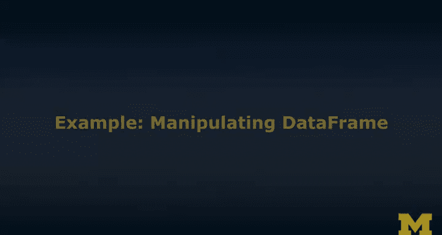
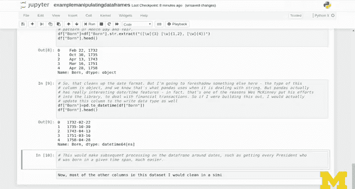

# 密歇根大学《Python用于数据科学实践（1-3课／共5课）｜Applied Data Science with Python 》deepseek翻译 - P21：20_DataFrame操作实例.zh_en - GPT中英字幕课程资源 - BV1U64y1L7VJ

In this lecture， I'm going to walk through a basic data cleaning process with you and introduce you to a few more panda's API functions。

Let's start by bringing in pandas， so import pandas is PD， and let's load our data。

 we're going to be cleaning the list of presidents in the US that I got from Wikipedia。

 so Df equals Pd。readcsv and we'll bring in datasets/presides。

csv and let's just take a look at some of the data so Df hat。Okay， so we have some presidents。

 some dates。 I see a bunch of footnotes in the B column， which may cause issues。

 So let's start with cleaning up that name into first name and last name。

 I'm going to tackle this with a redx。 So I want to create two new columns and apply a redx to the projection of the president column。

So here's one solution， we could make a copy of the president column。

 so I'll say DF sub first that creates a new column equals DF subprent。And then we can call replace。

 And we just have a pattern that matches the last name and sets it to an empty string。

 So Df sub first equals Df sub first dot replace。 And then the redx pattern might be a white space character followed by any number of characters。

 and we just want to null this out。 So the next value is just an empty string。

 And we say redx equals true。 Remember to use replace。 And now let's take a look at this。

 So Df taught head。So that works， but it's kind of gross and it's slow since we had to make a full copy of the column and then go through and update strings。

There are a few other ways that we can deal this。 Let me show you the most general one first。

 and that's the apply function。 So let's drop the column we just made。

 So we'll just remember Dell DF subfirst should drop the column immediately in place。

 No copy of a data frame being returned。So the apply function on a data frame will take some arbitrary function you have written and apply it either a series。

 a single column or a data frame across all rows or columns。

 Let's write a function which just splits a string into two pieces using a single row of data。

So we'll call this de split name and we pass in a parameter as the row。

 So the row is a single series object， which is a single row indexed by column values。

 So let's extract the first name and create a new entry into the series。

 So Df sub first equals row sub presidentnt dot split on space and we'll just take the first item。

 And so remember here when you're doing this that the row that comes into this is whatever data frame we apply it to。

 So we're going to use the data frame above。 but you could potentially reuse this with function with any data frame that has a president column。

So let's do the same with the last word in the string， too。

 So row sub last equals row subprent dot split。 And then we'll just take -1。

 Remember when you're indexing into a list， if you index negatively。

 that counts from the back end of the list。 So this is a handy way to get the last item。

 And that way we don't have to worry about any middle names or initials in there。

 And so now we just return the row and the pandas dot apply。

 we'll take care of merging them back together into the data frame。

 So this function will just return row。And so now if we apply this to the data frame indicating that we want to apply it across columns。

 we should get our result， so DF equals DF dot apply。

 we say which function we're interested in applying split name and then we say a equals columns and then DF dot head。

So it's pretty questionable as to whether that's less gross， but it achieves the result。

 and I find that I use the apply function regularly in my work。

The pandaace series has a couple of other nice convenience functions， though。

 And next I'd like to touch on one called extract。 So let's drop our first name and last name。

 So we'll dell both first and last。So extract takes a regular expression is input and specifically requires you to set capture groups that correspond to the output columns that you're interested in。

 And this is a great place for you to pause in the video and reflect。

 If you were going to write a regular expression that returned groups and had just the first name and last name in it。

 What would that look like。😊，So here's my solution where we would match three groups。

 but only return two the first name in the last name。 So the pattern。

 member of the groups are always in parentheses， So I'm going to have three sets of parentheses and the first one I want anchored to the beginning of the string。

 any characters or digits， any number of those。 The second one is question mark colon because I want this group not to be returned。

 and I want any number of characters followed by white space。 and then the last one。

 I want any number of characters， but I want to anchor this to the back of the string。

So now the extract function is built into the STR attribute of the series object。

 so we can call it using series。sr。extract subpattern， so in this case we say Df subprent。

 remember when you've got a single column that you're taking out of a data frame it's projected as a series dosR extract and then pass in pattern is the pattern we're interested in。

 we'll take a look at the head of this。So that looks pretty nice other than the column names。

 But if we name the groups， we get column names out。

 So I'm just going to update this pattern and remember that we can create named groups。

 So we just say question mark capital P。 and then within the less than and greater than signs we put the name of the group we want。

 So we'll say one for first。 and then of course， the middle one we're not interested in capturing and returning and the last one we'll call last。

😊，So now we'll call extract， so again， names equals Df subpresident。sR。extract subpattern。 head。

And we'll print out names。And we could just copy these into our main data frame if we want to。

 so we could say DF subfi equals name sub first and DF sublast equals name sublast and print out the data frame。

So it's worth looking at the panndas STR module for other functions。

 which we've been written specifically to cleanup strings and data frames。

 and you can find that in the docs in working with text section and here's a URL to that。

Now let's move on to clean up the boring column first。

 let's get rid of anything that isn't in the pattern of day month year。So here I'm going to do this。

 I'm going to do df subborn equals df sububborn。sr。 extract。

 so I'm going to use capture groups again， but I'm only going to have one capture group。

 so it's a little bit cheating maybe and I'm going to match any number of characters three times followed by a space followed by any number of characters somewhere in that one to two length followed by a space and that one to two length is really because I want to capture single digits like first。

 second third as well as double digits like 10th，11th。

12 and then any number of characters four time to get that last bit and let's print out the head。

So that cleans up the date format， but I want to foreshadow something else here。

 the type of this column is actually an object and we know that's what panndas uses when it's dealing with strings。

But pandas actually has really interesting date time features。 In fact。

 one of the reasons West McKinney put his efforts into the library was to deal with financial transactions。

 So if I were building this out further， I would actually update this column to write the data type as well。

 So to do that， I would say D F subborn equals。 And then I would call on the top level of the pandas module。

 there's a function called two date time。 And I would just pass a Df subborns。

 I would pass it the whole series。 And let's take a look at what that looks like。😊。

So this would make subsequent processing on the data frame around dates。

 such as getting every president who was born in a given time span much easier。Now。

 most of the other columns in this dataset set I would clean up in a similar fashion。

 And this would be a good practice activity for you So I recommend that you pause this video。

 open up a notebook for yourself for the lecture。 If you don't already have it opened， of course。

 and then finished cleaning up the data frame In this lecture， I introduced you to the STR module。

 which is a number of important functions for cleaning pandas data frames。

 You don't have to use these。 I actually use apply quite a bit myself。

 especially if I don't need high levell performance data cleaning。

 because my data set is usually small。 But the SR functions are incredibly useful。

 and they build on your existing knowledge of regular expressions， And because they're vectorized。

 they're very efficient to be using as well。😊。

