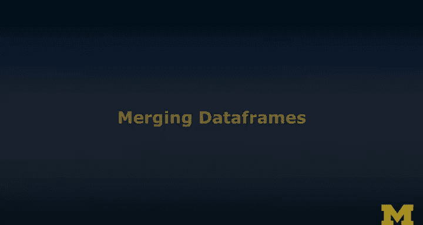
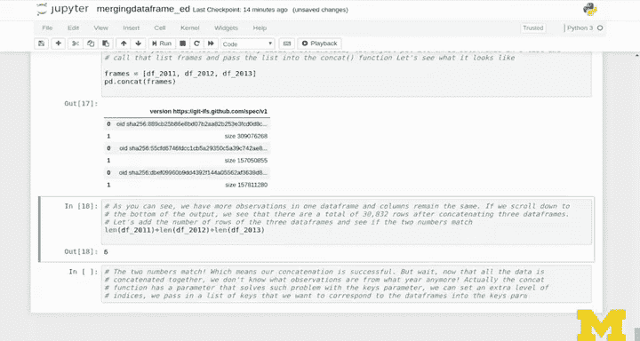

# 密歇根大学《Python用于数据科学实践（1-3课／共5课）｜Applied Data Science with Python 》deepseek翻译 - P22：21_DataFrame合并技术.zh_en - GPT中英字幕课程资源 - BV1U64y1L7VJ

In this lecture， we're going to address how you can bring multiple data frame objects together。

 either by merging them horizontally or by concatenating them vertically。

Before we jump into the code， we need to address a little relational theory and to get some language conventions down。

 And I'm going to bring in an image to help with some of those concepts。Okay， this is a Venn diagram。

 A Venn diagram is traditionally used to show set membership。 For example。

 the circle on the left is the population of students at a university。

 The circle on the right is the population of staff at a university。

 and the overlapping region in the middle are all of those students who are also staff。

 Maybe these students run tutorials for a course or great assignments or engage in running research experiments。

😊，So this diagram shows two populations we might have data about。

 but there's overlap between those populations。When it comes to translating this to pandas。

 we can think of the case where we might have these two populations as indices in separate data frames。

 maybe with the label of person name。And when we want to join the data frames together。

 we have some choices to make。First， what if we want a list of all of the people。

 regardless of whether their're staff or student and all of the information we can get on them in database terminology。

 This is called a full outer join。 And in set theory， it's called a union in the Ven diagram。

 it represents every one in any circle。So here's an image of what that would look like as a Venn diagram。

It's quite possible， though， that we only want those people who have maximum information for those people who are both staff and students。

Perhaps being a staff member and a student involves getting a tuition waiver。

 and we want to calculate the cost of this。In database terminology。

 this is called an inner join or in set theory， the intersection。

 It's represented in the Venn diagram as an overlapping part in each circle。

 And so here's what that would look like。So with that background。

 let's see an example of how we would do this in pandas， where we would use the merge function。

 So we'll import pandas as PD。 And first， let's create two data frames， staff and students。

 So I'll create the staff data frame first， PD D dot data frame。

 and I'm going to pass in a list of dis。 So the first one， Kelly will set her role to director of HR。

 and then we'll create another one， Sally， and we'll set her role to course liaison。

 And then the third person， James will set his role to greater。And let's index these staff by name。

 so staff Df equals staff Df dot set index name。Now， we'll create the student data frame as well。

 So student D F equals P D dot data frame。 we'll create a student called James and we'll say he's in business school。

 We'll create a student called Mike and we'll say he's in law school。

 and then we'll create a student called Sally and say she's in engineering。

 And we're going to index this by name too。 So student D F equals student D F dot set index name。

And let's just print out the data frame， so we'll first print out staff DF dot head。

 and then we'll print student DF dot head。So there's some overlap in these data frames in that James and Sally are both students and staff。

 but Mike and Kelly are not。Importantly， both data frames are indexed along the value we want to merge them on。

 which is called name。If we want the union of these。

 we would call merge passing in the data frame on the left and the data frame on the right and telling merge that we want it to use an outer join。

We would want to use the left and right indices as the joining columns。So we'd say PD D dot merge。

 We pass in the staff first and the student data frame second。 So that's our left and our right。

 We set the how parameter to odor by default， it's inner， I believe。

 So we have to set it here and then say that we want to use the index values。

 So we'll set the left index equal to true and the right index equal to true。

We see in the resulting data frame that everybody is listed， and since Mike does not have a role。

 and John does not have a school， though cells are listed as missing values。

If we wanted to get the intersection that is just those people who are a student and a staff member。

 we could set the how attribute to enter。 Again， we set both the left and right indexdices to be true as the joining columns。

 So we call P D dot merge。 And we would say the left is the staff。 The right is the student。

 How is the inner。 So we're looking for the intersection here and the left and the right index values are true。

And we see that the resulting data frame has only James and Sally in it。Now。

 there are two other common use cases when merging data frames。

 and both are examples of what we would call set addition。

The first is when we want to get a list of all staff， regardless of whether they are students or not。

 But if they were students， we'd want to get their student details as well。To do this。

 we would use a left join。 It's important to note that the order of data frames in this function。

 The first data frame is the left data frame， and the second is the right。 So P D dot merge。

 staff D F， that's our left student D F。 That's our right。 We say how left join。

 So we're interested in joining against the staff D F and set left index equal to true and right index equal to true。

So you could probably guess what comes next。 We want a list of all of the students and their roles if they are also staff to do this。

 we would do a right join， So we do staff D F on the left， student D F on the right。

 how equals right and left index equals true and right index equals true。

And we can also do it one other way。 The merge method has a couple of other interesting parameters。

 First， you don't need to use indices to join on。 You can use columns as well。 Here's an example。

 Here we have a parameter called on， and then we can assign a column that both data frames have using the joining column。

 So first， let's remove our index。 So we'll reset the index on a staff data frame and we'll reset the index on our student data frame。

Now let's merge using the on parameter。So PD do merge， staff on the left， student on the right。

 we want a right join， and then we just pass on equals name。 And so we're saying join on that column。

So using the on parameter instead of an index is how I find myself using merge the most。 In fact。

 I rarely use indices in panda's data frames， especially when I'm just cleaning data as opposed to doing data analysis。

So what happens when we have conflicts between the data frames。

 Let's take a look by creating new staff and student data frames that have a location information。

 So I'm going to create a new staff data frame。 I'm going to say Kelly， her role as director of HR。

 but I'm also good over a location of State Street。

And Sally role Co liaison and location of Washington Avenue。

 and then James is a grader and I'll say he's also on Washington Avenue。And then for our students。

 we'll say James is a school， a business school， but the location is on Billiard Avenue。

 Mike's law school， and his location is Frttho number 22。

 and then Sally's School of engineering and her location is on Wilson Crescent。

In the staff data frame， this is an office location where we can find the staff person。

 and we can see the director of HR is on State Street while the two students are on Washington Nv。

 and these locations just happen to be right outside my window as I film this。

But for the student data frame， the location information is actually their home address。

The merch function preserves this information， but depends either an underscore x or underscore y to help differentiate which index went with which column of data。

The underscore x is always the left data frame information and the underscore Y is always the right data frame information。

So here， if we want all of the staff information， regardless of whether they are students or not。

 but if they are students， we want to get their student details as well。

 then we would do a left join on the column of。And so PD。merge， staff， student。

 we're joining across the left because we want to get all the information of students and we're joining on name。

From the output， we can see that there are columns， location underscore X and location underscore Y。

 Lo X refers to the location column in the left data frame， which is the staff data frame。

 and location Y refers to the column in the right data frame， which is the student data frame。

Before we leave merging of data frames， let's talk about multi indexing and multiple columns。

 It's quite possible that the first name for students and staff might overlap。

 but the last name might not。 In this case， we can use a list of multiple columns that should be used to join keys from both data frames on using the on parameter。

Recall that the column names assigned to the parameter need to exist in both data frames。

So here's an example with some new first name and staff name data。

 so I'm just going to paste this in quickly， but what you can see is that people now have a last name。

So as you can see here， James Wilde and James Hammond don't match on both key since they have different last names。

 So we would expect that an inner join doesn't include these individuals in the output。

 And only Sally Brooks would be retained。 So P D do't mergege， staff D F， student D F。

 we want an inner join。 And then for on， we actually pass in a Python list。

 That's a list of the columns that we're interested in。 Those all have to match。

 So first name and last name。So joining data frames through merging is incredibly common。

 and you'll need to know how to pull data from different sources， clean it and join it for analysis。

 This is a staple not only of pandas， but of database technologies as well。

If we think of merging as joining horizontally， meaning we join on similar values in a column found in two data frames。

 then concatenating is joining vertically， meaning we put data frames on top or at the bottom of one another。

So let's understand this from an example。 You have a data set that tracks some information over the years。

 And each year's record is a separate CS SV， and every C SV of every year's record has the exact same columns。

 What happens if you want to put all of that data from all of the year's records together。

So you can concatenate them。Let's take a look at the US Department of Ed College scorecard data。

 it has each US university's data on student completion。

 student debt after graduation income and others。The data is stored in separate CSVs with each CSV containing a year's record。

Let's say we wanted the records from 2011 to 2013。 We create first three data frames。

 each containing one year's record。 And because the CSV files we're working with are messy。

 I want to suppress some of the Jupiter warninging messages。 and just read C SV to ignore bad lines。

 So I'm going to start the cell with the cell magic percent percent capture。

 So you don't have to worry about this。 It's just to suppress output as we're loading these CSV files because there are errors in them。

😊，So percent percent capture。 remember that has to be at the very beginning of a cell。

 Any cell logic。 magic functions have to be right the first line of the cell。

 And then we want Df 2011。 So we'll read CSV from the college scorecard。

 So this is merge 2011 underscore 12。 And I'm going say error bad lines equals false。

 that's just telling panda is not to bother throwing an error， And I'll do that for 2012 again。

 that's data sets college scorecard merge 2013， and then Df 2013 as well。All right。

 let's get a view of one of the data frames， so we'll take 2011 and we'll just look at the top three rows in that。

So we see there's a whopping number of columns， more than 1900。

 and we can calculate the length of each data frame as well。

 so you're going to do print land DF 2011， print land DF 2012， and we'll print land DF 2013。

So it's a bit surprising that the number of schools in the scorecard for 2011 is almost double that of the next two years。

 But let's not worry about that。 That's probably buried somewhere in the docks。 Why that is。 Instead。

 let's just put all three data frames in a list and call the list frames and pass the list into the concat function。

 So let's see what that looks like。 So we'll say frames is equal to this is a list of our three data frames。

 So D F 2011 D F 2012 D F 2013。 And then we just call P D dot concat。

 So that's a function on panda's top level module and we pass it the list of frames。

So as you can see， we have more observations in one data frame， and the columns remain the same。

 If we scroll down to the bottom of the output， we can see that there are a total of over 30000 rows after concatenating the three data frames。

 Let's double check and let's quickly add the number of rows of the three data frames to see if they match。

 So we'll just say the length of D F 2011 plus a length of Df 2012 plus the lens of D F 2013。Great。

 the two numbers match， which means our concatenation is successful。But wait。

 not all of the data is concatenated together， we don't know what observations are from what year anymore。

So actually， the concat function has a parameter that solves such a problem with the keys parameter。

 and we can set an extra level of index。 We pass in a list of the keys that we want to correspond to the data frames in as the keys parameter。

So let's try it out， so PD。kinca， we pass in our list of data frames。

 and then we just say the keys we want to be 2011， 2012 and 2013。

So now we have the indicess the year， so we know what observations are from what year。

You should know that concatetnation also has inner and outer methods。

 If you are concatenating two data frames that do not have identical columns and choose the outer method。

 Some cells will be N A N。 If you choose to do the inner。

 then some observations will be dropped due to N A N values。

 You can think of this as analogous to the left and right joins of the merge function。

Now you know how to merge in concatenate data frames together。

 you'll find such functions very useful for combining data to get more complex or complicated results to do analysis with。

A solid understanding of how to merge data is absolutely essential when you' are procuring。

 cleaning and manipulating data。It's worth knowing how to join different data frames quickly and the different observations that you can use when joining data sets。

 and I'd encourage you to check out the pandas docs for more on joining in concatenating data。

