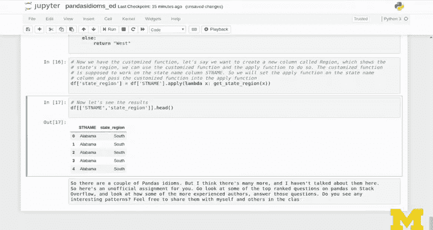

# 密歇根大学《Python用于数据科学实践（1-3课／共5课）｜Applied Data Science with Python 》deepseek翻译 - P23：22_Pandas惯用操作.zh_en - GPT中英字幕课程资源 - BV1U64y1L7VJ

Python programmers will often suggest that there are many ways the language can be used to solve a particular problem。

 but that some are more appropriate than others。 The best solutions are celebrated as idiomatic Python。

 And there's lots of great examples on stock overflow or other websites。😊。

As a sort of sub language within Python， Padas has its own set of idioms。

 We've alluded to some of these already， such as using vectorization wherever possible and not using iterative loops。

 if you don't need to。Several developers and users within the pandas community have used the term pandoable for these idioms。

 And I think it's a great term。 So I wanted to share with you a couple of key features of how you can make your code more pandoable。

😊，So let's start by bringing in our data processing libraries。

 so we'll bring in pandas and we'll bring in NMI， and we're going to bring in some timing functionality too because I want to demonstrate something about idiomatic code。

 so we'll bring it from the timeit module。And let's look at some of our census data from the US。

 so this is in the data frame or the data sorry data/census。csv。

 and we'll look at the head of that to remind ourselves what that looks like。

So the first of the panasidioiumms that I want to talk about is called method chaining。

 The general idea behind method chaining is that every method on object returns a reference to that object。

The beauty of this is that you can condense many different operations on a data frame， for instance。

 into one line or at least one statement of code。😊。

So here's a pandoable way to write code with method chaining In this code。

 I'm going to pull out the state and the city names as a multiple index。

 and I'm going to do so only for data， which has a summary level of 50。

 which in this data set is county level data， and I'm going to rename the column2 just to make it a bit more readable。

So I'm going to say Df dot where， the Df sub some level equals 50。

 then I'm going to drop the NAs that we have from that so you see the where just return to data frame and I just called dot drop on that and then I'm going to set the index and I'm going to use a multiple index here。

 I want the state name and the city name to be the index and then I'm going to rename some values and so the columns I'll rename I'll change estimate base 2010 to something a little bit more readable and we'll execute that。

So let's walk through this。 First， we use the wear function on the data frame and pass in a boolean mask。

 which is only true for those rows where the sum level is equal to 50。

 This indicates in our source data that the data is summarized at the county level。

 with the result of the where function evaluated。 We drop missing values。

 Remember that where doesn't drop missing values by default。

Then we set an index on the result of that。 In this case， I've said it to the state name。

 followed by the county name。Finally， I rename a column to make it more readable。

Note that instead of writing this all on one line， as I could have done。

 I began the statement with a parentheses， which tells Python that I'm going to span that statement over multiple lines for readability。

Here's a more traditional， non pandoable way of writing this。

 There's nothing wrong with the code in a functional sense。

 You might even be able to understand it better as a new person to the language。

 It's just not considered as pandoable as the first example。

So let's create the new data frame from the original so Df equals Df sub Df sum level equals 50。

 So here I'm using the overloaded indexing operator， which drops N。

 so I'm actually doing a couple of things I'm projecting and creating that Boolean array。

 and then I'm using that to project just certain values out of the data frame。

 not a number of values are being dropped automatically because that's the shortcut that's been sort of put in place there。

Then I'm going to update the data frame to have a new index。

 and we're going to use in place equals true to do this in place。 So DF dot set index。

 and then I'll pass in the columns I'm interested in。

 and then the in place equals true tells the data frame to just modify itself。

 Then I'm going to set the column names。 So I just rename the columns and this looks pretty much the same。

And we see we get a similar result。So now the key with any good idiom is to understand when it isn't helping you in this case。

 you can actually time both methods to see which one runs faster。

So we could put the approach into a function and pass the function into the timeit function to count the time。

 the parameter number for time。 it allows us to choose how many times we want to actually run that function。

 So here I'm just going to set it to 10。 So let's write a wrapper for our first function。

 So I'm going to define first approach。 we'll make a global data frame。

 And we'll just paste our sum code right in here。 So just our pandoable code in here。

 And we're just returning all of that as a result of that first approach。

I'm going to read in a new data set， so it's nice and fresh。 so DF。

 and remember in our function we've made this global DF。 and now we're just going to run it。

 so I'm going to call time it dot time it， pass it the function and tell it how many times I want it to run。

Allright， now let's test the second approach。 and as you notice。

 we're using the global variable DF in the function。 however。

 changing a global variable inside of a function will modify the variable even in a global scope。

 and we don't want that to happen in this case。 So for selecting summary levels of 50 only。

 I created a new data frame for those records。So let's run this for 10 times and see how it is。

 So def second approach， and I'll just paste the code from the second approach。

 and you can see that it's basically the same as we spoke about。

And then I'm going to read in a new data set， so we'll read this from the census。csv。

 and now let's run it and do our timing on it， so time it do time it and we'll pass in second approach and we'll run that 10 times as well。

So as you can see， the second approach is much faster and so in this particular example。

 it's actually a classic time readability trade off。😊。

You'll see lots of examples on stack overflow in documentation of people using method chaining in their pandas。

 And so I think it's really important for you to be able to read and understand the syntax。

 And it's really worth your time to investigate this。

 But keep in mind that following what appears to be stylistic idioms might have performance issues。

 And you need to consider this as well。 really depends on the scope of the data cleaning you're doing。

Here's another panasidium。 Python has a wonderful function called map。

 which is sort of a basis for functional programming in the language。

 When you want to use map in Python， you pass it to some function you want called in some iterable。

 like a list that you want the function to be applied to。

 The results of that function are then called against each item in the list。

 And there's a resulting list of all of the evaluations of that function。😊。

So pandas has something similar， and it's called apply map。 and in apply map。

 you provide some function which should operate on each cell of a data frame。

 and the return set is itself a data frame。 Now， I think apply map is fine。

 but I actually rarely use it。 Instead， I find myself often wanting to map across all of the rows in a data frame。

 not just the cells。 And so pandas actually has a function that I use quite heavily there called apply。

 And so let's take a look at an example。So let's look at our census data frame again in this data frame。

 we have five columns for population estimates， with each column corresponding with one year of estimates。

 it's quite reasonable to want to create some new columns for minimum or maximum values。

 and the apply function as an easy way to do this。So first。

 we need to write a function which takes in a particular row of data。

 finds a minimum and maximum value and returns a new row of data from that。

 We'll call this function min max。 this is pretty straightforward。

 we can create a small slice of a row by projecting the population columns Then we can use nuy min and max functions and create a new series with the label values representing the new values that we want applied。

 So de min max and we'll pass in row and then data we're just going to project the rows that we're actually interested in from the data frame So from this row we're just going to bring in our population estimates and then we're just going to return a new series and in this new series we've got two values a min and a max and we're going to pass in the nuy min and the nuy max from data。

So then we just need to call apply on the data frame。

Apply takes the function and the axis on which to operate as parameters。 Now。

 we have to be a bit careful。 We've talked about a 0 being the rows of a data frame in the past。

 But this parameter is really the parameter of the index to use。 So to apply across all rows。

 which is applying across all columns。 you can pass an a equal to one or equal to the word columns itself。

 So D F dot apply。 We push in our min max function here， I'll set the a equal to columns。

 And let's look at the head of this。😊，Of course， there's no need to limit yourself to returning a new series object。

 If you're doing this as part of data cleaning， you're likely to find yourself wanting to add new data to the existing data frame。

 In that case， you could just take the row values and add in new columns。

 indicating the max and min scores。 This is a regular part of my workflow in bringing in data and building summary or descriptive statistics and is often used heavily with the merging of data frames。

Here's an example where we have a revised version of the function min max。

 Instead of returning a separate series to display the min and max。

 we add two new columns to the original data frame to store min and max。

 So I'll just deaf min max again， I'm going to bring in all the population row data。

 And now I'm going to create a new entry for max。 So I just say row sub max equals MP dot max of data。

 And then we can create a new entry for the min as well。 So row sub min equalsmp dot min data。

 and then we'll just return row。 So now we actually have all of our pop estimate data in the row as well as our max and our min。

And so we just apply this and again we want to say DF dot apply。

 pass in the function we're interested in applying and then say that we want this applied to across columns。

So apply is an extremely important tool in your toolkit and the reason I introduced apply here is because you rarely see it being used with actually such large function definitions like we did。

 Instead you typically see it being used with Lambdas to get the most out of this discussion and the discussions that you'll see online you're going to need to know how to read Lambdas。

So you can imagine how you might chain several apply calls with Lambdas together to create a readable。

 yet succinct data manipulation script。 One line example of how you might calculate the max of the columns using the apply function is something we're going to do here。

 So I'll bring in the rows。 again， these are my population estimate rows。

 And now we'll just apply this across the data frame with lambda。 So D F dot apply。

 and then I pass into apply lambda x。 and I just want MP dot max x sub rows。

 And then here I'm saying axy equals 1。 And I could have said axiy equals column1 in column are synonymous and row and0 are synonymous。

 And then we'll take the head of that。And so this is something that you'll commonly see in stock overflow examples or messages or even the official documentation。

If you don't remember Lambdas， just pause the video for a moment and look up the syntax。

 A Lada is just an unnamed function in Python。 In this case。

 it takes in a single parameter X and returns a single value。 In this case。

 the maximum over all the columns associated with rhx。

The beauty of the apply function is that it allows flexibility in doing whatever manipulation that you desire as the function you pass into apply can be any customized function that you want。

 So let's say we wanted to divide the states into four categories Northeast， Midwet， south and west。

 We can write a customized function that returns this region based on the state and the state regions's information that maybe we looked up on Wikipedia。

😊，So here I'll write a function deaf get state region and for the northeast。

 I'll just have a nice big list of states in the northeast， the Midwest of course。

 the most important region will put in a bunch of states from the Midwest and there's lots of states here and they're all very important。

 especially that third one there。And then for the South。

 we'll bring in all the states that we want in the South region and then the states that we want to bring in from the West as well。

And then we're just going to write a little if else。 So if X is in the northeast， return northeast。

 if X is in Midwest， return Midwest， do the same for south， and we'll do the same for West。

And you can imagine that there's many ways that we could have written that function。

So now we have a customized function。 let's say we want to create a new column called region which shows the states region。

 We can use the customized function in the apply function to do so。

 The customized function is supposed to work on the state name column ST name。

 So we'll set the apply function to the state name column and pass the customized function into the apply。

 So here's our example we're going to create a new column in our data frame called state region。

 we're to make this equal to Df substate name， So we're just projecting a single column so this is a series but it also has a dot apply a function and so we'll call dot apply and we'll pass in a lambda and that lambda is just going to take whatever value it sees there and call the get state region to it。

So let's take a look at those results and so even though it was a series that we were working on。

 we assigned that to a data frame projection slice。

 and so that means we've got our full data frame still so we'll take a look at DF substate name and state region and the head of that and so we can see here that we have both the state name and the state region throughout。

So there are a couple of panda's idioms， but I think there's many more that I haven't talked about here。

 and there's an unofficial assignment for you。 Go look at some of the top ranked questions on pandas on stack overflow。

 You're going to learn a lot from that and look at how some of the more experienced authors answer those questions。

 Do you see any interesting patterns。 Feel free to share them with others in the class and myself so that we can learn more about what idiomatic pandas looks like。

😊。

