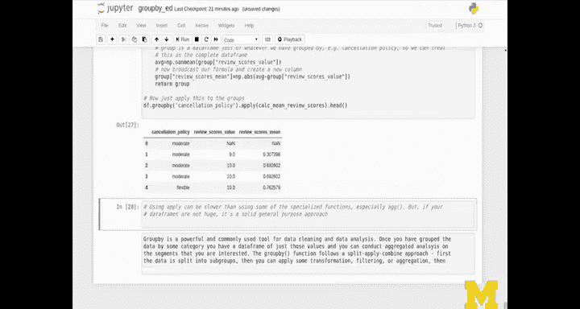

# 密歇根大学《Python用于数据科学实践（1-3课／共5课）｜Applied Data Science with Python 》deepseek翻译 - P24：23_分组聚合(GroupBy).zh_en - GPT中英字幕课程资源 - BV1U64y1L7VJ

Sometimes we want to select data based on groups and understand aggregated data at the group level。

 We've seen that even though pens allows us to iterate every row in a data frame。

 it's generally very slow to do this。Fortunately， pandas has a group eye function to speed up such tasks。

 The idea behind group I is that it takes some data frame。

 splits it into chunks based on some key values， and then applies computation on those chunks。

 and then combines the result back together into another data frame In pandas。

 This is referred to as the split apply combined pattern。So let's take a look at the example。

 first we'll bring in our pandas in Ny libraries。 we'll import pandas and import Numpy。

 and let's look at some US census data， So we'll read this data from datas slash census CSv and we're going to exclude state level sumizations which have a some level value of 40。

 So we just want to keep those that have a some level value of 50。

 It turns out there's only two some levels in this data file 40 and 50 and let's look at the head of that。

Okay， so that's the data that we're going to work with。In the first example for group I。

 I want to use this census date。 Let's get a list of all the unique states。

 Then we can iterate over all of those states for each state。

 we can reduce the data frame and calculate the average。

So let's run such a task for three times in time， and for this we're going to use this cell magic function。

 percent percent time it。So I'll say percent percent time at minus n3。

 so I'm going to run this cell three times and a Jupiter will present me some of the average values。

So for state in DF substate name dot unique， so this projects the data frame state name and then a list of all the unique values in there。

 and we're just going to iterate over that。We're just going to calculate the average using NI for this particular state。

 so the average equalsmp do average and then we'll do Df do where Df substate name is equal to state so we want to exclude those that aren't and we'll use a Boolean mask here drop NA and we just want to project the census 2010 pop and pass that all into average。

 and then we're going to print it to the screen so we're going to print counties in state state have an average population of and then we'll print the average。

And we see that that gets up and running。So if you scroll down to the bottom of that output。

 you can see it takes a fair bit of time to finish。 Now， let's try another approach using Group by。

So again， we're going to say time at minus n3。 for this method。

 we're going to start by telling pandas we're interested in grouping the state by name。

 and so this is our split。So for group comma frame in DF dot group by state name。

 So we're saying that we want to split on the state name。

 you'll notice that there are two values that we set here。

 Group by actually returns a tupo where the first value is the value of the key that we're trying to group by in this case。

 a specific state name。 And the second one is a projected data frame that was found for this group。

 So you get a tuple back from group by。Now we include our logic in the apply step。

 and that's just to calculate an average of the census 2010 pop。 So here it's easy。

 we just say the average is equal tomp dot average and we just project from the frame the one column we're interested in census 2010 pop and we don't have to do any further reduction here because we know it's all for a given state。

 And then we're going to print the results。 And so this looks the same print counties in state group have an average population of whatever the string of the average is。

 And we don't have to worry about the combined step in this case。

 because all of our data transformation is actually printing out our results。 and let's run this。

So that's a huge difference in speed， an improvement of roughly by two factors。Now。

 99% of the time you'll use Group I on one or more columns。

 but you can also provide a function to group I and use that to segment your data。

So this is a bit of a fabricated example。 But let's say that you have a big batch job with lots of processing。

 and you want to work only on a third or so of the states at a given time。

 We could create some function， which returns a number between 0 and 2 based on the first character of the state name。

 Then we can tell group by to use this function to split up our data frame。

 It's important to note that in order to do this， you need to set the index of the data frame to be the column that you want a group by first。

So we'll create some new function called set batch number。 And if the first number of the parameters。

 the capital M will return a0， if it's a capital Q will return a 1 and otherwise we'll return a2。

 and then we'll pass this function to the data frame。 So Df equals Df dot set index state name。

 and then here's our function。 So we'll define a set batch if item sub0 is less than M then we'll return a 0 if it's less than Q。

 then it's in our second batch will' return a1， otherwise we'll just lump it into our last batch and we'll return a2。

So the data frame is supposed to be grouped by according to the batch number and we're going to loop through each batch group。

 so for a group and frame in DF do Group by and we just pass in our function to the set batch number and then we'll print out there are。

 let's say the length of the data frame number of records in group and the group name for processing。

Notice that this time I didn't pass in a column name to GroupI。

 instead I set the index of the data frame to be ST name， and if no column identifiers passed。

 GroupI will automatically use that index。Let's take one more look at an example of how we might group data In this example。

 I want to use a data set of housing from Airbnb In this data set， there's two columns of interest。

 One is the cancellation policy， and the other is the review of scores value。 So we'll bring this in。

 D F equals P D do read CSv from data sets and we'll bring in listings CSv。

 and let's print out the head of that。So how would I group by both of these columns。

 A first approach might be to promote them to a multi index and then just call group by。

 So here I'll just say D F equals D F dot set index。

 and I just will say I want the cancellation policy there and the review scores value。

When we have a multi index， we need to pass in the levels that we're interested in grouping by by default。

 group I does not know and does not assume that you want to group by all levels。

 So here we just say for group and for frame in DF dot group I。

 And then we say we want levels 0 and1。 And let's print that out。

And so there we can see that we get lots of different groups by both levels that we're interested in。

 So this seems to work out okay。 But what if we wanted to group by the cancellation policy and review scores。

 but separate all of the1s from those under 10。 In this case。

 we could use a function to manage the groupings。 So we'll define some function called grouping fund and passing an item。

 we'll check that the review scores value portion of the index item is in the format of cancellation policy and review scores value。

 So it's a tuple。 So if item sub 1 equals 10， then we're going to return item sub0 and 10。0。

 So we'll leave that one basically alone。 Otherwise。

 we're going to return item sub0 and just the string not 10 by 0。

 because we just care about breaking them into two groups。And then for group and frame in DF。

 Group by， we pass in our function grouping fund and let's print out the groups。Okay。

 so there we see that we've grouped by either things that have some cancellation policy， flexible。

 moderate， strict and super strict， and or some score， either 10 or not 10。

Let's look at the head of our data frame。Allright， so that's what our data frame looks like。

So to this point， we've applied very simple processing to our data after splitting。

 really just outputting some print statements to demonstrate how the splitting works。

 The pandas developers have three broad categories of data processing to happen during the apply step。

 aggregation of group data， transformation of group data and filtration of group data。

So the most straightforward apply step is the aggregation of data。

 And this uses a method called Ag on the group by object。 Thus far。

 we've only iterated through the group by object， unpacking it into a label。

 the group name and a data frame。 But with Ag， we can pass in a dictionary of the columns we are interested in aggregating。

 along with the function that we're looking to apply。So let's reset the index for our Airbnb data。

 So Df equals Df do reset index and remember you have to assign this to the data frame or you have to use in place equals true that catches me up quite a bit still so keep that in mind So now let's group by the cancellation policy and find the average review scores value by group so we want Df dot group by cancellation policy so that's as it was before but now on that group by object that gets returned we want to call dot A and to dot A we give it a dictionary and the dictionary is the name that we're interested in the column we're interested in targeting and the operation or the function that we're interested。

 So here I'll pass in review scores value and NP dot average and that's just on nuy。

So that didn't seem to work at all。 Just a bunch of not a numbers。

 The issue is actually in the function that we sent to aggregate。

 And this is me just showing a mistake that I did as I was preparing this lecture。

 N P dot average does not ignore not a numbers。 However。

 there is a function that we can use for this。 So actually。

 I want to write the statement all over again， just the same as it was。

 So D F group I cancellation policy dot Ag。 But now in there。

 I want to pass the function N P dot N A N mean。 And this just call gets the mean values。

 So the average， but excludes not a number of values from that。Okay。

 so there we can see that we actually have our review scores values for each category in nice aggregate form。

 and you can see how simple and readable that was to write。

We could just extend this dictionary to aggregate by multiple functions if we want to or multiple columns。

 so DF do group by cancellation policy call AG and now in our dictionary we just pass in all of the different functions and columns that we're looking to create from that value。

 so we'll pass in review scores value and I'm going to send in a tuple here of and NI is not a number mean and NmpI is not a number of standard deviation and then reviews per month and here I'll pass in the NI。

 not a number mean。So take a moment to make sure you understand the previous cell since it's somewhat complex。

 First， we're doing a group I on the data frame object by the column cancellation policy。

 This creates a new group bio object。Then we're invoking the Ag function on that object。

The Ag function is going to apply one or more functions that we specify to the group data frames and return a single row per data frame slash group。

When we call this function， we sent it two dictionary entries。

 each with the key indicating which column we wanted functions applied to。For the first column。

 we actually supplied a tuple of two functions。 note that these are not function ins like MP do NAN mean with parentheses after it。

 or function names like NN mean in quotes in a string。

 there are actually references to functions which will return single values。

The group by object will recognize the tuple and call each function in order on the same column。

 The results will then be in a hierarchical index。 But since they are columns。

 they don't show up as an index per se。 Then we indicated that another column in a single function we wanted to be run should be run。

 So this is really important that you understand what's happened here and how that statement was created。

 If you understand that your， your're flying。 That's great。 If not。

 you really should go back and review that statement and this text or this part of the video to understand better how this is being called underneath。

So transformation is different from aggregation， where ag returns a single value per column。

 So one row per group transform returns an object that is the same size as the group。

Essentially it broadcasts the function you supply over the group data frame returning a new data frame。

 This makes combining data later quite easy。So for instance。

 suppose we wanted to include the average rating values in a given group by cancellation policy。

 but preserve the data frame shape so that we could generate a difference between an individual observation and the sum。

So first， let's just define some subset of the columns that we're interested in。

 So here I'm just going to make a variable calls and say we're interested in the cancellation policy and the review scores value and this just makes it a little cleaner as I'm typing it in。

Now let's transform it， I'm going to store this in its own data frame。

 so transform Df equals Df subcalls group by cancellation policy。trans， and I want MP。

 NAN mean and let's take a look at the head of this data frame。

So we can see that the index here is actually the same as the original data frame。

 So let's just join this in。 Before we do that， let's rename the column in the transform version。

 So I'm going to say transform Df do rename and I'm going to take the review scores value because it's not actually the review scores value anymore and rename it to the mean review scores。

 I want this a equals columns and in place equals true。

 And then I'm just going merge the data frames。 and so Df equals Df dot merge。

 I pass in transform Df is the other one。 and I want to merge on the indexes because the index is between our two data frames are the same。

 And let's take a look at the new Df that we've created。So great。

 we consider our new column is in place。 the mean review scores。 So now we could create。

 for instance， the difference between a given row and its group， the cancellation policy means。

 So we do that just by Df sub mean diff。 So that's the new column we're creating and assign this to NP do absolute。

 So I want to take the absolute value of the review scores value minus the mean review scores。

 And so here you can see that there's a number of things going on。

 I'm taking our review scores value。 I'm vectorized passing the subtract operator across that with the Df mean review scores。

 So we're making the difference there， and then I'm calling the absolute value also vectorized across that and sending it back to the mean Df。

 And let's take a look at the head。😊，So the group by object has built in support for filtering groups as well。

 It's often that you'll want a group by some features， then make some transformations to the groups。

 then drop certain groups as part of your cleaning routine。

The filter function takes in a function which it applies to each group data frame and returns either a true or false。

 depending on whether that group should be included in the results。For instance。

 if we wanted to only those groups which have a mean rating above 9 included in our results。

 we'd say D F dot group I， the cancellation policy， then we'd say dot filter。

 and here we would pass in a function。 So Lada x。 and we just want to take a look at the the mean of x。

 again， remember we have to use NAN means because we have NNs in there。

 and we just want the means where the review score values are greater than 9。2。

Notice that the results are still indexed， but that any of the results which were in the group with a mean review score of less than or equal to 9。

2， were not copied over because of how we did our projection。By far。

 the most common operation I invoke on group I objects is the apply function。

 This allows you to apply an arbitrary function to each group and stitch the results back together for each apply into a single data frame where the index is preserved。

So let's look at an example using our Airbnb data。 I'm going to get a clean copy of that data frame。

 so we'll just load that from the CSv listing。 CSsv and let's just include some of the columns that we were interested in previously so I'm going to drop those columns except for cancellation policy and review scores value and let's look at that。

In previous work， we wanted to find the average review score of a listing and its deviation from the group mean。

 And this was a two step process。 First， we used transform on the group by object。

 and then we had to broadcast to create a new column。 with apply。

 we could wrap this logic in one place。 So I'm going to write a function deaf Calc mean review scores and pass in a group。

 So this is working on a data frame。 So group is a data frame just of whatever we've grouped。

 In this case， the cancellation policy。 So we can treat this as the complete data frame that we're operating on。

 So it's a bit of a mind shift。😊，Here I want to create an average value。

 so that's just equal to Ny's N N mean of the group review scores value。

 And then now we want to broadcast our formula and create a new group。

 So group sub review scores mean equals and P dot A BS our absolute value。

 the average minus the group sub review scores value， and then we'll return the group。

So now we just want to apply this to all of the groups。

 so D F do group by cancellation policy dot apply， send in our function that we want to work on all of the groups。

 the Calalcommamine review scores， and let's look at the head of this。

Using apply can be slower than using some of the specialized functions， especially Ag。

 but if your data frames are not huge， it's a solid general purpose approach。

Groupy is a powerful and commonly used tool for data cleaning and data analysis。

 Once you've grouped the data by some category， you have a data frame of just those values。

 and you can conduct aggregate analysis on the segments that you are interested in。

The group by function follows a split apply combined approach。 First。

 the data split into some groups。 Then you apply some transformation， filtering or aggregation。

 And then the results are automatically combined for you by pandas。

