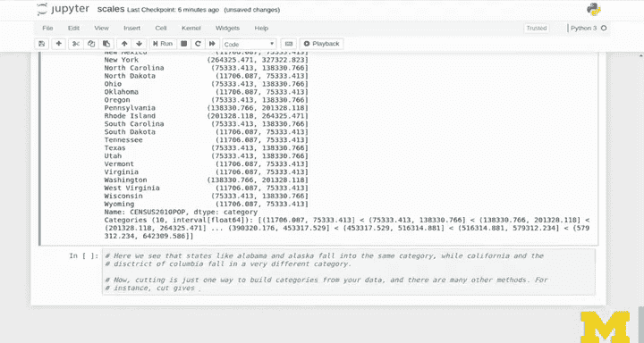

# 密歇根大学《Python用于数据科学实践（1-3课／共5课）｜Applied Data Science with Python 》deepseek翻译 - P25：24_数据尺度处理.zh_en - GPT中英字幕课程资源 - BV1U64y1L7VJ

Now that we've covered many of the mechanics of pandas。

 I want to stop and talk for a moment about data types and scales。

 we've already seen that pandas supports a number of different computational data types。

 such as strings， integers， floating point numbers。

 What this doesn't capture is what we call the scale of the data。

Let's say that we have got a data frame of students and their academic levels。

 such as being in grade 1， grade 2， and grade3。Is the difference between a student in grade 1 and a student in grade 2 the same as the difference between a student in grade 8 and one in grade 9？

Or maybe let's think about final exam scores these students might get on assignments。

 Is the difference between an A and an a minus the same as the difference between an A minus and a B plus。

So at the University of Michigan， at least， the answer is often no。

 at least not when you're converting this to a percentage based scale。

We've intuitively seen some different scales， and as we move through data cleaning and into statistical analysis and machine learning。

 it's important to clarify our knowledge and terminology。As a data scientist。

 there's at least four different scales it's worth knowing about。 And I want to talk about those now。

 The first is the ratio scale in the ratio scale， the measurement units are equally spaced and mathematical operations such as subtraction。

 division and multiplication are all valid。 Good examples of the ratio scale might be height and weight。

The next scale is the interval scale。 In the interval scale。

 the measurement units are equally spaced， like the ratio scale。

 but there is no clear absence of value。 That is， there isn't a true 0。

 And so operations such as multiplication。 a division are not valid。

 An example of the interval scale might be the temperature is measured in Celsius or Fahrenheit。

 Since there's never an absence of temperature， and 0 degrees is actually a meaningful value itself。

The direction on a compass might be another good example。

 where zero degrees on the compass doesn't indicate a lack of direction。

 but instead describes a direction itself。For most of the work that you'll be doing with data mining。

 the differences between the ratio and interval scales might not be clearly apparent or important to the algorithm that you're applying。

 but it's important to have this distinction clear in your mind when applying advanced statistical tests。

The next scale to understand is the ordinal scale In the ordinal scale。

 the order of values is important， but the differences between the values are not equally spaced。

 Here， the grading method that is used in many classes at the University of Michigan is a great example。

 where letter grades are given with pluses and minuses。

 But when you compare this to a percentage value， you see that a letter by itself covers 4% of the available grades。

 and that a letter worth a plus or minus is usually just 3% of the available grades。Based on this。

 it would be odd if there as many students who received an A plus or an A minus as there was who received a straight A。

 assuming， of course that we expect each percentage point in a course to be uniformly likely to occur。

Ordinal data is very common in machine learning and sometimes can be a bit of a challenge to work with。

The last scale I'll mention is the nominal scale， which is often just called categorical data。 Here。

 the names of teams in a sport might be a good example。 There are limited number of teams。

 but changing their order， applying mathematical functions to them is meaningless。

Categorical values are very common， and we generally refer to categories where there are only two possible values as binary categories。

So why did I stop talking about pandas and jump into this discussion of scale？ Well。

 given how important they are in statistics and machine learning。

 Padas has a number of interesting functions to deal with converting between measurement scales。

Let's start first with nominal data， which in pandas is called categorical data。

Paands actually has a built in type for categorical data。

 and you can set a column of your data to categorical simply by using the as type method。

As typey tries to change the underlying type of your data in this case， to category data。

And you could further change this to ordinal data by passing in an ordered flags set to true and passing in the categories in an ordered fashion。

So let's take a look at an example of this in pandas。 So let's bring in pandas as normal。

 So we'll just import pandas as PD。So here's an example。

 let's create a data frame of letter grades in descending order。

 we can also set an index value and here we'll just make it some human judgment of how good a student was。

 so I just made these up like excellence or good。So we just create our new data frame and pass in all of our different letter grades and then we set our index as normal to align with those letter grades and then just say what we want to be called and let's take a look at that。

Allright， now， if we check the data type of this column we'll see that it's just an object since we set string values。

 so if we do DF do D types， we see that it's an object。We can， however。

 tell pandas that we want to change the type to category using the as type function。

 So the way we do this is actually we just put category and quotes to as type。

 it's kind of a special string。 so we'll do Df grades do as type category and let's take a look at the head of that。

Now we see that there's 11 categories and pandas is aware of what those categories are。

 more interesting though is that our data isn't just categorical in this case。

 but that it's actually order， that is an a minus comes after a B plus and a B comes before a B+。

We can tell pandas that the data is ordered by first creating a new categorical data type with a list of categories in order and the ordered equals true flag。

 so I'll create a new variable my categories， and then we're going to use PD dot categorical D type so this is going to create a new data type object and then categories I'm going to pass in the list of categories and then I'm going to say that it's ordered is true。

So now we can just pass this to the as type function instead of that string。

 so grades equals DF subgrades dot as type， and now we're just going to pass in our new categorical D type and let's take a look at the head of grades。

So now we see the panda is not only aware that there are 11 categories。

 but it's also aware of the order of those categories。So what can you do with this， Well。

 because there's an ordering， this can help with some comparisons in boolean masking。 For instance。

 if we have a list of our grades and we compare them to a C。

 we can see that lexiographical comparisons， which is the default for strings。

 Re results that we are not intending。 So let's take our data frame and Df subgrades。 Remember。

 this is the one that isn't categorical data。 These are just objects。

 We're going to see we want a Boolean mask where the grades are greater than a C。😊。

So a C plus is greater than a C， but a C minus in a D are certainly not。 However。

 if we broadcast over the data frame， which has the type set to ordered categorical。

 we get the results we might expect。 And so we'll use here。

 the grades data frame which is set with the correct type categorical type and grades greater than C。

We see that the operator works as we would expect here。

We can then use a certain set of mathematical operators like minimum， maximum， etca。

 on this ordinal data。Sometimes it's useful to represent categorical values as each being a column with a truer or false as to whether the category applies。

 This is especially common in feature extraction， which is a topic in the data mining course。

 Vas with a boolean value are typically called dummy variables。

 and pandas has built in function called get dummies。

 which will convert the values of a single column into multiple columns of zeros and ones。

 indicating the presence of a dummy variable。 I rarely use it。 But when I do， it's very handy。

There's one more common scale based operation that I'd like to talk about。

 And that's on converting a scale from something that is on the interval or ratio scale。

 like a numeric grade into one which is categorical。 Now。

 this might seem a bit counterintuitive to you since you're losing information about the value。

 but it's commonly done in a couple of places。For instance。

 if you're visualizing the frequencies of categories。

 this can be an extremely useful approach and histograms are regularly used with converted interval or ratio data。

In addition， if you're using a machine learning classification approach on data。

 you'll need to be using categorical data， so reducing dimensionality may be useful just to apply a given technique。

Paands has a function called cut， which takes an argument， some array like structure。

 like a column of a data frame or a series。 It also takes a number of bins to be used。

 and all bins are kept at equal spacing。So let's go back to some census data as an example。

 We saw that we could group by state and then aggregate to get a list of the average county size by state。

 If we further apply cut to this with， say， 10 bins。

 we could see that the states listed as categoricals using the average county size。

 So let's bring in numpy， So import Ny as NP P。 And now we'll read in our data sets。

 So this is in data sets slash census do C SV。And we'll reduce this to county level data， so DF。

 we just want to take the sum level equals 50。And for a few groups。

 so we'll set the index to state name， we'll group by level equals0。

 and we'll look at just this census 2010 population and let's look at the average values there and let's look at the head of this。

Okay。Now， if we just want to make bins of each of these， we can use cut， so we can say PD。cut。

 we pass in the data frame that we've created， and let's say we want 10 bins。

So here we see that states like Alabama and Alaska fall into the same category。

 while California and the District of Columbia fall into very different categories。Now。

 cutting is just one way to build categoricals from your data， and there's many other methods。

 For instance， Cud gives you interval data where the spacing between each category is equally sized。

 But sometimes you want to form categories based on frequency。

 You want the number of items in each bin to be the same。 And instead of spacing between the bins。

So it really depends on the shape of what your data is and what you're planning to do with it。

