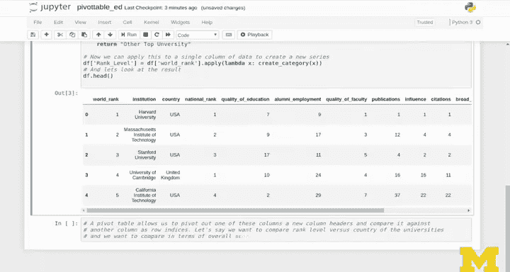

# 密歇根大学《Python用于数据科学实践（1-3课／共5课）｜Applied Data Science with Python 》deepseek翻译 - P26：25_数据透视表.zh_en - GPT中英字幕课程资源 - BV1U64y1L7VJ

A pivot table is a way of summarizing data in a data frame for a particular purpose。

 It makes heavy use of this aggregation function we've been talking about。 A pivot table is。

 in itself a data frame where the rows represent one variable that you're interested in。

 the columns another。 and then the cells some aggregate value。

A pivot table also tends to include marginal values as well， which are sums for each column in row。

 This allows you to be able to see the relationship between two variables， at a glance。

Let's take a look at pivot tables in pandas。 So we'll import pandas as P D and importumps N P。

So here we have the Times Higher Education World University ranking data set。

 one of the most influential data set for universities。

 so let's import this data set and see what it looks like， so dataframe is PD。

read CSv and we can find this in data/ cwdata。csv and let's look at the head of that。

So here we can see that each institution's rank， country， quality of education， and other metrics。

 and an overall score are shown。Let's say we wanted to create a new column called rank level。

 where institutions with world rankings 1 to 100 are categorized as first tier。

 and those with world rankings 101 to 200 are second tier and ranking 201 to 300 or third tier。

 and then after 301， we'll just bucket those as other top universities。

Now you actually already have enough knowledge to do this。

 so why don't you pause the video and give it a try？So here's my solution。

 I'm going to create a function called create category which will operate on the first column in the data frame world rank。

 So I'll def create category with some and it'll take some ranking。

 So since the rank is just an integer， I'll just do a bunch of if out statement。

 So if it's greater than or equal to 1 or less than 100。

 I we'll make it a first tier for greater than or equal to 101。

 but less than 200 we' say it's a second top tier and we'll do our third tier here as well。

 and then the default will just be return other top university。

So now we can apply this to a single column of data to create a new series。 So Df sub rank level。

 remember， this creates a new column equals Df sub worldor rank dot apply。

 and then we're going to pass in a lambda function。

 and the Lada function we'll just call create category on our particular row。

 And let's take a look at the results。 So D F dot head。

So a pivot table allows us to pivot out one of these columns into new column headers and compare it against another column as row indices。

 Let's say we want to compare the rank level versus country of the universities。

 and we want to compare it in terms of overall score。

So to do this， we tell Padas we want the values to be score and the index to be the country and the columns to be the rank levels。

 so there's three things at play here。Then we specify the aggregation function。

 and here we'll use the Nmpy mean to get an average rating for universities in that country。

So DF do pivot table， it's a top level function right on the data frame。

 we say the values are going to be the score， the index is going to be country and the columns we're going to use rank level。

 and then we pass in our actual aggregation function which is the NI mean function and let's look at the head of this。

So we could see a hierarchical data frame where the index or rows are by country。

 and the columns have two levels， the top level indicating that the mean value is being used and the second level being our ranks。

In this example， we only have one variable， the mean that we're looking at。

 so we don't really need a hierarchical index。We notice that there are some not a number values。

 for example， the first row for Argentina， the NIN values indicate that Argentina only has observations in the other top university category。

Now， pivot tables aren't limited to one function that you might want to apply。

 You can pass a named parameter， Ag funk， which is a list of the different functions to apply。

 and pandas will provide you with the results using hierarchical column names。

Let's try that same query but pass in the max function too。

 so I'm just going to do Df dot pivot table values again。

 we're going to call that score index is country and columns as rank level。

 but now we're going to pass in agfk as a list and we're going to pass in two values NP dot mean which is a definition of a function。

 So remember we're not invoking the function here but passing a reference to it and NP dot max so both of these in our list。

 let's look at the head of that。So now we see that we have both the mean and the max。

 As mentioned earlier， we can also summarize the values within a given top level group。 For instance。

 if we wanted to see an overall average for the country with the mean。

 and we wanted to see the max of the max。 We can indicate that we want pandas to do this by providing marginal values。

 So our function looks basically the same。 we pass in ag fun with our two values。

 but then we just add an extra parameter to the n called margins equals true。

 Let's take a look at what that looks like。So a pivot table is just a multi level data frame。

 and we can access series or cells in that data frame in a similar way as a regular data frame。

So let's create a new data frame from our previous example。

 so I'm just going to take the previous example and assign that to a new variable called new DF。

And then let's take a look at the index and see what that looks like。

 so I'll just print out the index of this data frame and let's take a look at the columns and just print out the column values。

So we could see that the columns are hierarchical， the top level column indices have two categories。

 mean in max， and the lower level column indices have four categories。

 which are the four rank levels。So how would we query this if we wanted to get the average scores of the first top tier university levels in each country。

 We would just need to make two data frame projections。

 the first for the mean and the second for the top tier。 So， for instance。

 we could do new D F sub mean。 So this is projecting just the mean that we want。 And then from that。

 we get another data frame。 And we just project the first top tier university column。

 And let's look at the head of that。So we can see that the output here is a series object。

 which we can confirm by printing the type。 remember that when you project a single column of values。

 which is what we're doing here after we make the two projections out of a data frame。

 you get a series object and so let's just look at the type of this。

And we see it's a panda Co series series。So what if we wanted to find the country that has the maximum average score on firster top university level so for this we can use the IDX max function。

 so again I'll take our new DF project mean and then project our first tier top university and on this series object we'll just call IDX max。

So now the IDX max function isn't actually a special value for pivot tables。

 it's a built in function to the series object， and we don't have time to go over all the pandas functions and attributes in this course。

 I want to really encourage you to explore the API to learn more deeply what is available to you。

If you want to achieve a different shape of your pivot table。

 you can do so with the stack and unst functions。 Staing is pivoting the lowest column index to become the innermost row index。

 and unstacking is just the inverse of stacking。 Pivoing the innermost row index to become the lowermost column index。

 An example will help make this a little bit more clear。

So let's look at our pivot table first to refresh what it looks like， so new DF dothead， okay。

 that's our pivot table。So now let's try stacking and this should move the lowermost column so the tiers of the university rankings to the innermost row。

 So we'll just create a new data frame and new D F dot stack。 and let's look at the head of that。

 And so here we can see that that column just transpoposed essentially into the rows。

In the original pivot table， the rank levels are the lowermost column， after stocking。

 rank levels become the innermost index appearing to the right just after the country。

Now let's try unstacking this， so needdf。 unst。 head。

So that seems to restore our data frame to its original shape。

 so what do you think would happen if we unsted twice in a row？

So let's try it new Df do unsSt do unst dohead。So we actually end up unstacking all the way to just a single column。

 so we get a series object being returned。 and this column is just a value。

 the meaning of which is denoted by the hierarchical index of operation， rank and country。

So that's pivot tables。 This has been a pretty short description。

 but they're incredibly useful in dealing with numeric data。

 especially if you're trying to summarize the data in some form。

You'll regularly be creating new pivot tables on different slices of data。

 whether you're exploring the data yourself or preparing that data for others to report on。 And。

 of course， you could pass any functions you want to the aggregate function。

 including those that you define yourself。

