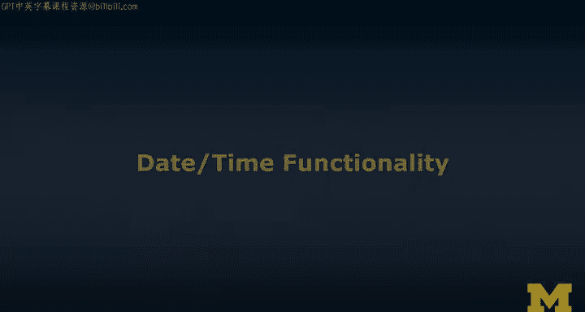
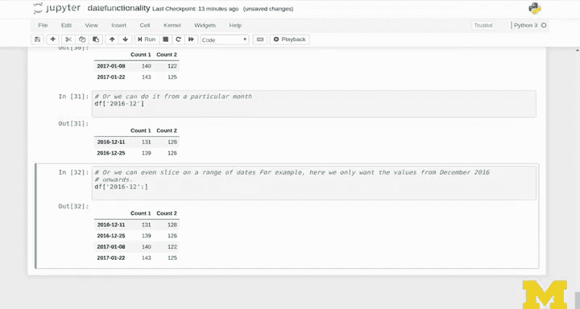
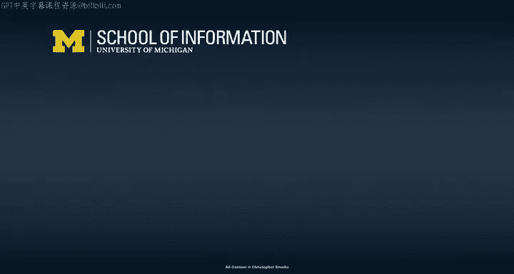

# 密歇根大学《Python用于数据科学实践（1-3课／共5课）｜Applied Data Science with Python 》deepseek翻译 - P27：26_日期时间功能.zh_en - GPT中英字幕课程资源 - BV1U64y1L7VJ

In today's lecture， we're going to be looking at time series and date functionality in pandas。

 Manipulating dates and times is quite flexible in pandas and thus allows us to conduct more analysis such as time series analysis。

 which we're going to talk about soon。😊，Actually， Penns was originally created by West McKinney to handle Dayton time data when he worked as a consultant for hedge funds。

 so it's quite robust in this matter。Let's bring in pandas and numpy as usual。

Pice has four main time related classes， timestamp， datetime index， period and period index。 First。

 let's look at timestamp， it represents a single timestamp and associates values with points in time。

For instance， let's create a timestap with a string 912019 at 1005 a。And here we have our timet。

 Timetamp is interchangeable with Python's date time in most cases。

 So we just do PD D dot timestamp and pass the string。

We can also create a timestamp by passing multiple parameters such as year， month， hour， date。

 minute separately。So PDd。timetamp and we just pass these in order。

Timetamp also has some useful attributes， such as IS O weekday。

 which shows the weekday of the timest。 note that one represents Monday and 7 represents Sunday。

 So we create our new time stamp。 and then we just say IS O weekday。

 And this is actually quite commonly done to just get a simple numeric value。😊。

You can find extract the specific year， month， day， hour， et cetera from a time stamp as well。

 So we can create some new time stamp。 And as we're using it。

 just do dot second and see how many seconds there were were the second parameter or space rather for that。

So suppose we weren't interested in a specific point in time。 And instead， we wanted a span of time。

 This is where the period class comes into play。 Period represents a single time span。

 such as a specific day or month。So here let's create a period that's just for the day or for the month。

 January 2016， so we do PD dot period one/lash 2016。

You'll notice that when we print out the granularity of the period is M for month。

 since this was the finest grain piece of data that we provided。

Here's an example of a period that's March 5， 2016， so we just do PD dot period pass in our date。

 and we'll see that it's got the granularity of day。

Period objects represent the full time span that you specify。

 So arithmetic on period is very easy and intuitive。 For instance。

 if we just want to find out five months after January 2016， we simply plus 5 to it。

 So PD D do period， January 2016， add 5。 Here we go。From the result。

 you'll see that we get June 2016。 If we want to find out two days before March 5，2016。

 we simply subtract to。 So create a new period and subtract to。

The key here is that the period object encapsulates the granularity for arithmetic。

The index of a timestamp is a datetime index。And let's look at a quick example because this is really quite handy when you start to deal with time series data。

First， let's create our example series T1。 We use the timestamp of September 1，2 and 3 of 2016。

When we look at the series， each timestamp is the index that has a value associated with it。

 In this case， A B and C。 So here we do PD D dot series， we're going to give a list ABc。

 So these are our data values。 and then our index is an array next to it。

 And we're going to do create three timestamps。 One is going to be the first day of September then the second day of September then the third day。

 Let's take a look at what this creates as a series。😊，So looking at the type of our series index。

 we're going to see that it's a date time index， so we do type T1。t index。

 remember the D type above is referring to the data values in this series， not the index。

So here we can see that the index is a date time index。So similarly。

 we can create a period based index as well， which I think is really quite nice。

 so we'll create some new series DEF， and we'll just create our period objects in that list for the index。

And so looking at the type of TS2 dot index will'll see that it's a period index。Now。

 let's look into how to convert to date time， Supp we have a list of dates of strings and we want to create a new data frame。

So I'm going to try a bunch of different date formats so here I'll say D1 equals to June 2013。

 which is common August 29 comma 2014， that's also common 20150626 and then 7/12/lash 16。

 So if you take human enteredered data this is what you're going to get or if you take data that comes from multiple different systems。

 let's say you're joining data frames and you're bringing in date fields from multiple places。

AndNow let's just create some random data here， so we'll just create a new data frame just with some random integers。

 and then we're going to set our index to D1 and some columns and let's take a look at that。

So using panda's to date time， pandas will try and convert these date time and put them into a standard format。

 because this is ugly and horrible to deal with。 So pandas has this nice belt in two date time to try and figure out the format for us。

 So let's take a look with T S 3。🤢，So two day time also has options to change the date parse order。

 For example， we can pass in the argument day first equals true to par and European date if we think that our data is going to be in that format。

 So here I'll take 4。7。12。 You see there's some ambiguity here。 What's month and what's day and well。

 even what's year， I guess， could be an ambiguity here。 So we could just say day1 equals true。

So time deltas are differences in times， and this is not the same as a period。

 but maybe it feels like it at first， but it's conceptually very similar。 So， for instance。

 if we want to take the difference between September 3 and September 1。

 we get a time delta of two days。 So we can actually just take a timetamp minus another timetamp。

 and the resulting object is a time delta。 And here you see it says that it's two days。

 it's printed out a nice human parsable thing。 But the object itself is capturing that it's these two days。

So we can also do something like find what the date and time is for 12 days in three hours past September 2nd at 8。

10 a。 so we don't have to have these round numbers。

 so here we've taken a timestamp which is a very precise it's 8，10 a。

 and here we just want to add to it a time delta of 12 days and3 hours。

And we can see what that time is。So offset is similar to time Delta。

 but it follows specific calendar duration rules。 Offset allows flexibility in terms of types of time intervals。

 Besides our， day， week， month， et cetera。 It also has things like business day and end of month。

 Se month begin， et cetera。 So very non traditional time series。

 but things that we would use in business all the time。

So let's create a timestamp and see what day it is so create some new timestamp and we'll see which week date is and this is now the six。

 So this is from the ISO。 So now we can add the timestamp with a week ahead so we can take that timestamp and then we can say we want to add an offset of one week。

So now， let's try and do this to month end with month end。

 And this would give us the last day of September。 So here we can take a time stamp。

 and then we want to add some offset to get to the month end。

 And so now we actually have the month end day。Alright， next。

 let's look at a few tricks for working with dates in a data frame。

 Suppose we want to look at nine measurements taken biweekly every Sunday， starting in October 2016。

Using date range， we can create a datetime index。In date range。

 we have to either specify the start or the end date。 If it's not explicitly specified by default。

 the date is considered the start date。So then we have to take the specified number of periods and a frequency。

 so here I'm going to set it to 2W Sun， which means biweekly on Sunday。

 so like Redx there's sort of a mini language to describe these periods and the pandas documentation if you get really dealing with time series data。

 we're not going to in this course， but if you end up dealing a lot with time series data。

 the pandas documentation is phenomenal。So here we'll do dates equals PD。 date range。

 we set our start， we say we want nine periods and this is our frequency。

 and then we can look at the date time index that comes out of that and we see that it's well set up for it。

So there's many other frequencies that you can specify， for example。

 one common one is the business day， and so here we just set the date range， we give it the date。

 we set the periods and then we say frequency equals B。Another common one is quarterly。

 but setting the start of the quarter in a specific month like June。

 So here we just set the periods to 12， and then our frequency equals Q S dash June。Now。

 let's go back to our weekly on Sunday example and create a data frame using these dates and some random data and see what we can do with it。

So dates equals PD。 date range， we're going to set the periods equals to nine and the frequency equal to two weeks starting on Sunday。

And now we're just going to fill into that some data， so I'm going to create a column called count1。

 we'll make these some random numbers and cumulative some of these and then count to as well and set the index to dates。

Okay， so there's our dummy data。So first， we can check what day of the week a specific date is For example。

 here we can see that all of the dates in our index are on a Sunday。

 which matches the frequency that we set so if we say Df。 indexex。weekday name， we see oh。

 they all come back on a Sunday if we had more variable dates as our index。

 we would see the variation here。We can also use the diF function to find the difference between each date's value。

 and this is just on the data frame itself， DF。D。Suppose we want to know what the mean count is for each month in our data frame。

 We can do this using resample。 Coning from a higher frequency from a lower frequency is called down samplingling。

 And we'll talk about this in a moment in a little bit more detail in another lecture。

 So DF dot resample to monthly。 and let's look at the mean values。

 And so here we've collapsed the dates on a monthly cadence。

 So we've got this kind of date perspective on how to do that。

 We haven't had to write our own group by and figure it all out ourselves We're able to use the resampling built in。

😊，Now， let's talk about daytime indexing and slicing。

 which is a wonderful feature of the pandas data frame。 For instance。

 we can use partial string indexing， And the key here is that it's actually based on string indexing to find values from a particular year。

 So if we're just interested in 2017， we can say D F sub 2017。

 and that returns to us all the values that were from that year。

 or we can do it from a particular month。 So D F 2016 12。😊，So remember。

 these are all string values that we're matching on。We can even slice on a range of dates。

 for example， here， we might want the values from December 2016 onwards。

 so we can just say we want DF 201612 colon onwards。

Okay so that's how the date functionality in pandas works it's kind of a whirlwind tour we've done here we're going to talk about resampling in another lecture and that's maybe going to be a little bit more clear how we use this again if you have to deal with a lot of date time data this lecture will become important to come back to to refresh and understand and also the functionality of pandas with respect to date time is really quite phenomenal and the documentation describes it in more detail。

