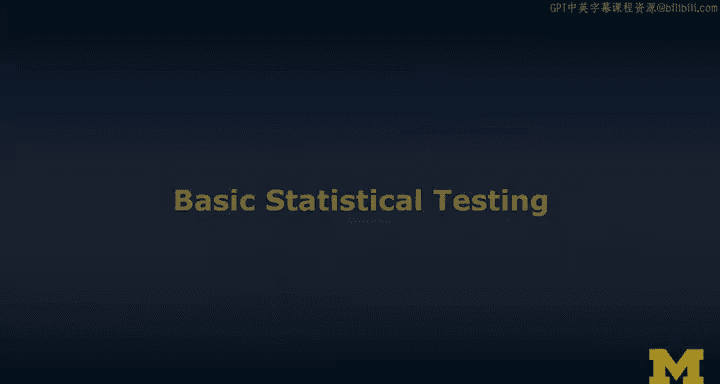
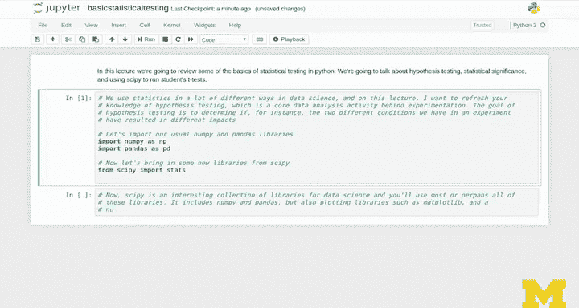

# 密歇根大学《Python用于数据科学实践（1-3课／共5课）｜Applied Data Science with Python 》deepseek翻译 - P28：27_基础统计检验.zh_en - GPT中英字幕课程资源 - BV1U64y1L7VJ

In this lecture， we're going to review some of the basic statistical testing in Python。

We're going to talk about hypothesis testing， statistical significance。

 and using SipP to run the student's T test。We use statistics a lot in different ways in data science。

 and in this lecture I want to refresh your knowledge of hypothesis testing。

 which is a core data analysis activity behind experimentation。

The goal of hypothesis testing is to determine if， for instance。

 the two different conditions we have in an experiment have resulted in different impacts。

So let's import our usual Nmpy and pandas libraries MP P and Padas is PDd。

Now let's bring in some new libraries from SipP， so from SipI I want to import stats。Now。

 SipI is an interesting collection of libraries for data science。

 and you'll use most or perhaps all of these libraries， it includes Dumpy and pandas。

 but also plotting libraries such as MapllootLi and a number of other scientific library functions as well。

When we do hypothesis testing， we actually have two statements of interest。

 The first is our actual explanation， which we call the alternative hypothesis。

 and the second is that the explanation we have is not sufficient。

 and we call this the null hypothesis。Our actual testing method is to determine whether the null hypothesis is true or not。

If we find that there is a difference between groups。

 then we can reject the null hypothesis and we accept our alternative。

So let's see an example of this， we're going to use some grade data， so make a new data frame here。

 read CSsv datas grades。csv and let's look at the head of that。

If we take a look at the data frame inside， we have six different assignments。

 let's look at some summary statistics for this data frame。

 so I'm just going to print out the number of rows and columns and remember the data frame has a shape and we'll just pass those as variables。

Right， for the purpose of this lecture， let's segment this population into two pieces。

 Let's say those who finished the first assignment by the end of December 2015 will call them early finishers and those who finish it sometime after that we'll call them late finishers so I'll create some new variable early finishers equals data frame I'm going to do a PD do2 date time So I'm going to convert that column to date time we could have done this when we read in the CSV file as well。

 and I want to take that assignment one submission time and just if it's less than 2016。

 And so then let's take a look at our early finishers。So you've got lots of skills now with Padas。

 how would you go about getting the late finishishers data frame。

 why don't you pause this video and give it a try？Al right。

 here's my solution first the data frame DF and the early finishishers share index values。

 so I really just want everything in the DF which is not in early finishers。

 so I'll create late finishers and I'll make that equal to our original data frame and then I'll take the inverse of Df。

 indexdex dot is in early finishishers。 index。So here， the tde is a bit wise compliment。

 So we're just taking all of our true values and negating them to false and taking all our false values and negating them back into true values。

 Let's take a look at the head。So there are a lot of other ways to do this。 For instance。

 you could just copy and paste the first projection and change the sign from less than to greater than or equal to。

 This is O。 But if you decide you want to change the date down the road。

 you have to remember to change it in two places。You could also do a join of the data frame DF with early finishers if you do a left join。

 you only keep the items in the left data frame， so this would have been a good answer。

You also could have written a function that determines if someone is early or late and then called dot apply on the data frame and added a new column to the data frame。

 this is a pretty reasonable answer as well， so there's a number of different things you could have done to create this data frame。

As you've seen， the pandas data frame object has a variety of statistical functions associated with it。

 If we call the mean function directly on the data frame。

 we see that each of the means for the assignments are calculated。

 Let's compare the means for our two populations。 So'm just going to print the early finishers。

 assignment 1 grade dot mean。 And I'm going to do the same thing with delayed finishers。

 And let's take a look。Okay， so these look pretty similar， but are they the same。

 And what do we mean by similar， And this is where the student's tea test comes in。

 It allows us to form the alternative hypothesis。 These are different。

 as well as the null hypothesis。 These are the same。 and then test that null hypothesis。

When doing hypothesis testing， we have to choose a significance level as a threshold for how much of a chance we're willing to accept。

This significance level is typically called alpha。 For this example， yet， let's use a threshold of 0。

05 for our alpha， which is 5 per cent。 Now， this is commonly used under。

 but it's really quite arbitrary。The Sippi library contains a number of different statistical tests and forms of basis for hypothesis testing and Python。

 and we're going to use the T test and function， which does an independent T test。

 meaning that the populations in the two groups are not related to one another。

The result of T test in are this T statistic and the P value。It's this latter value， the probability。

 which is the most important to us， as it indicates the chance between0 and1 of our null hypothesis being true。

So let's bring in T test end function， so from sip stats， import T test end。

And let's run this function with our two populations and we're going to look at the assignment1 grades。

 so T test end we'll take early finishers and we just want to project the assignment one grade and late finishers and we'll project the assignment one grade。

So here we see that the probability is 0。18， and this is above our alpha value of 0。05。

 This means that we cannot reject the null hypothesis。

 The null hypothesis was that the two populations are the same and we don't have enough certainty in our evidence because of the probability is greater than alpha to come to a conclusion to the contrary。

This doesn't mean that we've proven that the populations are the same。

So why don't we check the other assignment grades， so I'm just going to copy and paste here so I'm going to put it in the assignment two grade。

 assignment three grade， assignment4 grade，5， and I think there's six assignments here。Okay。

 so it looks like in this data， we do not have enough evidence to suggest the populations differ with respect to grade。

Let's look at those P values for a moment， though， because they're saying things that can inform experimental design down the road。

 For instance， one of the assignments， assignment 3 has a P value around 0。1。

This means that if we accept a level of chance similarity of 11 per cent。

 this would have been considered statistically significant。As a researcher。

 this would suggest to me that there's a number of things here worth considering following up on。

 For instance， if we had a small number of participants and we don't here。

 or if there was something unique about this assignment as it relates to our experiment。

 whatever the experiment was， then there may be follow up experiments that we could run to better understand the phenomenon。

Now， P values have come under fire recently for being insufficient for telling us enough about the interactions which are happening and two other techniques。

 confidencefi intervals and Bayesian analyses are being used more regularly。

 One issue with P values is that as you run more tests。

 you're likely to get a value which is statistically significant just by chance。

So let's see a little simulation of this。First， let's create a data frame of 100 columns each with 100 numbers。

So here I'm going to do DF1 PD。 data frame， and then we'll put in a nice list comprehension， NP。

random。random 100 for x in range 100 and let's look at the head of that。Now， pause this and reflect。

 do you understand the list comprehension and how I created this data frame？

You don't have to use a list comprehension to do this。

 but you should be able to read this and figure it out because this is a commonly used approach that you'll find on web forms and in help forms。

Okay， let's create a second data frame。 So here we'll just do the same thing。

 DF2 equals P dot data frame。 Now I'm going to have a list comprehension。

 And so what I'm saying here is I want to call the statement NP dot random dot random 100。

 So this will generate 100 random values into in a list4 x in range 100。

 So I want to iterate over another list of 100 values。 I'm actually not using X here。

 It's just being thrown away because the data that I'm using is the NP dot random dot random。

So are these two data frames the same？Maybe a better question is for a given row inside of DF1。

 is it the same as that same row inside of DF2？So let's take a look。

 Let's say our critical value here is 0。1 or an alpha of 10%。

 and we're going to compare each column in Df1 to the same numbered column in DF2。

And will report when the P value isn't less than 10 per cent。

 which means that we have sufficient evidence to say that the columns are different。

So let's write this as a function called test columns。 So de test columns will'll pass a parameter。

 Al。 And by default， we'll set it to 0。1。 We can change that later， though。

 So it's nice to have a parameter。 I want to keep track of how many columns actually differ。

 So make some new variable non di and make it0。 And now we're just going iterate over the column。

 So for call in Df1 dot column。 So we're just iterating over the list of columns in Df1。

 we're just going run our T test in between the two data frames。

 So we're gonna to get a test stat and P value is equal to t test end and we'll do Df1 subca and Df2 subca。

 Remember， T test end returns two values， and we can use tuple unpacking here to get the test stat and its variable and the probability and it。

And we're going to check the P value versus the alpha。

 So if the P value is less than or equal to alpha and now we're just going to print out if they're different and increment the number of different。

 So column is statistically significantly different at some alpha level。

 some P value level and we'll pass our parameters and of course。

 let's increment our number of differences and let's print out some summary stats after we're done testing all the columns。

 So the total number different was we'll place that in and we'll turn it into a percentage and we'll just do the math with the length of columns。

And now let's actually run this coat， so T test columns。Interesting。

 so we see that there's a bunch of columns that are actually different。 In fact。

 that number looks a lot like the alpha value we chose。 So what's going on。

 Shouldn't all of the columns be the same。 Remember that al T test in does is check if two sets are similar。

 given some level of confidence。 In our case，10 per cent。The more random comparisons you do。

 the more will just happen to be the same by chance。In this example， we checked 100 columns。

 so we would expect there would be roughly 10 of them to be the same if our alpha was 0。1。

So we could test some other alpha values as well， so let's do test columns with 0。

05 and you could try other values as well。So keep this in mind when you're doing statistical tests like the T test。

 which has a P value。Understand that this P value isn't magic and it's a threshold for you when reporting results and trying to answer your hypothesis。

What's a reasonable threshold that depends on your question。

 and you need to engage domain experts to better understand what they would consider significant。

So just for fun， let's recreate that second data frame using a non-normal distribution。

 I'm going to arbitrarily choose chi squared。 you could try some other ones if you'd like。

 so we'll just Df2 equals Pd do data frame and now we'll just do NP do random chi squared Now chi squared is a distribution actually takes parameter the degrees of freedom I'll just set it to one here。

 you can read about that or maybe you already know about the chi square distribution and I want 100 values and we're going to iterate over 100 columns as well and let's just test that。

So now we see that all or most columns test to be statistically significant at the 10% level。

In this lecture， we've discussed just some of the basics of hypothesis testing in Python。

 I introduced you to the Sip Pi Library， which you can use for the students' tea test。

 We've discussed some of the practical issues which arise from looking at statistical significance。

Now there's much more to learn about hypothesis testing， for instance。

 there are different tests to be used depending on the shape of your data and different ways to report on the results instead of just P values such as confidence intervals or Bayesian analyses。

 but this should give you a basic idea of where to start when comparing two populations for differences。

 which is a common task for data scientists。出。

