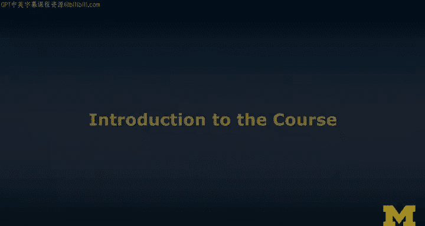
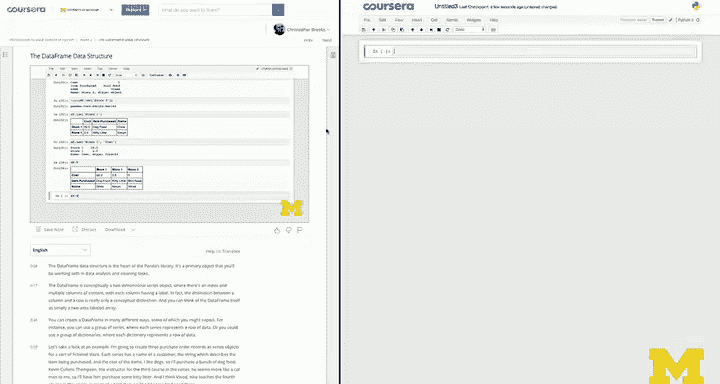
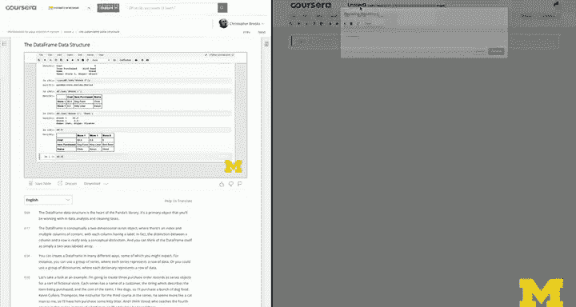
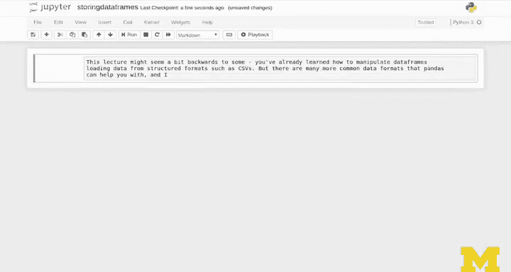
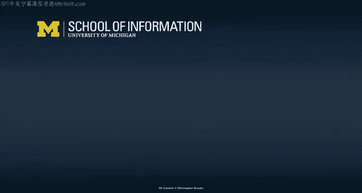

# 密歇根大学《Python用于数据科学实践（1-3课／共5课）｜Applied Data Science with Python 》deepseek翻译 - P2：1_课程简介.zh_en - GPT中英字幕课程资源 - BV1U64y1L7VJ

Hi， I'm Chris Brooks faculty here at the University of Michigan School of Information。

This class is about data manipulation and data manipulation is really the foundation of what you'll do as a data scientist。

 and that doesn't really change， even as you deepen a lot of your investigation and your skills in the area。

 So in this course， we're going to teach you the excellent pandas library。

 It's wonderful for data manipulation， it is the de facto standard for Python。

 and when you come out of this class， you should be quite masterful in the use of that library。

 we're going to teach you about how to acquire data， how to clean data。

 how to manipulate and join data together how to make basic inferences about that data。

Now we expect that you already have some Python skills and some sta skills。

 but this course is really a place where you're going to get to build those skills through practice and there will be some course resources off to the sidebar in the course shell that describe other ways that you can get some experience with Python。

I've filmed the lectures for this course in a very specific manner。

 I'm using a tutorial style where most of what you'll be watching is actually screen captures of me typing into Jupiter notebooks code。

 And I'm doing a couple of unique things with this。 One， you'll see all of my text。

 all of my comments in that code live。 So you'll be able to read as well as listen。

 but I wanted to share with you a strategy that I think is powerful for learning and learning using the Jupiter notebooks。

 And so let's take a look at some of the course shell right now。😊。

So this is the Coursera Courchll here on the left。 and on the right hand side。

 I've opened up the Jupiter Notes。 So this is actually a MOOC that I taught and I'm going to use to demonstrate。

When you go to a video in the course， let's say this one on data frames。

You'll see that it's a regular instructional video。 I'll just mute that。

 And you can seek around in the video。 and there's some talking head。

But the majority of it is going to look like this。Let's just close the notes and close the sidebar。

 The majority of it's actually going to look like this。

 It's going to be me working through examples in a Jupiter notebook。

 And I think the most powerful way to learn in this course is actually to go into your Jupiter system。

 So I've got that here on the right hand side。 And there will be a separate video about the Coursera Jupiter platform。

 But to actually create a new Python notebook。It's empty and you know maybe name it after the lecture。

So this was data frames， I think。And to follow from the beginning what I'm doing and type it in yourself。

 So here we'll maybe seek to the beginning。And so here you can see I'm looking at some cricket loving countries in this example。

 and so you could just type here， cricket loving countries and just follow the example as you go。

The power of doing it this way is that at any time you can pause the video and you can explore and you can start to look at alternates and you can start to form questions。

 and this is really powerful to be doing as youre watching a video。

 to be actively learning instead of just watching passively this video。😊。

The video has a number of other opportunities in it。 in particular。

 you can increase or decrease the speed of the video。 And that can be useful to for review。

 I actually think highspe video playback is wonderful。

 I listen to a lot of educational video this way， largely after I've already done the practice。

 and I've already experienced at once。 And I just want to quick review of the content I'll flip it on at maybe one and a half or two time speed and try and absorb that content。

 And the way we've built the videos for you for this class， which is frankly， new to me。

 and I'd love to get your feedback on， is with that whole transcript within the video as well。

 So you should be able to read and listen to the video at the same time。

 And you really can't go wrong with practicing over and over again。

 So please grab the educational videos as you're watching them engage with a blank notebook。

 And just follow along and see how you've maybe misinterpreted things。😊。

Different investigations that you've gone off on and share what you found or questions you have with the rest of the class。

