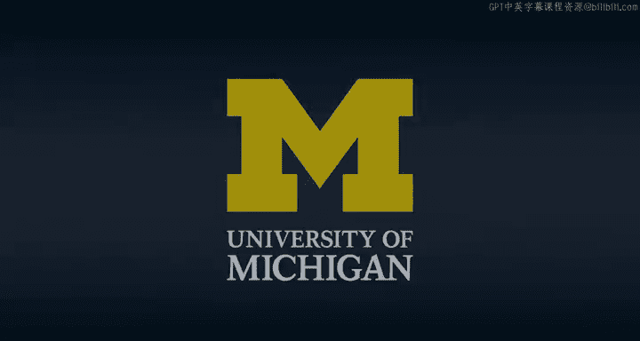
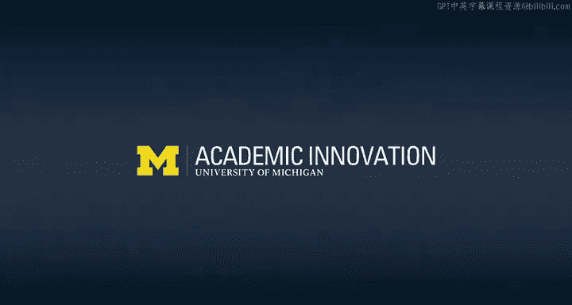

# 密歇根大学《Python用于数据科学实践（1-3课／共5课）｜Applied Data Science with Python 》deepseek翻译 - P32：2_Christopher Brooks教授介绍.zh_en - GPT中英字幕课程资源 - BV1U64y1L7VJ

I'm Chris Brooks， I'm a research assistant professorfe at the School of Information。

 I'm Director of Learning Analytics and Research at the Office of Academic Innovation。

 I'm a computer scientist who studies Z learning， student achievement， student success。

 both in higher ed and in online situations like in MOs。🎼One thing I remember as a child。

 my father was a physicist and so I would go to the university as many kids do and as my kids do now come and experience the university and what it has to offer and as a physicist he had access to some of the first instances of the World Wide Web and so I got to sit there and play with things like NCSA Mosaic early versions of Netscape etc and I think it's that connectivity。

 the idea that information was now a firstclass citizen in the world of sciences and so this new world that we're starting to see with data science。

 these are competencies that learners are learning in preschool that are starting to think about data as a different way of investigating the world and I think that for me that started in a very early stage when I was young you know at the university seeing what my father was doing and being able to play with computers I'm happy to try and bring that to as many people as possible and that's really one of the goals of this introduction to data science with Python。

